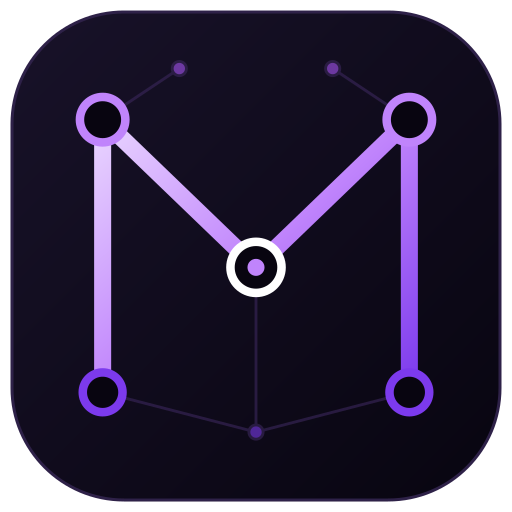

<p align="center"></p>

# Mimir

Один открытый инструмент синхронизации Obsidian-хранилища на всех платформах: Linux, Windows, macOS, Android, плюс headless-демон в Docker. Работает как Google Drive Desktop: один раз указываете папку vault и пароль, дальше всё синхронизируется само. Локально лежат обычные `.md`, в Google Drive — только зашифрованные данные.

Шифруются и содержимое, и имена файлов (формат совместим с rclone crypt, имена шифруются по сегментам пути). Заметки в Drive нечитаемы для Gemini и любых сервисов с доступом к Drive. Запасной выход: vault можно расшифровать обычным rclone, даже если Mimir перестанет существовать (см. [Совместимость с rclone](#совместимость-с-rclone)).

## Установка

Все сборки лежат на странице [GitHub Releases](https://github.com/gidragir/mimir/releases/latest). `<версия>` в именах файлов ниже — номер релиза без `v`, например `0.3.0`.

| Платформа | Файл в релизе | Способ |
|---|---|---|
| Windows 10/11 x64 | `Mimir-<версия>.msi` | [установщик](#windows) |
| macOS на Apple Silicon (M1 и новее) | `Mimir-<версия>.dmg` | [образ диска](#macos) |
| Arch Linux x86_64 | `mimir-<версия>-1-x86_64.pkg.tar.zst` | [`pacman -U`](#arch-linux) |
| Другие дистрибутивы Linux | — | [jar из Arch-пакета, Docker или сборка из исходников](#другие-дистрибутивы-linux) |
| Android 8.0+ | `mimir-<версия>.apk` | [установка APK](#android) |
| Сервер / NAS без дисплея | `ghcr.io/gidragir/mimir:<версия>` | [Docker](#docker-headless-демон) |
| Obsidian (десктоп и мобильный) | `mimir-sync-<версия>.zip`, `main.js`, `manifest.json` | [BRAT или вручную](#плагин-obsidian) |
| Chromium-браузеры | `mimir-extension-<версия>.zip` | [распакованное расширение](#расширение-браузера) |

> **Сборки пока не подписаны** ни для Windows, ни для macOS. При первом запуске система предупредит о неизвестном разработчике; в разделах ниже описано, как разрешить запуск. Целостность файла можно проверить по [контрольным суммам](#проверка-контрольных-сумм).

### Windows

1. Скачайте `Mimir-<версия>.msi` и запустите.
2. SmartScreen покажет «Система Windows защитила ваш компьютер» — нажмите **Подробнее → Выполнить в любом случае**.
3. Установщик ставит Mimir только для текущего пользователя (права администратора не нужны), Java уже встроена. Можно выбрать папку установки; ярлыки появятся на рабочем столе и в меню «Пуск».

Обновления приложение ставит само: находит новый MSI в релизах, скачивает и запускает его. Удаление — «Параметры → Приложения → Mimir».

### macOS

Сборка только для Apple Silicon (M1 и новее); для Intel-маков сборки пока нет.

1. Скачайте `Mimir-<версия>.dmg`, откройте и перетащите **Mimir** в «Программы».
2. Запустите Mimir. macOS ответит, что не может проверить разработчика, — нажмите **Готово** (не «В корзину»).
3. Откройте **Системные настройки → Конфиденциальность и безопасность**, внизу у сообщения о Mimir нажмите **Всё равно открыть** и подтвердите паролем.

Если macOS пишет, что «Mimir повреждён и не может быть открыт», или кнопки «Всё равно открыть» нет, снимите карантинную метку в Терминале и запустите снова:

```sh
xattr -dr com.apple.quarantine /Applications/Mimir.app
```

На macOS 14 и старше вместо шага 3 достаточно открыть Mimir через Control-клик → «Открыть». Автоустановки обновлений на macOS нет: новую версию скачайте из релизов и замените приложение в «Программах».

### Arch Linux

Нужна системная Java 27 или новее (`java-runtime>=27`, например пакет `jre-openjdk`), pacman подтянет её сам.

```sh
sudo pacman -U mimir-<версия>-1-x86_64.pkg.tar.zst
```

Mimir появится в меню приложений, из терминала запускается командой `mimir`. Иконка в трее работает через StatusNotifierItem (D-Bus): в GNOME нужно расширение AppIndicator. Под niri понадобится `xwayland-satellite`, подробности — в разделе [niri](#niri). О новых версиях приложение сообщает, но ставить их нужно самому той же командой `pacman -U`.

### Другие дистрибутивы Linux

Отдельного пакета пока нет. Варианты:

- **jar из Arch-пакета.** Нужны Java 27+ и `tar` с поддержкой zstd:

  ```sh
  tar --zstd -xf mimir-<версия>-1-x86_64.pkg.tar.zst usr/share/java/mimir/mimir.jar
  _JAVA_AWT_WM_NONREPARENTING=1 java -jar usr/share/java/mimir/mimir.jar
  ```

  `_JAVA_AWT_WM_NONREPARENTING=1` нужен для тайлинговых композиторов (niri, sway и т. п.); в остальных окружениях не мешает.
- **[Docker-демон](#docker-headless-демон)** с web-интерфейсом в браузере — без десктопного окна и трея.
- **Сборка из исходников:** `mise run desktop` (см. [Разработка](#разработка)).

### Android

1. Скачайте на телефон `mimir-<версия>.apk`. Файл с суффиксом `-unsigned` не ставьте: Android не устанавливает неподписанные APK.
2. Откройте файл и разрешите установку из этого источника (браузера или файлового менеджера), когда система попросит.
3. При первом запуске выдайте Mimir **«Доступ ко всем файлам»** — без него приложение не видит папку vault Obsidian — и разрешите уведомления (Android 13+): в них виден статус синхронизации.

Вход в Google идёт через системное окно выбора аккаунта; если на устройстве нет Google Play Services, приложение откроет вход в браузере. Обновления Mimir находит в релизах сам и предлагает установить.

### Docker (headless-демон)

Демон без интерфейса для сервера или NAS: синхронизирует примонтированную папку vault, управляется через web-интерфейс на порту 47821. В образ не вшиты OAuth-клиенты Google, поэтому нужен свой клиент типа «TVs and Limited Input devices» (см. [Google Cloud](#google-cloud-для-владельца-проекта)); вход идёт по коду с любого устройства.

Настройки, токены и индекс синхронизации нужно хранить вне контейнера, иначе они пропадут при пересоздании. Пароль шифрования передаётся файлом:

```sh
mkdir -p ~/.config/mimir-docker
printf '%s' 'пароль шифрования' > ~/.config/mimir-docker/password
chmod 600 ~/.config/mimir-docker/password

docker run -d --name mimir --restart unless-stopped \
  --user "$(id -u):$(id -g)" \
  -p 127.0.0.1:47821:47821 \
  -v "$HOME/vault:/vault" \
  -v "$HOME/.config/mimir-docker:/config" \
  -e MIMIR_CONFIG_DIR=/config \
  -e MIMIR_PASSWORD_FILE=/config/password \
  -e MIMIR_GOOGLE_DEVICE_CLIENT_ID=... \
  -e MIMIR_GOOGLE_DEVICE_CLIENT_SECRET=... \
  ghcr.io/gidragir/mimir:latest
```

Затем откройте `http://127.0.0.1:47821/` и войдите в Google по коду. Проверка живости: `curl -s 127.0.0.1:47821/health`.

- `--user` запускает демон от вашего пользователя: файлы в vault остаются вашими, а каталог `/config` доступен на запись.
- Если открываете порт не только на `127.0.0.1`, задайте токен API `-e MIMIR_TOKEN=<длинная случайная строка>`: без него управлять демоном сможет любой в сети.
- Остальные настройки: `MIMIR_SYNC_INTERVAL` (секунды, по умолчанию 30), `MIMIR_SYNC_PARALLELISM` (1..16, по умолчанию 4), `MIMIR_ROOT_FOLDER` (папка в Drive, по умолчанию `MimirVault`), `MIMIR_UPDATE_CHECK`.
- Демон в Docker не обновляет себя сам, а только пишет в лог `Update vX.Y.Z available`; обновление — `docker pull` и пересоздание контейнера.

### Плагин Obsidian

> Пока это предпросмотр: плагин показывает статус в строке состояния и обновляет сам себя, но синхронизации в нём ещё нет. Синхронизируют vault десктопное приложение, Android и демон.

Работает и в десктопном, и в мобильном Obsidian.

- **Через BRAT (удобнее, обновления приходят сами).** Установите из каталога сообществ плагин **BRAT**, выполните команду «BRAT: Add a beta plugin for testing» и укажите `gidragir/mimir`.
- **Вручную.** Создайте в vault папку `.obsidian/plugins/mimir-sync/`, распакуйте в неё `mimir-sync-<версия>.zip` (или положите туда `main.js` и `manifest.json` из релиза), перезапустите Obsidian и включите **Mimir** в «Настройки → Сторонние плагины».

### Расширение браузера

Работает автономно (без демона) в Chrome, Edge, Brave, Vivaldi и других Chromium-браузерах; Firefox не поддерживается. В магазинах расширения пока нет, поэтому ставится как распакованное:

1. Распакуйте `mimir-extension-<версия>.zip` в постоянную папку: удалять её после установки нельзя.
2. Откройте `chrome://extensions` (в Edge — `edge://extensions`), включите **Режим разработчика**.
3. Нажмите **Загрузить распакованное** и выберите эту папку.

Mimir открывается в боковой панели браузера; вход в Google — в отдельной вкладке. Пароль хранится только в памяти браузера и запрашивается заново после перезапуска. Для обновления распакуйте новый архив в ту же папку и нажмите «Обновить» на карточке расширения. Браузер может напоминать о расширениях в режиме разработчика при запуске — это ожидаемо.

### Проверка контрольных сумм

В каждом релизе есть `sha256sums.txt`. Положите его рядом со скачанными файлами:

```sh
sha256sum -c --ignore-missing sha256sums.txt          # Linux
shasum -a 256 -c --ignore-missing sha256sums.txt      # macOS
```

На Windows (PowerShell): `Get-FileHash .\Mimir-<версия>.msi` и сравните хеш со строкой в `sha256sums.txt`.

### Первый запуск

На любой платформе Mimir просит три вещи: папку vault, пароль шифрования и вход в Google. **Пароль на всех устройствах должен быть одинаковым**: по нему Mimir проверяет, что подключается к тому же зашифрованному хранилищу. Потерянный пароль не восстановить — без него данные в Drive не расшифровать.

## Разработка

### Модули

| Модуль | Назначение |
|---|---|
| `build-logic` | convention-плагины Gradle, определение Android SDK |
| `libs/core` | KMP (jvm, android, js, wasmJs): порты, шифрование (`RcloneCipher`), локальная ФС, движок синхронизации |
| `libs/drive` | адаптер Google Drive: HTTP, OAuth, путь→id, загрузка |
| `libs/client` | HTTP-клиент, DTO и интерфейс удалённого демона |
| `libs/runtime` | общая логика демона и Android (KMP jvm/android): движок, вход в Google, база состояния, планировщик |
| `libs/ui` | общий Compose-интерфейс для desktop, Android и web |
| `apps/desktop` | приложение для Windows, macOS и Linux, трей |
| `apps/android` | приложение для Android |
| `apps/daemon` | headless-движок и локальный HTTP API (`127.0.0.1:47821`) |
| `apps/web-ui` | сборка `libs/ui` под wasmJs, раздаётся демоном |
| `apps/obsidian-plugin` | плагин Obsidian на Kotlin/JS (работает и на телефоне) |
| `apps/browser-extension` | расширение Chromium (MV3) на Kotlin/JS |
| `packaging/` | Arch PKGBUILD, Docker |

Зависимости идут только вниз: точки входа → `libs/ui` / `libs/runtime` → `libs/client` / `libs/drive` → `libs/core`. Имя «Mimir» рабочее; все идентификаторы лежат в `gradle.properties`. Строка статуса до подключения: `Mimir: not connected`.

### Как начать

```sh
mise install
cp mise.local.toml.example mise.local.toml   # секреты нужны только для реального входа в Google
mise run build                               # сборка и все тесты
mise run test                                # только тесты
```

Запуск точек входа:

| Что | Команда |
|---|---|
| Десктопное приложение | `mise run desktop` |
| Android (устройство подключено) | `mise run android` |
| Демон | `mise run daemon` |
| Web UI в режиме разработки | `mise run web` |
| Плагин Obsidian | `mise run plugin` |
| Расширение браузера | `mise run extension` |
| MSI (только Windows) | `mise run package:msi` |
| Uber-jar для пакета Arch | `mise run package:arch` |
| Docker-образ демона | `mise run package:docker` |

Локально собранный образ демона называется `mimir:dev`; запускается так же, как [релизный](#docker-headless-демон). Если порт занят, демон завершается с кодом 2 и сообщением `Port <port> on <bind> is already in use`.

### Android SDK

Необязателен. Без него `mise run build` проходит, пропуская Android-таргеты с предупреждением `Android SDK not found: skipping Android targets`. Чтобы собирать Android, задайте `ANDROID_HOME` (в `mise.local.toml` или в окружении) или создайте в корне `local.properties` (в `.gitignore`) со строкой `sdk.dir=<путь к SDK>`, например `sdk.dir=/home/<user>/Android/Sdk`; на Windows обратные слэши и двоеточие экранируются: `sdk.dir=C\:\\Users\\<user>\\AppData\\Local\\Android\\Sdk`.

### Браузер для js-тестов

Тесты `libs/core` и `libs/drive` на таргете js идут в headless Chromium (Karma). Если Chrome/Chromium не находится сам, укажите путь: `CHROME_BIN=/usr/bin/chromium` (в `mise.local.toml` — см. `mise.local.toml.example` — или в окружении). Тесты wasmJs идут в Node.js: в Karma+Chromium общий для wasm klib падает на `import.meta`.

### Что проверяется только с SDK или в CI

Задачи `:apps:android:*` (в том числе `ManifestPermissionsTest` и `assembleDebug`) выполняются только при наличии Android SDK (проверены на Arch с SDK из Android Studio: `ANDROID_HOME=~/Android/Sdk`); без SDK они пропускаются, в CI на Linux идут с `setup-android`. MSI (`package:msi`) собирается и проверяется только на Windows-раннере в CI, dmg — только на macOS-раннере. Остальное (сборка, тесты, Docker, пакет Arch) проверяется на Arch.

### Android: вход через Google Identity Services

- Android-клиент заводится в том же проекте Google Cloud, где созданы остальные клиенты (единый scope `drive.file`).
- Тип клиента — «Android», package name — `dev.mimir.app`.
- В консоли GCP указываются SHA-1 отпечатки используемых ключей подписи (debug и release). SHA-1 debug-ключа:
  ```sh
  keytool -list -v -keystore ~/.android/debug.keystore -alias androiddebugkey -storepass android -keypass android
  ```
- Без Google Play Services или без настроенного GIS-клиента приложение переключается на вход через браузер (Custom Tabs / системный браузер с перенаправлением на `mimir://authorized`).

### niri

Окно десктопного приложения под niri требует `xwayland-satellite`. Лаунчеры Linux (`mise run desktop`, `packaging/arch/mimir.sh`) выставляют `_JAVA_AWT_WM_NONREPARENTING=1`: без этого Compose под niri рисует только левый верхний угол окна. Трей — StatusNotifierItem по D-Bus.

### Google Cloud (для владельца проекта)

Право `drive.file` привязано к **проекту Google Cloud**, а не к отдельному OAuth-клиенту. Все клиенты Mimir (desktop, Android, расширение браузера, web UI и демон) заводятся в одном проекте и видят одни и те же файлы.

1. **Branding.** На экране согласия задайте App name = `Mimir`, иначе Google покажет прежнее имя проекта.
2. **Два OAuth-клиента в одном проекте.** Тип «Desktop app» нужен для входа кнопкой через браузер (loopback + PKCE); тип «TVs and Limited Input devices» — для Device Code (Docker-демон, вход с другого устройства). Google не позволяет использовать один клиент для обоих способов, а refresh-токен обновляется только тем клиентом, который его выдал.
3. **Publishing status — «In production».** Право `drive.file` нечувствительное, security-аудит не нужен; достаточно пройти проверку бренда. В статусе «Testing» войти могут только добавленные тестовые пользователи, а refresh-токены истекают через 7 дней.
4. **Файлы rclone.** Файлы, созданные rclone с другим client ID, под `drive.file` Mimir не видит. Чтобы работать с ними вместе, укажите в rclone client ID этого же проекта.
5. **Секреты релиза.** Client ID и secret кладутся в `mise.local.toml` при разработке и в GitHub Secrets при релизе: `MIMIR_BUILD_GOOGLE_DESKTOP_CLIENT_ID`, `MIMIR_BUILD_GOOGLE_DESKTOP_CLIENT_SECRET`, `MIMIR_BUILD_GOOGLE_DEVICE_CLIENT_ID`, `MIMIR_BUILD_GOOGLE_DEVICE_CLIENT_SECRET`. Значения вшиваются в BuildConfig модулей `apps/daemon` и `apps/android` и попадают в сборки msi, dmg, arch и apk; без них сборка и тесты проходят, а вход в Google в такой сборке недоступен. Секрет Desktop-клиента у устанавливаемого приложения секретом не является (защита — PKCE и согласие пользователя).

### Свой OAuth-клиент

Продвинутые пользователи могут подставить свой клиент через переменные окружения демона или одноимённые ключи `config.json`; они приоритетнее вшитых значений:

| Переменные | Для чего |
|---|---|
| `MIMIR_GOOGLE_DESKTOP_CLIENT_ID`, `MIMIR_GOOGLE_DESKTOP_CLIENT_SECRET` | вход через браузер (клиент «Desktop app») |
| `MIMIR_GOOGLE_DEVICE_CLIENT_ID`, `MIMIR_GOOGLE_DEVICE_CLIENT_SECRET` | вход по коду (клиент «TVs and Limited Input devices») |

Старые `MIMIR_GOOGLE_CLIENT_ID` / `MIMIR_GOOGLE_CLIENT_SECRET` читаются как алиас Device-пары с предупреждением в логе. Демон в Docker не получает вшитых значений: он настраивается только этими переменными (вход по Device Code).

### Проверка обновлений

Демон раз в сутки (первый раз через 30 секунд после старта) смотрит релизы GitHub; состояние отдают `GET /api/v1/update` и `POST /api/v1/update/{check,download,apply}`. Windows ставит новый MSI сам, Android и плагин Obsidian обновляются из релиза, Linux сообщает о новой версии; в Docker и других headless-запусках демон только пишет в лог `Update vX.Y.Z available: <ссылка>`, образ обновляет оператор. Отключить проверку: переменная `MIMIR_UPDATE_CHECK=false` (также `0`, `off`, `no`; по умолчанию включена) или ключ `"updateCheck": false` в `config.json`; тогда статус — `DISABLED`, в сеть демон не ходит.

## Совместимость с rclone

`RcloneCipher` (модуль `libs/core`, чистый Kotlin на jvm, android, js и wasmJs) бит-в-бит совместим с rclone crypt в режиме `filename_encryption = standard`, `directory_name_encryption = true`, `filename_encoding = base32`:

- Ключи: `scrypt(password, salt, N=16384, r=8, p=1, dkLen=80)`; соль — `password2` или стандартная соль rclone. Байты 0..31 — ключ данных, 32..63 — ключ имён, 64..79 — tweak имён.
- Файл: `RCLONE\0\0` + nonce (24 байта) + блоки до 64 КиБ открытого текста в NaCl `secretbox` (XSalsa20-Poly1305, +16 байт тега на блок). Пустой файл — 32 байта заголовка.
- Имя: каждый сегмент пути отдельно — UTF-8, PKCS#7 до 16 байт, EME на AES-256, base32hex в нижнем регистре без `=`.

Расшифровать копию vault вручную (путь — локальная копия зашифрованной папки из Drive, пароль и соль — те же, что вводились в Mimir; `rclone obscure` превращает пароль в формат конфига rclone):

```bash
rclone copy ":crypt,remote=/путь/к/копии/из/Drive,password=$(rclone obscure 'пароль')[,password2=$(rclone obscure 'соль')]:" ./vault-plain
```

Оговорки (общие с rclone): размеры и время изменения файлов в Drive остаются видны; усечение файла ровно по границе блока не обнаруживается — у формата нет финального маркера. Первое получение ключей (scrypt) на js и wasm занимает порядка секунды, в проверках этапа — не дольше нескольких секунд вместе с запуском браузера. Golden-векторы лежат в `libs/core/src/commonTest/kotlin/dev/mimir/core/RcloneVectors.kt`; их генерирует `libs/core/scripts/gen-rclone-vectors.sh` (нужен rclone ≥ 1.60), а опциональный `RcloneInteropTest` (jvm) сверяется с живым rclone, если он есть в `PATH`.

## Релизы

Версия одна на все модули (`mimir.version` в `gradle.properties`) и управляется Release Please: изменения коммитятся по Conventional Commits, push в `main` ведёт PR «chore(main): release <версия>»; после слияния ставится тег `v<версия>` и вызывается `release.yml`: MSI, dmg, APK, пакет Arch, zip плагина и расширения, образ Docker в GHCR, `sha256sums.txt`, прикрепление артефактов к GitHub Release. Версию в `gradle.properties` руками не менять.

Подпись: APK подписывается, если в GitHub Secrets задан полный набор `ANDROID_KEYSTORE_BASE64`, `ANDROID_KEYSTORE_PASSWORD`, `ANDROID_KEY_ALIAS`, `ANDROID_KEY_PASSWORD` (иначе выходит `-unsigned.apk`). MSI и dmg сейчас не подписываются; для dmg без предупреждений Gatekeeper нужны сертификат Developer ID (Apple Developer Program) и нотаризация.

## Версии

- Kotlin 2.4.21, JDK 27, Gradle ≥ 9.8.
- AGP 9.5.0 (9.1.0 не работает на JDK 27: его `jlink`-трансформация падает с «cannot find the build signature»), `compileSdk` 37 (требуют зависимости Compose 1.12). Откатов на JDK 25 нет. Но Kotlin 2.4 генерирует байткод максимум для JVM 26, поэтому в JVM-модулях `javac` запускается с `--release 26` (на JDK 27).
- Версии библиотек в `gradle/libs.versions.toml` выставлены без проверки сборкой; при первой синхронизации их, возможно, придётся поднять.
- Linux: Arch, системная Java (`java-runtime>=27`). Windows: MSI per-user со вшитой JRE. macOS: dmg для Apple Silicon со вшитой JRE. Android: APK вне Google Play, `MANAGE_EXTERNAL_STORAGE`. Браузер: только Chromium, Manifest V3.
