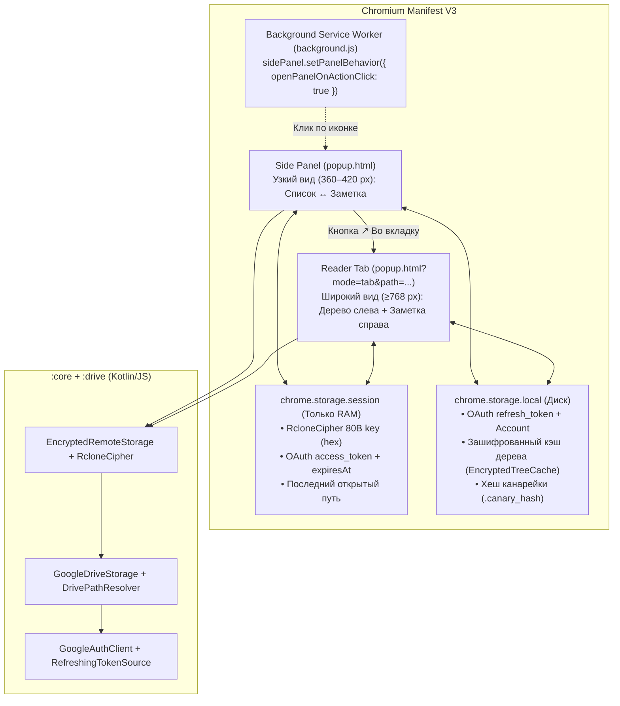

# Mimir: Архитектурная спецификация расширения Chromium MV3 (`:browser-extension`)

**Дата:** 2026-11-01  
**Статус:** Draft (на согласовании)  
**Область:** `browser-extension`, `core`, `drive`, CI

---

## 1. Замысел и цели (Quick View)

### 1.1 Мотивация и контекст использования
В Google Drive хранилище Obsidian зашифровано по стандарту `rclone crypt` (зашифрованы и имена файлов/папок, и их содержимое). В стандартном веб-интерфейсе `drive.google.com` пользователь видит нечитаемые Base32-имена (`p0e52nreeaj0a5...`) и не может ни найти заметку через поиск Диска, ни прочитать её без установки десктопного клиента Mimir и полной синхронизации на диск.

Браузерное расширение Mimir (`:browser-extension`) решает эту проблему: оно позволяет **открывать, искать и читать зашифрованные заметки прямо в браузере Chromium в оперативной памяти**, не скачивая хранилище на локальный диск ПК и не запуская локальный демон Mimir.

**Типовой сценарий:**
1. Пользователь работает в браузере (на рабочем/гостевом ПК без локальной копии vault или параллельно с чтением документации/задач в браузере).
2. Пользователь кликает по иконке расширения Mimir — справа открывается закреплённая **боковая панель (`chrome.sidePanel`)**, которая не закрывается при переключении вкладок и кликах по веб-страницам.
3. Пользователь входит в Google, один раз за сессию браузера вводит мастер-пароль хранилища, находит заметку через мгновенный поиск или дерево папок и читает классически отрендеренный Markdown.
4. При необходимости комфортного чтения большой заметки пользователь нажимает кнопку `↗` («Во вкладку»), открывая двухпанельный полноэкранный ридер в соседней вкладке браузера (`popup.html?mode=tab&path=...`) с использованием уже разблокированной в памяти сессии.

### 1.2 Цели
1. **Полная автономность**: Расширение работает целиком внутри Chromium (Manifest V3) напрямую с Google Drive API и не требует запущенного процесса `daemon` или `app-desktop`.
2. **Удобный неблокирующий UI (Side Panel + Full-Tab Reader)**:
   - Основной режим по клику на иконку расширения — **нативная боковая панель (`chrome.sidePanel`)**, которая остаётся открытой рядом с любой веб-страницей. Внутри узкой панели используется пошаговая навигация **Master-Detail (Список ↔ Заметка с кнопкой «← Назад»)**.
   - Дополнительный режим — **полноэкранная вкладка (Reader Tab)** с двухколоночной раскладкой (дерево файлов и фильтр слева, широкая колонка чтения заметки по центру).
   - Fallback в классический Popup, если браузер не поддерживает `chrome.sidePanel`.
3. **Сквозное Zero-Knowledge шифрование**: Расшифровка путей и содержимого выполняется строго в памяти браузера через штатные классы `:core` ([`RcloneCipher`](file:///home/gidragir/projects/mimir/core/src/commonMain/kotlin/dev/mimir/core/crypto/RcloneCipher.kt), [`EncryptedRemoteStorage`](file:///home/gidragir/projects/mimir/core/src/commonMain/kotlin/dev/mimir/core/crypto/EncryptedRemoteStorage.kt)) и `:drive` ([`GoogleDriveStorage`](file:///home/gidragir/projects/mimir/drive/src/commonMain/kotlin/dev/mimir/drive/GoogleDriveStorage.kt)).
4. **Безопасная сессия в RAM**: Мастер-пароль никогда не сохраняется; деривированный 80-байтный ключ `RcloneCipher` хранится исключительно в оперативной памяти браузера (`chrome.storage.session`), разделяется между боковой панелью и открытой вкладкой ридера и гарантированно уничтожается при закрытии браузера или по кнопке «Заблокировать» (`🔒`).
5. **Классический рендеринг Markdown (Read-Only)**: Безопасный рендеринг заголовков, списков, чеклистов, таблиц, цитат, блоков кода и инлайн-форматирования в цветовой палитре Obsidian с копированием исходного Markdown или чистого текста в один клик.

### 1.3 Не-цели
- Редактирование, создание или удаление заметок в Google Drive из расширения (только чтение).
- Подгрузка и расшифровка вложенных бинарных картинок (`![[image.png]]`) и скачивание нетекстовых вложений в первой версии.
- Встраивание скриптов в обфусцированный DOM таблиц `drive.google.com`.
- Поддержка браузеров вне семейства Chromium (Firefox, Safari исключены согласно базовой спецификации §6.6a).

### 1.4 Анти-цели
- Запись мастер-пароля, деривированных ключей шифрования или расшифрованных текстов/имён заметок в постоянное дисковое хранилище (`chrome.storage.local`, `localStorage`, `IndexedDB`).
- Повторное вычисление `Scrypt` при каждом переключении между боковой панелью и полноэкранной вкладкой внутри одной сессии браузера.
- Дублирование кода обхода Google Drive, дедупликации ревизий или шифрования отдельно от модулей `:core` и `:drive`.
- Использование `innerHTML` с несанитизированным текстом или внешних скриптов, нарушающих CSP Manifest V3 (`script-src 'self'`).

---

## 2. Рассмотренные подходы (Approaches)

### 2.1 Формат интерфейса (UI/UX)

| Вариант | Описание | Компромиссы | Решение |
|---|---|---|---|
| **1. Встраивание в DOM `drive.google.com`** | Content Script расшифровывает имена строк прямо в таблице Google Диска и открывает модальное окно по клику. | Не работает поиск на `drive.google.com` (сервер Google ищет по зашифрованным base32-именам); хрупкая привязка к обфусцированной вёрстке Google Wiz и виртуальному скроллу. | Отклонён |
| **2. Только классический Popup (`420×560 px`)** | Всплывающее окно по клику на иконку расширения. | Закрывается при любом клике мимо окна — невозможно держать заметку открытой и копировать команды/данные в рабочую вкладку; тесно для чтения. | Отклонён (оставлен только как fallback) |
| **3. Side Panel + полноэкранная вкладка (`Reader Tab`)** | Боковая панель `chrome.sidePanel` (пошаговый переход «Список → Заметка») + кнопка `↗` для открытия двухпанельного режима в отдельной вкладке браузера. | Требует разрешения `"sidePanel"` в манифесте MV3; даёт неблокирующее чтение рядом с любой вкладкой и полноценный двухколоночный вид во вкладке. | **Выбран пользователем** |

### 2.2 Архитектура кода и слоёв

| Подход | Описание | Компромиссы | Решение |
|---|---|---|---|
| **Подход 1: Переиспользование `:core` + `:drive` (Kotlin/JS) и адаптивный DOM UI** | Подключение KMP-модулей `:core` и `:drive`, использование `EncryptedRemoteStorage(GoogleDriveStorage(...), cipher)`. Единый бандл `popup.html` + `popup.js` с адаптивной CSS-сеткой (Master-Detail в узкой Side Panel, 2 колонки во вкладке). | UI пишется на типизированном Kotlin/JS DOM вместо Compose Canvas, зато бандл компактный (~350 КиБ), мгновенно стартует, работает нативное выделение текста и `Ctrl+F`. | **Выбран пользователем** |
| **Подход 2: Собственный Drive-клиент на `fetch` в `:browser-extension`** | Зависимость только от `:core`, ручная реализация запросов к Drive API и построения дерева. | Нарушает `mimir-design-patterns`: дублирует `GoogleDriveStorage.listAll`, `DrivePathResolver`, ретраи и проверку `.mimir_canary`. | Отклонён |
| **Подход 3: Compose Multiplatform (`wasmJs` / Skia Canvas) из `:ui`** | Рендеринг интерфейса на Canvas через Skiko/Wasm. | Бандл 8–12 МБ, долгий старт боковой панели, сломано нативное выделение текста мышью и поиск `Ctrl+F`, требует `wasm-unsafe-eval` в CSP. | Отклонён |

---

## 3. Инварианты Mimir

### 3.1 Платформы
- **Chromium (Linux, Windows, macOS — Chrome, Brave, Edge, Vivaldi, Opera)**: целевая платформа. Расширение работает в `chrome.sidePanel` (при открытии по иконке) и в полноэкранной вкладке браузера (`chrome.tabs.create`). Если в конкретном форке Chromium отсутствует API `chrome.sidePanel`, расширение автоматически открывается как стандартный Popup (`action.default_popup`).
- **Android / Desktop JVM / Docker-демон / Obsidian-плагин**: неприменимо — у этих целей собственные точки входа (`:app-android`, `:app-desktop`, `:daemon`, `:obsidian-plugin`), использующие те же `:core` и `:drive`.

### 3.2 Дизайн
- **Паттерны и эталонные классы**:
  - *Порт и адаптер + Декоратор*: [`RemoteStorage`](file:///home/gidragir/projects/mimir/core/src/commonMain/kotlin/dev/mimir/core/api/RemoteStorage.kt) ↔ [`GoogleDriveStorage`](file:///home/gidragir/projects/mimir/drive/src/commonMain/kotlin/dev/mimir/drive/GoogleDriveStorage.kt), обёрнутый в [`EncryptedRemoteStorage`](file:///home/gidragir/projects/mimir/core/src/commonMain/kotlin/dev/mimir/core/crypto/EncryptedRemoteStorage.kt) и [`RcloneCipher`](file:///home/gidragir/projects/mimir/core/src/commonMain/kotlin/dev/mimir/core/crypto/RcloneCipher.kt).
  - *Аутентификация и токены*: переиспользование [`GoogleAuthClient`](file:///home/gidragir/projects/mimir/drive/src/commonMain/kotlin/dev/mimir/drive/auth/GoogleAuthClient.kt), [`Pkce`](file:///home/gidragir/projects/mimir/drive/src/commonMain/kotlin/dev/mimir/drive/auth/BrowserLogin.kt), [`RefreshingTokenSource`](file:///home/gidragir/projects/mimir/drive/src/commonMain/kotlin/dev/mimir/drive/auth/AccessTokenSource.kt) и [`TokenStorage`](file:///home/gidragir/projects/mimir/drive/src/commonMain/kotlin/dev/mimir/drive/auth/TokenStorage.kt) из модуля `:drive`.
  - *Хранение секретов/сессии*: реализация [`SecretStore`](file:///home/gidragir/projects/mimir/core/src/commonMain/kotlin/dev/mimir/core/api/SecretStore.kt) поверх `chrome.storage.session` (для сессионного ключа шифрования и `access_token`) и `chrome.storage.local` (для `refresh_token`, email аккаунта и зашифрованного кэша списка файлов).
  - *Однонаправленный поток данных (UDF)*: состояние экрана описывается `sealed interface ExtensionUiState` в `StateFlow<ExtensionUiState>`; представление (`PopupDomView`) является чистой функцией состояния без собственной бизнес-логики.
  - *Тестируемые побочные эффекты*: браузерные API (`chrome.storage`, `chrome.identity`, `chrome.tabs`, `navigator.clipboard`) спрятаны за интерфейсом `ExtensionPlatform` с in-memory фейком `FakeExtensionPlatform` для unit-тестов в `jsTest`.

### 3.3 IO (Ввод/Вывод и Сеть)
Для хранилища из $N$ файлов/папок и чтения $K$ заметок:

| Операция | Запросы к Google Drive API | Прочитано байт по сети | Диспетчер и параллелизм |
|---|---|---|---|
| Проверка мастер-пароля (`.mimir_canary`) | $1$ поиск корня + $1$ `stat` + $1$ `files.get?alt=media` | $< 256$ байт | `Dispatchers.Default` (JS event loop + кооперативный `Scrypt`) |
| Первичное построение дерева (`listAll`) | $\lceil N / 1000 \rceil$ постраничных запросов `files.list` (`pageSize=1000`) | $\approx N \times 120$ байт метаданных | Постранично, без загрузки тел файлов |
| Повторное открытие Side Panel / вкладки | **$0$ запросов** (чтение зашифрованного списка из `chrome.storage.local` + расшифровка имён в RAM ключом из `chrome.storage.session`) | **$0$ байт** | Локально в памяти (`< 15$ мс на $1000$ файлов) |
| Ручное обновление дерева кнопкой `🔄` | $1$ запрос `changes.list` (при наличии `changeToken`) либо $\lceil N / 1000 \rceil$ `listAll` | $< 2$ КиБ при отсутствии изменений | Асинхронно без сброса открытой заметки |
| Открытие заметки ($K$ кликов) | **$K$ запросов** `files.get?alt=media` (только выбранный `.md`-файл) | $\sum_{i=1}^K \text{размер}_i$ | Потоковая блочная расшифровка через `kotlinx.io.Source` чанками по $64$ КиБ (`RcloneCipher.decrypt`) |

- **Никакого жадного чтения тел файлов**: тела заметок скачиваются строго по одной штуке по клику пользователя.
- **Кэш в `chrome.storage.local` хранит только зашифрованные `RemoteEntry`** (как они пришли из `GoogleDriveStorage`): на диск никогда не пишутся открытые имена заметок. При открытии панели/вкладки имена расшифровываются на лету в RAM текущим сессионным `RcloneCipher`.

### 3.4 UX
- **Палитра и типографика Obsidian**: совпадает с [`ObsidianStyle`](file:///home/gidragir/projects/mimir/ui/src/commonMain/kotlin/dev/mimir/ui/theme/ObsidianStyle.kt) — глубокий тёмный фон `#1e1e1e`, вторичный `#262626`, границы `#363636`, акцент `#705dcf`, текст `#dcddde`, приглушённый `#8e8e8e` (плюс светлая тема по `@media (prefers-color-scheme: light)`).
- **Все состояния экранов**:
  1. `Loading` — индикатор прогресса (деривация ключа, загрузка дерева с счётчиком найденных файлов, загрузка заметки);
  2. `Empty` — понятная подсказка, если хранилище в Google Drive ещё не создано или по поисковому запросу ничего не найдено;
  3. `Error` — человекочитаемое сообщение на русском языке (неверный пароль, отозванный доступ, ошибка сети) + кнопка «Повторить» / «Сменить аккаунт»;
  4. `Offline` — баннер «Нет сети: показан сохранённый список файлов» при работе по кэшированному дереву без интернета;
  5. `Content` — рабочее состояние (Список/Дерево заметок и Чтение заметки).

---

## 4. Архитектура Manifest V3 и среда исполнения

### 4.1 Топология: Единая страница `popup.html` для Side Panel, Вкладки и Popup



1. **Единая HTML-точка входа (`popup.html` + `popup.js`)**:
   - В `manifest.template.json` указываются одновременно `"action": { "default_popup": "popup.html" }` и `"side_panel": { "default_path": "popup.html" }`.
   - При установке/старте крошечный фоновый скрипт (или инициализатор `chrome.sidePanel?.setPanelBehavior({ openPanelOnActionClick: true })`) переключает клик по иконке расширения на открытие нативной боковой панели `chrome.sidePanel`. Если браузер не поддерживает `sidePanel`, клик открывает тот же `popup.html` как классический Popup.
   - Кнопка `↗` («Открыть во вкладке») вызывает `chrome.tabs.create({ url: chrome.runtime.getURL("popup.html?mode=tab&path=" + encodeURIComponent(currentPath)) })`.
2. **Адаптивная раскладка (Responsive Layout)**:
   - **Узкий режим (`< 768px` или без `mode=tab` — Side Panel / Popup)**: пошаговая навигация **Вариант А (Master-Detail)**. На экране `VaultReady` при отсутствии выбранной заметки отображается дерево папок и поиск во всю ширину панели; при выборе заметки открывается экран чтения во всю ширину с кнопкой `← Назад` в шапке.
   - **Широкий режим (`mode=tab` и `≥ 768px` — Полноэкранная вкладка)**: двухколоночный CSS Grid (`280px 1fr`). Левая колонка постоянно показывает строку поиска и дерево заметок, правая колонка — открытую заметку.

### 4.2 Манифест расширения (`manifest.template.json`)

Для того чтобы Redirect URI (`https://<extension-id>.chromiumapp.org/oauth2`) оставался неизменным при локальной загрузке (`Load unpacked`) и установке из релизного архива `mimir-extension-<version>.zip`, в `manifest.template.json` фиксируется публичный RSA-ключ (`"key"`):

```json
{
  "manifest_version": 3,
  "name": "${appName} Quick View",
  "version": "${version}",
  "description": "Быстрый просмотр зашифрованных заметок Obsidian из Google Drive",
  "key": "${extensionPublicKey}",
  "action": {
    "default_popup": "popup.html",
    "default_icon": {
      "128": "icon-128.png"
    }
  },
  "side_panel": {
    "default_path": "popup.html"
  },
  "icons": {
    "128": "icon-128.png"
  },
  "permissions": [
    "identity",
    "storage",
    "sidePanel"
  ],
  "host_permissions": [
    "https://accounts.google.com/*",
    "https://oauth2.googleapis.com/*",
    "https://www.googleapis.com/*",
    "https://drive.google.com/*"
  ],
  "content_security_policy": {
    "extension_pages": "script-src 'self'; object-src 'self';"
  }
}
```

> [!NOTE]
> Идентификатор `mimir.extensionPublicKey` хранится в `gradle.properties` (согласно скиллу `mimir-identifiers`) и подставляется задачей `assembleExtension`. Это публичный идентификатор манифеста (не секрет), который детерминированно фиксирует `extension-id` в Chromium.

### 4.3 Персистентность и границы безопасности

| Хранилище | Ключи | Содержимое | Время жизни |
|---|---|---|---|
| `chrome.storage.session` | `session.cipherKeyHex`<br/>`session.accessToken`<br/>`session.expiresAt`<br/>`session.selectedPath` | • 80-байтный ключ `RcloneCipher` в Hex (160 символов)<br/>• Текущий `access_token` и время его истечения<br/>• Путь текущей открытой заметки в Side Panel | **Только в RAM браузера**. Стирается при закрытии браузера или нажатии кнопки `🔒 Заблокировать`. |
| `chrome.storage.local` | `auth.refreshToken`<br/>`auth.clientKind`<br/>`auth.account`<br/>`vault.encryptedEntries`<br/>`vault.changeToken`<br/>`vault.cachedAtEpochSec`<br/>`vault.canaryHash` | • `refresh_token` и профиль (`email`, `displayName`)<br/>• Зашифрованные `RemoteEntry` (пути в Base32Hex, без расшифрованных имён!)<br/>• SHA-256 хеш канарейки (`.canary_hash`) для мгновенной проверки пароля | На диске профиля браузера до нажатия кнопки «Выйти из аккаунта» или удаления расширения. |

---

## 5. Авторизация Google OAuth 2.0

### 5.1 Поддерживаемые потоки входа
Расширение переиспользует [`GoogleAuthClient`](file:///home/gidragir/projects/mimir/drive/src/commonMain/kotlin/dev/mimir/drive/auth/GoogleAuthClient.kt) из модуля `:drive` и поддерживает два способа авторизации в рамках единого проекта Google Cloud (scope `drive.file openid email profile`):

1. **Основной поток — `chrome.identity.launchWebAuthFlow` (OAuth 2.0 PKCE)**:
   - Генерируется пара `verifier` / `challenge` через [`Pkce`](file:///home/gidragir/projects/mimir/drive/src/commonMain/kotlin/dev/mimir/drive/auth/BrowserLogin.kt).
   - Вызывается `chrome.identity.launchWebAuthFlow({ url = authUrl, interactive = true })` с `redirect_uri = chrome.identity.getRedirectURL("oauth2")`.
   - Полученный `code` обменивается на `OAuthTokens` (`access_token` + `refresh_token`) через `GoogleAuthClient.exchangeAuthorizationCode`.
2. **Резервный поток — Device Code Flow (`GoogleAuthClient.requestDeviceCode` / `pollDeviceToken`)**:
   - Если в Google Cloud Console пользователя настроен только `Desktop`/`Device` клиент без зарегистрированного `https://<extension-id>.chromiumapp.org/oauth2` Redirect URI (ошибка `redirect_uri_mismatch`) или пользователь выбрал «Войти по коду устройства», расширение отображает 8-значный код и кнопку открытия `https://www.google.com/device`, опрашивая `pollDeviceToken`.
   - Это гарантирует 100% работоспособность расширения из коробки с существующими переменными `MIMIR_GOOGLE_DEVICE_CLIENT_ID` / `MIMIR_GOOGLE_DESKTOP_CLIENT_ID` из `mise.local.toml`.

### 5.2 Конфигурация OAuth-клиентов при сборке
По аналогии с `:daemon` и `:app-android`, в `browser-extension/build.gradle.kts` подключается плагин `buildconfig` (`dev.mimir.extension.ExtensionBuildConfig`), который считывает `MIMIR_BUILD_GOOGLE_*` с fallback на `MIMIR_GOOGLE_*` из окружения (при отсутствии секретов — пустые строки, сборка и тесты проходят без секретов). Если сборка выполнена без вшитых `CLIENT_ID`, на экране входа показывается сворачиваемое поле для ввода собственного `Client ID`.

---

## 6. Криптография, проверка пароля и работа с `:core` / `:drive`

### 6.1 Экспорт и восстановление сессионного ключа в `RcloneCipher`
Вычисление `Scrypt(N=16384, r=8, p=1)` в JS занимает ~150–350 мс. Чтобы не выполнять `Scrypt` повторно при каждом открытии боковой панели или переходе в полноэкранную вкладку, в [`RcloneCipher`](file:///home/gidragir/projects/mimir/core/src/commonMain/kotlin/dev/mimir/core/crypto/RcloneCipher.kt) добавляются методы работы с 80-байтным производным ключом:

```kotlin
// В core/src/commonMain/kotlin/dev/mimir/core/crypto/RcloneCipher.kt
class RcloneCipher internal constructor(...) : Cipher {
    /** Возвращает копию 80-байтного ключа (dataKey[32] + nameKey[32] + nameTweak[16]) для хранения в RAM-сессии. */
    fun exportKeyBytes(): ByteArray = dataKey + nameKeyBytes + nameTweak

    companion object {
        const val KEY_SIZE = 80

        /** Восстанавливает шифр из ранее деривированного 80-байтного ключа за O(1) без вызова Scrypt. */
        fun fromKeyBytes(
            keys: ByteArray,
            nonceSource: () -> ByteArray = ::randomNonce,
        ): RcloneCipher {
            require(keys.size == KEY_SIZE) { "RcloneCipher key must be $KEY_SIZE bytes, got ${keys.size}" }
            return RcloneCipher(keys.copyOf(), nonceSource)
        }
    }
}
```

### 6.2 Проверка пароля по канарейке (`.mimir_canary`)
Логика проверки пароля из `runtime/Canary.kt` выделяется в чистую мультиплатформенную функцию в `:core` (`CanaryVerifier.kt` в `commonMain`), не зависящую от `java.nio.file.Path`:
1. При вводе пароля создаётся `cipher = RcloneCipher.create(password)`.
2. Если в `chrome.storage.local` уже сохранён `canaryHash` (`SHA-256(cipher.encryptName("mimir-canary-hash"))`), неверный пароль отсекается мгновенно без сетевого запроса.
3. При первой проверке (или отсутствии локального `canaryHash`) через нешифрованный `GoogleDriveStorage` проверяется файл `.mimir_canary` в корне папки `Mimir`:
   - Файл найден → расшифровывается `cipher.decrypt(remote.read(RemotePath(".mimir_canary")))` и проверяется подстрока `"mimir-vault-canary"`. При ошибке `CryptException` возвращается состояние `InvalidPassword`.
   - Файл `.mimir_canary` не найден, но в папке `Mimir` есть зашифрованные файлы → попытка расшифровать имена первого уровня через `cipher.decryptName`; если ни одно имя не расшифровывается — `InvalidPassword`.
4. После успешной проверки `cipher.exportKeyBytes().toHexString()` сохраняется в `chrome.storage.session`, а `canaryHash` — в `chrome.storage.local`.

### 6.3 Построение дерева и фильтрация заметок
1. **Загрузка зашифрованного списка**:
   - Вызывается `googleDriveStorage.listAll(RemotePath("")) { folders, files -> updateProgress(folders, files) }`.
   - Полученный список зашифрованных `RemoteEntry` сохраняется в `chrome.storage.local` (`vault.encryptedEntries`) вместе с `changeToken = googleDriveStorage.getLatestChangeToken()`.
2. **Расшифровка имен в памяти и фильтрация**:
   - В памяти каждый зашифрованный путь `RemoteEntry.path` по сегментам расшифровывается через `cipher.decryptName(segment)`.
   - Сегменты, вызывающие `CryptException`, и служебный файл `.mimir_canary` пропускаются.
   - Применяется штатный фильтр служебных путей [`VaultPathFilter`](file:///home/gidragir/projects/mimir/core/src/commonMain/kotlin/dev/mimir/core/fs/VaultPathFilter.kt) / [`SyncRules`](file:///home/gidragir/projects/mimir/core/src/commonMain/kotlin/dev/mimir/core/rules/SyncRules.kt) — скрываются папки `.obsidian/`, `.trash/` и временные файлы конфликтов.
   - Из плоского списка расшифрованных `RemoteEntry` строится иерархическое дерево папок и файлов `VaultTreeNode` (папки сортируются по алфавиту перед файлами).
3. **Чтение заметки**:
   - По клику на заметку вызывается `encryptedStorage.read(note.path).readString()`.
   - Поскольку `DrivePathResolver` прогревается при загрузке дерева (или разрешает сегменты по зашифрованному пути), чтение файла с известным `id` выполняет ровно **один** запрос `GET /drive/v3/files/{fileId}?alt=media`.

---

## 7. Пользовательский интерфейс и сценарии (UX/UI)

### 7.1 Конечный автомат состояний (`ExtensionUiState`)

```kotlin
package dev.mimir.extension.ui

import dev.mimir.core.Account
import dev.mimir.core.RemotePath

sealed interface ExtensionUiState {
    /** Инициализация: чтение chrome.storage.session и chrome.storage.local */
    data object Initializing : ExtensionUiState

    /** Экран 1: Вход в Google Drive */
    data class AuthRequired(
        val error: String? = null,
        val isAuthorizing: Boolean = false,
        val deviceCodePrompt: DeviceCodeUiPrompt? = null,
    ) : ExtensionUiState

    /** Экран 2: Ввод мастер-пароля хранилища */
    data class UnlockRequired(
        val account: Account,
        val isVerifying: Boolean = false,
        val error: String? = null,
    ) : ExtensionUiState

    /** Первичная загрузка дерева из Google Drive */
    data class VaultLoading(
        val account: Account,
        val foldersSeen: Int = 0,
        val filesSeen: Int = 0,
    ) : ExtensionUiState

    /** Экран 3 и 4: Разблокированное хранилище (Список и Просмотр заметки) */
    data class VaultReady(
        val account: Account,
        val tree: List<VaultTreeNode>,
        val flatNotes: List<VaultTreeNode.File>,
        val searchQuery: String = "",
        val filteredNotes: List<VaultTreeNode.File> = flatNotes,
        val collapsedFolders: Set<String> = emptySet(),
        val activeNote: ActiveNoteState? = null,
        val isRefreshing: Boolean = false,
        val isOffline: Boolean = false,
        val statusError: String? = null,
        val cachedAtEpochSec: Long? = null,
    ) : ExtensionUiState
}

sealed interface ActiveNoteState {
    val file: VaultTreeNode.File

    data class Loading(override val file: VaultTreeNode.File) : ActiveNoteState
    data class Loaded(
        override val file: VaultTreeNode.File,
        val rawMarkdown: String,
        val plainText: String,
    ) : ActiveNoteState
    data class Error(override val file: VaultTreeNode.File, val message: String) : ActiveNoteState
}
```

### 7.2 Экраны и поведение в Side Panel (Вариант А) и Полноэкранной вкладке

1. **Экран 1 — Подключение Google Drive (`AuthRequired`)**:
   - Заголовок `Mimir Quick View`, краткое пояснение («Быстрый просмотр зашифрованных заметок в браузере без скачивания на ПК»).
   - Основная кнопка **«Войти через Google»** (`launchWebAuthFlow`) и вторичная ссылка **«Войти по коду устройства»** (Device Code Flow).
2. **Экран 2 — Разблокировка хранилища (`UnlockRequired`)**:
   - Отображает подключённый аккаунт (`user@gmail.com`) и кнопку «Сменить».
   - Поле ввода мастер-пароля с переключателем видимости, отправка по `Enter`.
   - Подсказка: «Ключ хранится только в оперативной памяти браузера до его закрытия или блокировки».
3. **Экран 3 — Дерево и поиск заметок (`VaultReady`, `activeNote == null` в Side Panel)**:
   - Верхняя панель: поле поиска `🔍 Поиск по имени и пути...` (фильтрация по подстроке без учёта регистра), кнопки `🔄` (обновить список из Drive), `↗` (открыть во вкладке), `🔒` (заблокировать сессию).
   - При пустой строке поиска отображается сворачиваемое дерево папок и файлов `📁 Папка` / `📄 Заметка.md`.
   - При вводе текста в поиск вместо дерева показывается плоский отфильтрованный список заметок с указанием родительской папки и времени изменения.
   - Нижний статус-бар: количество заметок, время обновления кэша и индикатор `Offline` при отсутствии сети.
4. **Экран 4 — Чтение заметки (`VaultReady`, `activeNote != null`)**:
   - **В узкой Side Panel (`Вариант А`)**: занимает всю ширину панели. В шапке: кнопка **`← Назад`** (сбрасывает `activeNote = null`, возвращая к дереву/результатам поиска), хлебные крошки пути заметки, кнопки `📋 MD` (копировать исходный Markdown), `📄 Текст` (копировать чистый текст без разметки), `↗` (открыть эту заметку в широкой вкладке).
   - **В полноэкранной вкладке (`mode=tab`)**: дерево и поиск остаются открытыми в левой колонке (`280px`), а выбранная заметка рендерится справа с максимальной читаемой шириной текста (`760px` по центру области чтения).

### 7.3 Классический безопасный рендерер Markdown (`SafeMarkdownRenderer`)
Для соблюдения строгого CSP Manifest V3 (без `innerHTML` и сторонних JS-библиотек с `eval`) рендерер строит DOM-узлы напрямую через `document.createElement`:
- **Блочные элементы**:
  - Заголовки `# H1` .. `###### H6` (`<h1>`..`<h6>`);
  - Огороженные блоки кода ```` ```lang ... ``` ```` (`<pre><code data-lang="...">` с кнопкой быстрого копирования блока кода);
  - Таблицы GFM (`<table>`, `<thead>`, `<tbody>`, `<tr>`, `<th>`, `<td>`);
  - Цитаты и Callout-блоки Obsidian `> [!NOTE]` (`<blockquote>`);
  - Маркированные, нумерованные списки и чеклисты `- [ ]` / `- [x]` (`<ul>`, `<ol>`, `<li>`, `<input type="checkbox" disabled>`);
  - Горизонтальные разделители `---` (`<hr>`) и абзацы (`<p>`).
- **Строчные элементы**:
  - Жирный `**text**`, курсив `*text*`, зачёркнутый `~~text~~`, инлайн-код `` `code` ``;
  - Внутренние ссылки Obsidian `[[Название заметки]]` и `[[Путь/Заметка|Текст]]`: рендерятся как кликабельные элементы `<a class="wikilink">`, клик по которым находит целевую заметку в загруженном дереве и открывает её;
  - Внешние ссылки `[text](https://...)`: открываются в новой вкладке (`target="_blank" rel="noopener noreferrer"`), схемы `javascript:` и `data:` блокируются.

---

## 8. Сборка, верификация и тестирование

### 8.1 Конфигурация Gradle (`browser-extension/build.gradle.kts`)
- Зависимости `jsMain`: `implementation(project(":core"))`, `implementation(project(":drive"))`, `implementation(libs.ktor.client.js)`, `implementation(libs.serialization.json)`.
- Плагин `alias(libs.plugins.buildconfig)` генерирует `ExtensionBuildConfig` с полями `GOOGLE_DESKTOP_CLIENT_ID`, `GOOGLE_DESKTOP_CLIENT_SECRET`, `GOOGLE_DEVICE_CLIENT_ID`, `GOOGLE_DEVICE_CLIENT_SECRET`.
- Задачи сборки:
  - `assembleExtension`: собирает директорию `build/extension/` (`manifest.json`, `popup.html`, `popup.css`, `popup.js`, `icon-128.png`).
  - `checkExtension`: проверяет валидность `manifest.json` (MV3, наличие `side_panel.default_path`, `action.default_popup`, `permissions`, отсутствие inline-скриптов в `popup.html`).
  - `zipExtension`: пакует `mimir-extension-<version>.zip` в `build/distributions/`.

### 8.2 Автоматическое тестирование (`:browser-extension:jsTest` и `:core:commonTest`)
1. `:core:commonTest` — `RcloneCipherKeyExportTest`: проверка того, что `RcloneCipher.fromKeyBytes(cipher.exportKeyBytes())` идентично расшифровывает имена и потоки данных без повторного вызова `Scrypt`, а также тест `CanaryVerifierTest`.
2. `:browser-extension:jsTest`:
   - `ExtensionControllerTest`: тестирование переходов `ExtensionUiState` (вход в Google, проверка канарейки, загрузка дерева из `InMemoryRemoteStorage`, кэширование зашифрованного дерева, переключение `activeNote` и возврат кнопкой «← Назад», блокировка сессии `🔒`).
   - `VaultTreeBuilderTest`: построение дерева из плоского списка `RemoteEntry`, фильтрация `.obsidian`/`.trash`, поиск по имени и пути.
   - `SafeMarkdownRendererTest`: проверка генерации безопасных DOM-элементов для заголовков, списков, чеклистов, таблиц, блоков кода, кликабельных `[[wikilinks]]` и блокировки XSS (`<script>`, `javascript:` ссылок).

### 8.3 Что остаётся на усмотрение разработчика (Left to the Builder)
- Точная вёрстка CSS-отступов и SVG-иконок кнопок (`🔄`, `↗`, `🔒`, `📋`) в рамках заданных переменных темы Obsidian.
- Детали разбиения классов внутри пакета `dev.mimir.extension.*` с соблюдением лимита ~300 строк на файл.
