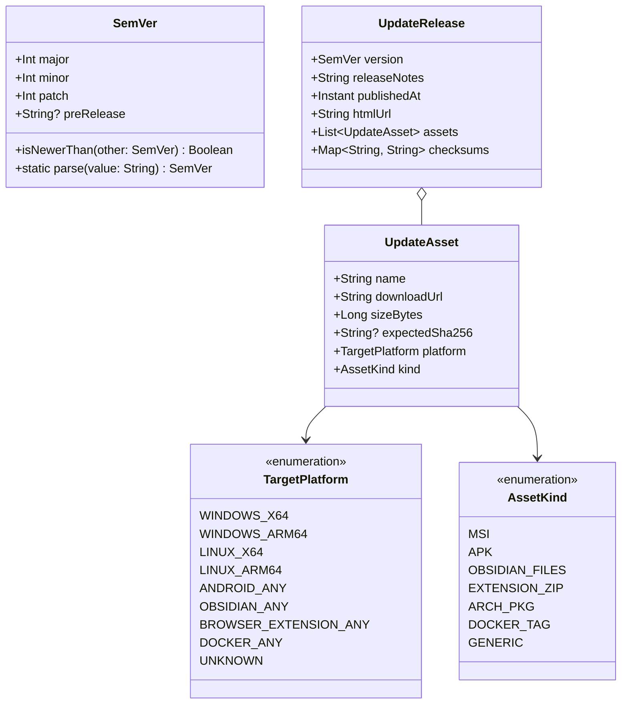

# Mimir: Архитектурная спецификация платформонезависимого механизма обновлений (`:core`, `:runtime`, `:daemon`, `:app-desktop`, `:app-android`, `:obsidian-plugin`, `:browser-extension`)

**Дата:** 2026-11-03  
**Статус:** Approved (согласовано с пользователем и валидировано архитектурным ревью)  
**Область:** `core`, `runtime`, `daemon`, `app-desktop`, `app-android`, `obsidian-plugin`, `browser-extension`, `ui`, CI (`release.yml`)

---

## 1. Замысел и цели (Quick View)

### 1.1 Мотивация и контекст
Mimir функционирует на шести принципиально разных типах платформ: Desktop (Windows MSI, Arch Linux pacman/AUR), Android (APK вне Play Store), Obsidian Plugin (JS-плагин внутри vault), Chromium Browser Extension (MV3), Docker-контейнер и headless-демон. 

В проекте используется единый источник истины для версии — свойство `mimir.version` в `gradle.properties`, синхронизируемое через `changesets` и выпускаемое через GitHub Actions ([`release.yml`](file:///home/gidragir/projects/mimir/.github/workflows/release.yml)). Однако в клиентах отсутствует механизм обнаружения новых версий и доставки обновлений.

Из-за различий в моделях безопасности операционных систем и сред исполнения единый подход «скачать бинарник и перезаписать себя» невозможен:
- **Chromium MV3:** запрещает любое исполнение удалённого кода (Remote Code Execution, CSP `script-src 'self'`).
- **Docker-демон:** изолирован внутри контейнера и не имеет прав/сокета для обновления собственного образа.
- **Linux (Arch pacman/AUR):** прямая замена бинарников разрушает целостность пакетной базы ОС.
- **Android:** не допускает фоновой тихой перезаписи APK без root-прав, требуя запуск системного диалога `PackageInstaller`.
- **Windows:** требует вызова MSI-установщика и корректного завершения процесса приложения и демона.
- **Obsidian:** допускает in-place обновление собственных скриптов (`main.js`, `manifest.json`) в каталоге плагина.

Данная спецификация описывает платформонезависимую подсистему обновлений на базе паттернов проектирования (порты и адаптеры, стратегия источника, стратегия применения, реактивный поток состояния), обеспечивающую единую логику проверки версий и гибкое адаптивное поведение под каждую среду.

---

### 1.2 Цели
1. **Единое ядро валидации и обнаружения в `:core` (KMP)**: общая логика парсинга SemVer, сопоставления платформ/архитектур, разбора релизов GitHub и управления конечным автоматом состояния (`UpdateState`).
2. **Паттерн «Стратегия» для источников обновлений (`UpdateChannel`)**: поддержка GitHub Releases API (основной канал) с возможностью подключения статического JSON-манифеста или каталогов приложений без изменения бизнес-логики.
3. **Паттерн «Порты и Адаптеры» для применения (`UpdateApplier`)**:
   - `IN_PLACE`: скачивание отдельных файлов `main.js` и `manifest.json` и их прямая замена в каталоге плагина (`obsidian-plugin`).
   - `DOWNLOAD_AND_LAUNCH`: потоковое скачивание ассета с обязательной проверкой контрольной суммы SHA-256 по `sha256sums.txt` и делегирование установки системному инсталлятору (`Windows MSI`, `Android APK`).
   - `NOTIFY_ONLY`: деликатное уведомление пользователя с открытием URL/релиза без попытки модификации файлов (`Docker`, `Browser Extension`, `Arch Linux`).
4. **Уважение к сетевым квотам (IO Rate Limiting)**: периодичность автоматической проверки (по умолчанию раз в 24 часа), поддержка заголовков `If-None-Match` (ETag) для исключения расхода квот GitHub API (60 запросов/час для неавторизованных запросов).
5. **Бесшовная интеграция с UI/UX**: отображение ненавязчивого баннера или бейджа в настройках/статус-баре, просмотр заметок к релизу (changelog), прогресс-бар загрузки, исключение блокирующих всплывающих окон во время активной синхронизации.
6. **Автономность клиентов**: расширение браузера и плагин Obsidian работают автономно и не зависят от локального демона для проверки своих обновлений.
7. **Доработка CI (`release.yml`)**: генерация `sha256sums.txt` для всех релизных ассетов и публикация несжатых `main.js` и `manifest.json` для экосистемы Obsidian.

---

### 1.3 Не-цели
- Создание собственного бинарного differential-patching (дельта-патчей) или упаковщика исполняемых файлов на лету.
- Обход системных механизмов контроля учетных записей (UAC на Windows, Android PackageInstaller, прав root на Linux).
- Принудительное прерывание активных операций синхронизации хранилища ради установки обновления.

---

### 1.4 Анти-цели
- Вызов `msiexec` или `PackageInstaller` без предварительной валидации размера файла и хэша SHA-256.
- Попытки скачивания `.exe` / `.msi` внутри сред, не поддерживающих бинарную установку (Docker, Web Extension).
- Жёсткая привязка логики обновлений к локальному Ktor-демону, лишающая браузерное расширение и мобильный Obsidian возможности проверять обновления.
- Включение тяжелых сетевых библиотек (Ktor) напрямую в модуль `:core`.

---

## 2. Рассмотренные подходы (Approaches)

| Подход | Описание | Компромиссы | Решение |
|---|---|---|---|
| **1. KMP-порты с матрицей возможностей (`UpdateChannel` + `UpdateApplier`)** | Контракты в `:core`. Движок `UpdateManager` переиспользуется на JVM, Android и JS. Платформенные адаптеры реализуют только специфичные действия (запуск процесса, скачивание APK, запись файлов плагина, показ уведомления). | Требует базовой абстракции для скачивания файла/HTTP GET в KMP. | **Выбран (максимальная переиспользуемость, чистая архитектура)** |
| **2. Демоноцентричный шлюз (`:daemon` only)** | Вся логика проверки и скачивания живёт в демоне. Клиенты опрашивают REST API `/api/v1/update`. | Ломает автономность: `browser-extension` и `obsidian-plugin` на мобильных устройствах не имеют демона и не смогут обновляться. | Отклонён |
| **3. Децентрализованные платформенные скрипты** | Каждая платформа реализует проверку и обновление независимо с нуля на своём стеке. | Дублирование парсинга SemVer, GitHub API, состояний; рассинхронизация форматов и логики. | Отклонён |

---

## 3. Архитектура и контракты

### 3.1 Модель предметной области (`dev.mimir.core.update`)



### 3.2 Сетевой порт `:core` (`UpdateHttpClient`)

Для сохранения модуля `:core` чистым от тяжелых внешних сетевых библиотек вводится минимальный контракт сетевого клиента:

```kotlin
package dev.mimir.core.update

interface UpdateHttpResponse {
    val statusCode: Int
    val headers: Map<String, String>
    val bodyText: String
}

interface UpdateHttpClient {
    suspend fun get(url: String, headers: Map<String, String> = emptyMap()): UpdateHttpResponse
    suspend fun downloadStream(
        url: String,
        headers: Map<String, String> = emptyMap(),
        onChunk: suspend (bytes: ByteArray, bytesRead: Long, totalBytes: Long) -> Unit
    ): Result<Unit>
}
```
- **JVM / Android (`:runtime`):** реализуется через штатный Ktor Client (`KtorUpdateHttpClient`).
- **JS (`:obsidian-plugin`, `:browser-extension`):** реализуется через нативный `fetch` (`FetchUpdateHttpClient`).

---

### 3.3 Контракты портов (Interfaces)

#### 3.3.1 Источник обновлений (`UpdateChannel`)
```kotlin
package dev.mimir.core.update

sealed interface UpdateCheckResult {
    data class NoUpdate(val checkedVersion: SemVer) : UpdateCheckResult
    data class UpdateAvailable(val release: UpdateRelease, val matchedAsset: UpdateAsset?) : UpdateCheckResult
    data class Error(val message: String, val cause: Throwable? = null) : UpdateCheckResult
}

interface UpdateChannel {
    val name: String
    suspend fun checkForUpdates(currentVersion: SemVer, targetPlatform: TargetPlatform): UpdateCheckResult
}
```

Реализация по умолчанию: `GitHubReleasesChannel(owner: String, repo: String, httpClient: UpdateHttpClient)`:
- Выполняет `GET https://api.github.com/repos/{owner}/{repo}/releases/latest`.
- Передает заголовок `If-None-Match` с сохраненным `etag`. При `304 Not Modified` возвращает `NoUpdate`.
- Запрашивает прикрепленный ассет `sha256sums.txt` (если есть), парсит маппинг `filename -> sha256` и обогащает `expectedSha256` для каждого ассета.
- Сопоставляет ассеты релиза:
  - Windows: `.*\.msi$` -> `TargetPlatform.WINDOWS_X64`, `AssetKind.MSI`
  - Android: `.*\.apk$` (исключая `-unsigned.apk`) -> `TargetPlatform.ANDROID_ANY`, `AssetKind.APK`
  - Obsidian: `^main\.js$` и `^manifest\.json$` -> `TargetPlatform.OBSIDIAN_ANY`, `AssetKind.OBSIDIAN_FILES`
  - Extension: `.*extension.*\.zip$` -> `TargetPlatform.BROWSER_EXTENSION_ANY`, `AssetKind.EXTENSION_ZIP`
  - Arch: `.*\.pkg\.tar\.zst$` -> `TargetPlatform.LINUX_X64`, `AssetKind.ARCH_PKG`

#### 3.3.2 Артефакт загрузки и Стратегия применения (`UpdateApplier`)

```kotlin
package dev.mimir.core.update

enum class ApplierCapability {
    NOTIFY_ONLY,
    DOWNLOAD_AND_LAUNCH,
    IN_PLACE_REPLACE
}

sealed interface DownloadedAsset {
    data class LocalFile(val localPath: String, val actualSha256: String, val asset: UpdateAsset) : DownloadedAsset
    data class MemoryBundle(val files: Map<String, ByteArray>, val asset: UpdateAsset) : DownloadedAsset
    data class Virtual(val asset: UpdateAsset) : DownloadedAsset
}

sealed interface UpdateApplyResult {
    data class Success(val message: String, val requiresRestart: Boolean) : UpdateApplyResult
    data class LaunchedInstaller(val message: String) : UpdateApplyResult
    data class NotificationDispatched(val url: String) : UpdateApplyResult
    data class Failed(val error: String, val cause: Throwable? = null) : UpdateApplyResult
}

interface UpdateApplier {
    val capability: ApplierCapability
    suspend fun download(
        asset: UpdateAsset,
        release: UpdateRelease,
        onProgress: (Float, Long, Long) -> Unit
    ): Result<DownloadedAsset>

    suspend fun apply(downloadedAsset: DownloadedAsset): UpdateApplyResult
}
```

#### 3.3.3 Автомат состояния и Оркестратор (`UpdateManager`)
```kotlin
package dev.mimir.core.update

import kotlinx.coroutines.flow.StateFlow
import kotlin.time.Instant

sealed interface UpdateState {
    data class Idle(val lastCheckedAt: Instant? = null, val latestKnownVersion: SemVer? = null) : UpdateState
    data object Checking : UpdateState
    data class Available(
        val release: UpdateRelease,
        val asset: UpdateAsset?,
        val capability: ApplierCapability
    ) : UpdateState
    data class Downloading(
        val release: UpdateRelease,
        val asset: UpdateAsset,
        val progress: Float,
        val bytesRead: Long,
        val totalBytes: Long
    ) : UpdateState
    data class ReadyToInstall(
        val release: UpdateRelease,
        val downloadedAsset: DownloadedAsset,
        val capability: ApplierCapability
    ) : UpdateState
    data class Installing(val release: UpdateRelease) : UpdateState
    data class Error(val message: String, val previousState: UpdateState) : UpdateState
}

interface UpdateManager {
    val state: StateFlow<UpdateState>
    suspend fun checkForUpdates(force: Boolean = false): UpdateCheckResult
    suspend fun downloadUpdate(): Result<DownloadedAsset>
    suspend fun applyUpdate(): UpdateApplyResult
    fun dismiss()
}
```

---

## 4. Платформенные адаптеры реализации

| Платформа | `TargetPlatform` | Реализация `UpdateApplier` | Поведение `download()` и `apply()` |
| :--- | :--- | :--- | :--- |
| **Windows Desktop (`app-desktop`)** | `WINDOWS_X64` | `WindowsMsiApplier` (`DOWNLOAD_AND_LAUNCH`) | **Download:** стримит `.msi` во временный каталог `%TEMP%`, параллельно считает SHA-256. При несовпадении с `expectedSha256` файл удаляется, возвращается ошибка. <br>**Apply:** отправляет вызов `POST /api/v1/shutdown` демону (если работает внешний демон), запускает `ProcessBuilder("msiexec", "/i", file.absolutePath, "/passive")`, закрывает GUI (`exitProcess(0)`). |
| **Linux Desktop (Arch / Generic)** | `LINUX_X64` | `DesktopNotifyApplier` (`NOTIFY_ONLY`) | **Download:** возвращает `DownloadedAsset.Virtual`. <br>**Apply:** открывает страницу релиза в системном браузере через [`SystemBrowserOpener`](file:///home/gidragir/projects/mimir/app-desktop/src/jvmMain/kotlin/dev/mimir/desktop/browser/SystemBrowserOpener.kt), генерирует уведомление: «Доступна версия X.Y.Z: обновите пакет через pacman/AUR». |
| **Android (`app-android`)** | `ANDROID_ANY` | `AndroidPackageInstallerApplier` (`DOWNLOAD_AND_LAUNCH`) | **Download:** скачивает APK в `context.cacheDir/updates/`, валидирует SHA-256. <br>**Apply:** получает content URI через `FileProvider`, инициирует `Intent(Intent.ACTION_VIEW)` с `FLAG_GRANT_READ_URI_PERMISSION` и MIME `application/vnd.android.package-archive`. |
| **Obsidian Plugin (`obsidian-plugin`)** | `OBSIDIAN_ANY` | `ObsidianInPlaceApplier` (`IN_PLACE_REPLACE`) | **Download:** скачивает `main.js` и `manifest.json` в память (`MemoryBundle`). <br>**Apply:** атомарно записывает файлы в каталог плагина `app.vault.adapter.write(pluginDir + "/main.js", ...)`, вызывает `new Notice("Mimir обновлен до vX.Y.Z! Перезагрузите плагин.")`. |
| **Browser Extension (`browser-extension`)** | `BROWSER_EXTENSION_ANY` | `WebExtensionNotifyApplier` (`NOTIFY_ONLY`) | **Download:** возвращает `DownloadedAsset.Virtual`. <br>**Apply:** выставляет бейдж `chrome.action.setBadgeText({ text: "•" })`, в Side Panel отображает плашку со ссылкой на релиз. |
| **Docker-демон (`daemon`)** | `DOCKER_ANY` | `DockerLogNotifyApplier` (`NOTIFY_ONLY`) | **Download:** `DownloadedAsset.Virtual`. <br>**Apply:** выводит лог: `[Mimir Update] New version vX.Y.Z available. Pull updated image: docker compose pull`, отдает статус в REST API `/api/v1/update`. |

---

## 5. Доработка CI (`.github/workflows/release.yml`)

Для поддержки строгой валидации контрольных сумм и прямого скачивания плагина Obsidian пайплайн релиза расширяется:

```yaml
# В задаче build для obsidian-plugin:
- name: Publish unzipped plugin files
  # Копирует main.js и manifest.json в артефакты для прикрепления к GitHub Release
  run: |
    mkdir -p dist-obsidian
    cp obsidian-plugin/build/dist/main.js dist-obsidian/main.js
    cp obsidian-plugin/build/dist/manifest.json dist-obsidian/manifest.json

# В задаче publish перед softprops/action-gh-release:
- name: Generate Checksums
  run: |
    cd dist
    sha256sum * > sha256sums.txt
```

---

## 6. Интеграция с демоном и UI

### 6.1 HTTP API демона (`:daemon`)
Роуты в `Routes.kt`:
- `GET /api/v1/update` — возвращает текущее состояние:
  ```json
  {
    "currentVersion": "0.1.0",
    "status": "AVAILABLE",
    "latestVersion": "0.2.0",
    "releaseNotes": "### Что нового\n- Улучшена скорость синхронизации...",
    "publishedAt": "2026-11-03T12:00:00Z",
    "capability": "DOWNLOAD_AND_LAUNCH",
    "downloadProgress": 0.0,
    "htmlUrl": "https://github.com/mimir-org/mimir/releases/tag/v0.2.0"
  }
  ```
- `POST /api/v1/update/check` — принудительный запуск проверки.
- `POST /api/v1/update/download` — команда начать загрузку ассета.
- `POST /api/v1/update/apply` — команда применить установку (на Windows запускает MSI и гасит сервис).

### 6.2 Фоновое расписание (`SyncScheduler` / `MimirRuntime`)
- При старте демона через 30 секунд выполняется фоновая проверка.
- Периодический таймер повторяет проверку каждые 24 часа.

### 6.3 UI-компоненты (`:ui`)
- В `SettingsScreen` секция «О программе»:
  - Текущая версия (`v0.1.0`), индикатор актуальности или бейдж «Доступно обновление v0.2.0».
  - Кнопка «Проверить обновления».
  - При наличии обновления: блок Changelog и кнопки «Скачать и установить» / «Обновить плагин» / «Открыть страницу релиза ↗».
- В трее десктопа: пункт `Доступно обновление vX.Y.Z...`.

---

## 7. Инварианты Mimir

### 7.1 Платформы (`mimir-cross-platform`)
- **Windows:** Безопасный запуск `msiexec` через `ProcessBuilder`, корректный `exitProcess(0)` без утечки файловых блокировок базы данных.
- **Linux:** Совместимость с Wayland/niri; отсутствие попыток записи в защищенные каталоги `/usr/bin/` или `/opt/`.
- **Android:** Загрузка в безопасный кэш приложения, использование `FileProvider`, обработка разрешения `REQUEST_INSTALL_PACKAGES`.
- **Docker:** Логирование в stdout, отсутствие попыток выполнения скриптов хоста.
- **Browser Extension:** Соблюдение CSP Manifest V3: никаких внешних скриптов, только внутренний рендеринг.

### 7.2 Дизайн (`mimir-design-patterns`)
- **Порты и Адаптеры:** `UpdateChannel`, `UpdateApplier`, `UpdateHttpClient` — интерфейсы в `:core`.
- **Стратегия:** Выбор источника и метода установки инкапсулирован в стратегии.
- **Фасад:** `UpdateManager` предоставляет чистый единый API для UI и демона.
- **UDF:** Состояние передается через иммутабельный `StateFlow<UpdateState>`.

### 7.3 IO и сеть (`mimir-sync-io`)
- **Квоты GitHub API:** Заголовок `If-None-Match` (ETag) и кэширование ответов.
- **Потоковое скачивание:** Скачивание ассетов чанками с отслеживанием прогресса.
- **Валидация:** Валидация по SHA-256 до запуска внешних установщиков.

### 7.4 UX и тексты (`mimir-ui-ux`)
- Никаких блокирующих модальных окон.
- Тексты на чистом русском языке без технического сленга.
- Стили и компоненты строго по дизайн-токенам Mimir ([`design/tokens.json`](file:///home/gidragir/projects/mimir/design/tokens.json)).

---

## 8. План тестирования и верификации

1. **Unit-тесты в `:core` (`commonTest`):**
   - `SemVerTest`: парсинг версий (`v0.1.0`, `0.2.0-beta.1`), корректность `isNewerThan`, транзитивность сравнения.
   - `GitHubReleasesChannelTest`: тест с `FakeUpdateHttpClient` на разбор JSON релизов GitHub, извлечение SHA-256 из `sha256sums.txt` и обработку `304 Not Modified`.
   - `UpdateManagerTest`: тестирование переходов конечного автомата (`Idle` -> `Checking` -> `Available` -> `Downloading` -> `ReadyToInstall`).
2. **JVM-тесты в `:daemon` и `:app-desktop`:**
   - Тест маршрутов `/api/v1/update/*` в Ktor Test Host.
   - `WindowsMsiApplierTest` (mock `ProcessLauncher`): валидация аргументов запуска `msiexec` и хэша SHA-256.
3. **Android-тесты (`:app-android`):**
   - Проверка генерации Intent `ACTION_VIEW` с `FileProvider` URI.
4. **JS-тесты (`:obsidian-plugin`, `:browser-extension`):**
   - Тест `ObsidianInPlaceApplier` на замену файлов `main.js` и `manifest.json`.
   - Тест `WebExtensionNotifyApplier` на установку бейджа.
