# Mimir: Архитектурная спецификация нативных диалогов выбора папки (`:ui`, `:app-desktop`, `:app-android`)

**Дата:** 2026-11-04  
**Статус:** Draft (на утверждении)  
**Область:** `app-desktop`, `ui`, `app-android`, кроссплатформенный UX

---

## 1. Замысел и цели

### 1.1 Мотивация и контекст
При первоначальной настройке приложения Mimir (Setup Wizard) и в настройках хранилища пользователю требуется указать путь к локальной папке заметок Obsidian. Для этого в интерфейсе предусмотрена кнопка «📁 Обзор…».

В текущей кодовой базе:
- На **Linux** реализован адаптер [`PortalFolderPicker`](file:///app-desktop/src/main/kotlin/dev/mimir/desktop/picker/PortalFolderPicker.kt), использующий системный портал XDG Desktop Portal (`org.freedesktop.portal.FileChooser` через D-Bus).
- На **Android** реализован адаптер [`AndroidFolderPicker`](file:///app-android/src/main/kotlin/dev/mimir/android/platform/AndroidFolderPicker.kt), использующий Storage Access Framework (`ActivityResultContracts.OpenDocumentTree`).
- Однако на **Windows** и **macOS** фабрика `defaultFolderPicker()` безусловно направляла вызов в [`AwtFolderPicker`](file:///app-desktop/src/main/kotlin/dev/mimir/desktop/picker/AwtFolderPicker.kt).
- [`AwtFolderPicker`](file:///app-desktop/src/main/kotlin/dev/mimir/desktop/picker/AwtFolderPicker.kt) использует `javax.swing.JFileChooser` без установки системного Look & Feel. В результате на Windows пользователи видят устаревшее ретро-окно Swing (Java Metal) вместо стандартного Проводника Windows (File Explorer).
- На macOS AWT `FileDialog` поддерживает нативный диалог Finder (`NSOpenPanel`) через системное свойство `apple.awt.fileDialogForDirectories`, однако в коде это свойство не активировалось, и на macOS также открывался Swing.
- На Linux при недоступности XDG-портала (минималистичные окружения, контейнеры, i3/sway без portal) фоллбэк сразу сваливался в Swing `JFileChooser`, игнорируя наличие стандартных системных утилит `zenity` или `kdialog`.

Цель данной спецификации — обеспечить запуск **настоящего системного проводника ОС** на каждой поддерживаемой платформе (Windows, Linux, macOS, Android), гарантируя соответствие гайдлайнам интерфейса платформы и чистую изоляцию фоллбэков.

---

### 1.2 Цели
1. **Настоящий Проводник Windows**: на Windows вызывать стандартный диалог выбора папки (Common Item Dialog / `FolderBrowserDialog` с `AutoUpgradeEnabled = true`), отображающий Быстрый доступ, сетевые диски, поиск и стандартный UI Windows 10/11 без консольных окон и мелькания.
2. **Нативный Finder на macOS**: на macOS открывать нативный лист/диалог Finder (`NSOpenPanel`) через AWT `FileDialog` с флагом `apple.awt.fileDialogForDirectories`.
3. **Бесшовный Linux (Arch / Ubuntu)**: сохранить D-Bus XDG Desktop Portal как первичный механизм (Nautilus в GNOME/Ubuntu, Dolphin в KDE/Arch), дополнив цепочку фоллбэком на `zenity` / `kdialog` перед переходом к AWT.
4. **Сохранение нативного Android DocumentsUI**: валидация и сохранение существующего механизма SAF `OpenDocumentTree`.
5. **Безопасность без C-библиотек**: исключить зависимости JNI/JNA, ломающие сборку и переносимость на JDK 27 и требующие сторонних нативных библиотек.
6. **Корректная обработка путей**: полная поддержка Unicode (кириллица, пробелы, спецсимволы, сетевые UNC-пути), предвыбор начального пути `initialPath`, корректный возврат `null` при отмене.
7. **Graceful Degradation**: если нативная подсистема ОС недоступна, приложение прозрачно переходит к следующему звену цепочки, вплоть до `AwtFolderPicker` (с принудительной активацией системного `UIManager.getSystemLookAndFeelClassName()`).

---

### 1.3 Не-цели
- Внедрение тяжелых бинарных C++/JNI библиотек или сторонних нативных зависимостей.
- Создание собственного файлового менеджера внутри Compose UI.
- Поддержка выбора нескольких несвязанных каталогов одновременно (выбор строго одного каталога vault).

---

### 1.4 Анти-цели
- Показ мерцающих черных окон командной строки при вызове диалога на Windows.
- Блокировка UI-потока Compose/AWT во время ожидания выбора пользователя.
- Необработанные падения при отмене диалога пользователем (нажатие `Cancel` или клавиши `Esc`).

---

## 2. Инварианты Mimir

### 2.1 Платформы
- **Windows**: `WindowsFolderPicker`. Запуск легковесного системного процесса PowerShell с флагами `-NoProfile -NonInteractive -WindowStyle Hidden`, открывающего `System.Windows.Forms.FolderBrowserDialog` с `AutoUpgradeEnabled = true` и всплывающего поверх активного окна (`TopMost`). Передача путей и возврат результата в UTF-8. Фоллбэк: `AwtFolderPicker` с системным Look & Feel.
- **macOS**: `MacFolderPicker`. Использование `java.awt.FileDialog(FileDialog.LOAD)` с временной установкой свойства `System.setProperty("apple.awt.fileDialogForDirectories", "true")`. Интегрируется с Cocoa `NSOpenPanel`. Фоллбэк: `AwtFolderPicker`.
- **Linux (Arch, Ubuntu, Fedora и др.)**: `PortalFolderPicker`. Основной путь — XDG Desktop Portal (`org.freedesktop.portal.FileChooser` по D-Bus) для Nautilus/Dolphin. Фоллбэк первого уровня — `ZenityFolderPicker` (вызов `zenity --file-selection --directory` или `kdialog --getexistingdirectory`). Финальный фоллбэк: `AwtFolderPicker`.
- **Android**: `AndroidFolderPicker` (уже реализован в `app-android`). Интеграция с системным `DocumentsUI` через Activity Result `ActivityResultContracts.OpenDocumentTree()`.
- **Docker / Headless / Web UI**: Неприменимо (диалог выбора каталога локальной ФС не вызывается; для Web UI используется веб-загрузка/ввод пути).

### 2.2 Дизайн
- **Паттерны:** «Порты и Адаптеры» (Hexagonal Architecture) + «Цепочка обязанностей» (Chain of Responsibility / Fallback Chain).
- **Контракт:** Порт `PlatformFolderPicker` в общем модуле `:ui` (`ui/src/commonMain/kotlin/dev/mimir/ui/picker/PlatformFolderPicker.kt`).
- **Реализации:** 
  - `WindowsFolderPicker` (Windows Shell)
  - `MacFolderPicker` (macOS Finder)
  - `PortalFolderPicker` (Linux XDG Portal)
  - `ZenityFolderPicker` (Linux Zenity/KDialog)
  - `AwtFolderPicker` (Swing Fallback с System L&F)
  - `AndroidFolderPicker` (Android SAF)
- **Фабрика:** Единая точка сборки `defaultFolderPicker()` в `app-desktop` определяет платформу через `System.getProperty("os.name")` и собирает устойчивую цепочку адаптеров.
- **Эталонные классы:** `PortalFolderPicker.kt` (эталон обработки D-Bus и фоллбэка), `AndroidFolderPicker.kt` (эталон платформенной изоляции).

### 2.3 IO
- **Потоки и диспетчеры:** Метод `suspend fun pickDirectory(initialPath: String?): String?` исполняется строго на `Dispatchers.IO`. Взаимодействие с AWT/Swing оборачивается в `EventQueue.invokeAndWait` внутри фонового пула.
- **Внешние процессы:** Вызовы PowerShell, Zenity и KDialog выполняются через абстракцию `ProcessExecutor` с корректным чтением `stdout` в кодировке UTF-8, таймаутом и обработкой отмены корутины (`destroyForcibly()`).
- **Сетевой IO:** 0 вызовов Google Drive API, 0 байт сетевого трафика.

### 2.4 UX
- **Внешний вид:** Пользователь получает 100% родной диалог своей операционной системы с привычным расположением избранных папок, недавних мест и сетевых расположений.
- **Состояния:**
  - *Успешный выбор:* путь подставляется в текстовое поле и активирует дальнейшие шаги настройки.
  - *Отмена (Cancel / Esc):* поле ввода сохраняет предыдущее значение без ошибок и предупреждений.
  - *Недоступность каталога / ошибка:* прозрачный переход на фоллбэк без падения приложения.
  - *Фокус окна:* модальное диалоговое окно открывается поверх окна Mimir, не теряя фокуса.

---

## 3. Архитектура и контракты

### 3.1 Диаграмма классов

```mermaid
classDiagram
    class PlatformFolderPicker {
        <<interface>>
        +pickDirectory(initialPath: String?) String?
    }

    class WindowsFolderPicker {
        -ProcessExecutor executor
        -PlatformFolderPicker fallback
        +pickDirectory(initialPath: String?) String?
    }

    class MacFolderPicker {
        -PlatformFolderPicker fallback
        +pickDirectory(initialPath: String?) String?
    }

    class PortalFolderPicker {
        -PlatformFolderPicker fallback
        +pickDirectory(initialPath: String?) String?
    }

    class ZenityFolderPicker {
        -ProcessExecutor executor
        -PlatformFolderPicker fallback
        +pickDirectory(initialPath: String?) String?
    }

    class AwtFolderPicker {
        +pickDirectory(initialPath: String?) String?
        +resolveInitialDirectory(initialPath: String?) File
    }

    class AndroidFolderPicker {
        -Context context
        +pickDirectory(initialPath: String?) String?
    }

    PlatformFolderPicker <|.. WindowsFolderPicker
    PlatformFolderPicker <|.. MacFolderPicker
    PlatformFolderPicker <|.. PortalFolderPicker
    PlatformFolderPicker <|.. ZenityFolderPicker
    PlatformFolderPicker <|.. AwtFolderPicker
    PlatformFolderPicker <|.. AndroidFolderPicker

    WindowsFolderPicker --> PlatformFolderPicker : fallback
    MacFolderPicker --> PlatformFolderPicker : fallback
    PortalFolderPicker --> PlatformFolderPicker : fallback
    ZenityFolderPicker --> PlatformFolderPicker : fallback
```



---

### 3.2 Контракт `ProcessExecutor` для тестируемости

Для надежного тестирования запуска системных утилит (PowerShell, Zenity, KDialog) без реального вызова процессов в headless-тестах вводится интерфейс:

```kotlin
fun interface ProcessExecutor {
    suspend fun execute(command: List<String>): ProcessResult
}

data class ProcessResult(
    val exitCode: Int,
    val stdout: String,
    val stderr: String,
)
```

Системная реализация `SystemProcessExecutor` запускает `ProcessBuilder`, настраивает UTF-8 стримы и привязана к отмене корутины (`suspendCancellableCoroutine`).

---

### 3.3 Реализация под Windows (`WindowsFolderPicker`)

PowerShell скрипт выполняется одной строкой с передачей параметров:
```powershell
Add-Type -AssemblyName System.Windows.Forms
$dialog = New-Object System.Windows.Forms.FolderBrowserDialog
$dialog.Description = 'Выберите папку хранилища Obsidian'
$dialog.UseDescriptionForTitle = $true
$dialog.ShowNewFolderButton = $true
if ('<INITIAL_PATH>' -ne '' -and (Test-Path -LiteralPath '<INITIAL_PATH>')) {
    $dialog.SelectedPath = '<INITIAL_PATH>'
}
$top = New-Object System.Windows.Forms.Form
$top.TopMost = $true
if ($dialog.ShowDialog($top) -eq [System.Windows.Forms.DialogResult]::OK) {
    [Console]::OutputEncoding = [System.Text.Encoding]::UTF8
    [Console]::Out.Write($dialog.SelectedPath)
}
```

Флаги запуска:
`powershell.exe -NoProfile -NonInteractive -WindowStyle Hidden -Command <скрипт>`
- `-WindowStyle Hidden`: предотвращает появление черной консоли.
- `-NoProfile`: ускоряет запуск, исключая загрузку пользовательских скриптов профиля.
- `$top.TopMost = $true`: гарантирует всплытие проводника над окном Mimir.
- Экранирование пути `<INITIAL_PATH>` для защиты от инъекций.

---

### 3.4 Реализация под macOS (`MacFolderPicker`)

```kotlin
class MacFolderPicker(
    private val fallback: PlatformFolderPicker = AwtFolderPicker(),
) : PlatformFolderPicker {
    override suspend fun pickDirectory(initialPath: String?): String? = withContext(Dispatchers.IO) {
        try {
            var picked: String? = null
            EventQueue.invokeAndWait {
                val previous = System.getProperty("apple.awt.fileDialogForDirectories")
                System.setProperty("apple.awt.fileDialogForDirectories", "true")
                try {
                    val dialog = FileDialog(null as Frame?, "Выберите папку хранилища", FileDialog.LOAD).apply {
                        initialPath?.let { path ->
                            val f = File(path)
                            if (f.isDirectory) directory = f.absolutePath
                            else if (f.parentFile?.isDirectory == true) directory = f.parentFile.absolutePath
                        }
                    }
                    dialog.isVisible = true
                    val dir = dialog.directory
                    val file = dialog.file
                    if (dir != null && file != null) {
                        picked = File(dir, file).absolutePath
                    }
                } finally {
                    if (previous != null) {
                        System.setProperty("apple.awt.fileDialogForDirectories", previous)
                    } else {
                        System.clearProperty("apple.awt.fileDialogForDirectories")
                    }
                }
            }
            picked
        } catch (e: Throwable) {
            fallback.pickDirectory(initialPath)
        }
    }
}
```

---

### 3.5 Реализация фоллбэка под Linux (`ZenityFolderPicker`)

При недоступности D-Bus портала `PortalFolderPicker` передаёт управление в `ZenityFolderPicker`:
1. Проверка наличия `zenity` в `PATH`:
   Команда: `zenity --file-selection --directory --title="Выберите папку хранилища" --filename="<initialPath>/"`
2. Если `zenity` завершился с кодом 0 — берется путь из stdout.
3. Если `zenity` нет или вернул ошибку (код ≠ 0 и ≠ 1) — попытка запуска `kdialog --getexistingdirectory "<initialPath>"`.
4. Если ни одна утилита не сработала — вызов `AwtFolderPicker`.

---

### 3.6 Доработка `AwtFolderPicker`

Перед инициализацией `JFileChooser` добавляется установка системного Look & Feel:
```kotlin
try {
    UIManager.setLookAndFeel(UIManager.getSystemLookAndFeelClassName())
} catch (_: Throwable) {
    // игнорируем ошибку применения темы, оставаясь на стандартной
}
```
Это гарантирует, что даже в аварийном режиме на любой ОС окно Swing будет использовать системные цвета и шрифты вместо стиля Metal.

---

### 3.7 Фабрика `defaultFolderPicker()`

```kotlin
fun defaultFolderPicker(): PlatformFolderPicker {
    val os = System.getProperty("os.name").lowercase()
    val awtFallback = AwtFolderPicker()
    return when {
        os.contains("win") -> WindowsFolderPicker(fallback = awtFallback)
        os.contains("mac") -> MacFolderPicker(fallback = awtFallback)
        os.contains("linux") -> {
            val zenityFallback = ZenityFolderPicker(fallback = awtFallback)
            PortalFolderPicker(fallback = zenityFallback)
        }
        else -> awtFallback
    }
}
```

---

## 4. Безопасность и отказоустойчивость

1. **Экранирование аргументов командной строки:**
   При передаче `initialPath` в PowerShell или Zenity путь очищается от опасных символов:
   - В PowerShell путь передается внутри литеральной строки с удвоением одинарных кавычек: `path.replace("'", "''")`.
   - В Zenity путь передается как отдельный элемент массива аргументов `ProcessBuilder`, исключая shell-интерпретацию.
2. **Изоляция сбоев (Zero-Crash Guarantee):**
   Любое платформенное исключение (`ProcessException`, `SecurityException`, `TimeoutCancellationException`, `NoClassDefFoundError`) перехватывается с логированием уровня `INFO`/`WARNING` и прозрачным переходом на следующий адаптер цепочки.
3. **Отсутствие утечек процессов:**
   При отмене корутины вызова (`CancellationException`) внешний запущенный процесс уничтожается принудительно через `Process.destroyForcibly()`.

---

## 5. План валидации и тестирования

### 5.1 Модульные тесты (`app-desktop/src/test/kotlin/dev/mimir/desktop/picker/`)
1. **`WindowsFolderPickerTest`**:
   - Возврат пути при успешном ответе PowerShell (код 0).
   - Возврат `null` при отмене пользователем (код 0, пустой stdout).
   - Переход в `fallback` при ошибке запуска процесса или ненулевом коде возврата.
   - Корректное экранирование одинарных кавычек и кириллических путей в генерируемом скрипте.
2. **`ZenityFolderPickerTest`**:
   - Успешный парсинг пути из stdout `zenity`.
   - Переключение на `kdialog` при отсутствии `zenity`.
   - Переход в `fallback` при отсутствии обеих утилит.
3. **`MacFolderPickerTest`**:
   - Проверка установки и корректного восстановления системного свойства `apple.awt.fileDialogForDirectories`.
   - Тестирование возврата `null` при закрытии диалога.
4. **`DefaultFolderPickerRoutingTest`**:
   - Проверка выбора соответствующего класса в зависимости от значения системного свойства `os.name`.

---

## 6. Затронутые файлы и структура

| Файл | Назначение |
|---|---|
| `docs/superpowers/specs/2026-11-04-cross-platform-native-folder-picker-design.md` | Данная спецификация |
| `app-desktop/.../picker/ProcessExecutor.kt` | Интерфейс и реализация выполнения системных процессов |
| `app-desktop/.../picker/WindowsFolderPicker.kt` | Нативный проводник Windows через PowerShell |
| `app-desktop/.../picker/MacFolderPicker.kt` | Нативный диалог Finder для macOS |
| `app-desktop/.../picker/ZenityFolderPicker.kt` | Системный диалог Linux через zenity/kdialog |
| `app-desktop/.../picker/PortalFolderPicker.kt` | Обновление fallback-цепочки и фабрики `defaultFolderPicker()` |
| `app-desktop/.../picker/AwtFolderPicker.kt` | Установка системного Look & Feel в Swing |
| `app-desktop/src/test/.../picker/*Test.kt` | Набор модульных тестов |
