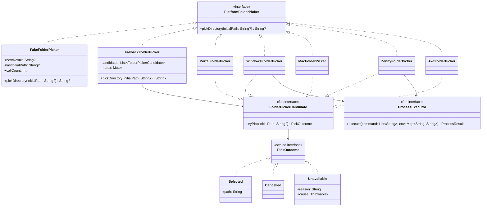

# Mimir: Архитектурная спецификация нативных диалогов выбора папки и автообнаружения хранилищ (`:libs:ui`, `:apps:desktop`, `:apps:android`)

**Дата:** 2026-11-04 (актуализировано 2026-11-06)  
**Статус:** Approved  
**Область:** `:apps:desktop`, `:libs:ui`, `:apps:android`, кроссплатформенный UX

---

## 1. Замысел и цели

### 1.1 Мотивация и контекст
При первоначальной настройке приложения Mimir (Setup Wizard, шаг [`VaultStep.kt`](file:///home/gidragir/projects/mimir/libs/ui/src/commonMain/kotlin/dev/mimir/ui/screens/setup/VaultStep.kt)) пользователю требуется выбрать локальную папку заметок Obsidian. Для этого в интерфейсе предусмотрены список автоматически обнаруженных хранилищ ([`LocalVaultDiscovery`](file:///home/gidragir/projects/mimir/libs/ui/src/commonMain/kotlin/dev/mimir/ui/platform/VaultDiscovery.kt)) и кнопка «Обзор…» ([`LocalFolderPicker`](file:///home/gidragir/projects/mimir/libs/ui/src/commonMain/kotlin/dev/mimir/ui/picker/PlatformFolderPicker.kt)).

Проблемы исходной реализации:
1. **Отсутствие нативного Проводника на Windows и Finder на macOS:** фабрика `defaultFolderPicker()` в [`PortalFolderPicker.kt`](file:///home/gidragir/projects/mimir/apps/desktop/src/main/kotlin/dev/mimir/desktop/picker/PortalFolderPicker.kt) на всех не-Linux ОС возвращала [`AwtFolderPicker`](file:///home/gidragir/projects/mimir/apps/desktop/src/main/kotlin/dev/mimir/desktop/picker/AwtFolderPicker.kt) (`JFileChooser` в устаревшем стиле Java Metal без системного Look & Feel и без привязки к родительскому `Frame` окна Mimir).
2. **Отсутствие промежуточного фоллбэка на Linux:** при недоступности D-Bus XDG Desktop Portal (минималистичные WM, контейнеры) `PortalFolderPicker` сразу падал в Swing `JFileChooser`, игнорируя системные утилиты `zenity` и `kdialog`.
3. **Смешение отмены и ошибки в контракте адаптеров:** отсутствие типизированного результата попытки (`PickOutcome`) и ручное дублирование `fallback` в каждом классе усложняли разграничение пользовательской отмены (`Cancel` → вернуть `null`) и сбоя подсистемы (`Unavailable` → перейти к следующему адаптеру).
4. **Отсутствие `VaultDiscovery` на Desktop:** [`VaultStep.kt`](file:///home/gidragir/projects/mimir/libs/ui/src/commonMain/kotlin/dev/mimir/ui/screens/setup/VaultStep.kt) умеет показывать кнопки быстрого выбора хранилищ из `LocalVaultDiscovery`, но в [`apps/desktop/Main.kt`](file:///home/gidragir/projects/mimir/apps/desktop/src/main/kotlin/dev/mimir/desktop/Main.kt) провайдер не передавался, хотя настольный Obsidian хранит точный реестр всех открытых хранилищ в системном `obsidian.json`.
5. **Кроссплатформенные шероховатости в [`VaultStep.kt`](file:///home/gidragir/projects/mimir/libs/ui/src/commonMain/kotlin/dev/mimir/ui/screens/setup/VaultStep.kt) и тестах:**
   - Имя папки для кнопки быстрого выбора извлекалось только по `/`, не поддерживая разделитель Windows `\`.
   - Кнопка «Обзор…» не блокировалась на время ожидания системного диалога (`picking`), что позволяло двойным кликом открыть два окна проводника подряд.
   - У порта [`PlatformFolderPicker`](file:///home/gidragir/projects/mimir/libs/ui/src/commonMain/kotlin/dev/mimir/ui/picker/PlatformFolderPicker.kt) отсутствовал тестовый двойник `FakeFolderPicker` в `:libs:ui`.

---

### 1.2 Цели
1. **Настоящий Проводник Windows:** вызывать стандартный диалог выбора папки Windows 10/11 (`FolderBrowserDialog` с `AutoUpgradeEnabled = true` в режиме `-Sta`), передавая право переднего плана через [`PlatformFocus.allowForegroundTransfer()`](file:///home/gidragir/projects/mimir/apps/desktop/src/main/kotlin/dev/mimir/desktop/PlatformFocus.kt#L42-L59).
2. **Нативный Finder на macOS:** открывать системный лист/диалог Finder (`NSOpenPanel`) через `java.awt.FileDialog` с флагом `apple.awt.fileDialogForDirectories = "true"` и привязкой к родительскому `Frame` окна Mimir.
3. **Многоуровневая цепочка на Linux:** `PortalFolderPicker` (XDG Desktop Portal) → `ZenityFolderPicker` (`zenity` → `kdialog`) → `AwtFolderPicker`.
4. **Детерминированный компоновщик `FallbackFolderPicker` + `PickOutcome`:** разделить исходы `Selected(path)`, `Cancelled` и `Unavailable` через `sealed interface PickOutcome` и защитить вызов от повторного входа через `Mutex`.
5. **Автообнаружение хранилищ Obsidian на Desktop (`DesktopObsidianVaultDiscovery`):** парсить `obsidian.json` на Windows (`%APPDATA%\obsidian\obsidian.json`), macOS (`~/Library/Application Support/obsidian/obsidian.json`) и Linux (`~/.config/obsidian/obsidian.json` + Flatpak) для выбора хранилища в один клик.
6. **Тестовый двойник `FakeFolderPicker` и защита кнопки в `VaultStep`:** устранить анонимные стабы в UI-тестах, блокировать кнопку «Обзор…» на время открытия диалога и корректно отображать имена папок с `\` на Windows.

---

### 1.3 Не-цели
- Внедрение сторонних бинарных C++/JNI библиотек.
- Создание собственного эмулятора файлового менеджера внутри Compose UI.
- Поддержка мультивыбора каталогов.

---

### 1.4 Анти-цели
- Показ мерцающих черных окон консоли при вызове диалога на Windows.
- Каскадное открытие запасных диалогов (`kdialog`, `JFileChooser`), когда пользователь сам нажал `Cancel` или `Esc`.
- Открытие двух системных диалогов одновременно при быстром двойном клике по кнопке «Обзор…».
- Принудительное убийство открытого диалога по короткому таймауту.

---

## 2. Инварианты Mimir

### 2.1 Платформы

| Платформа | Выбор папки (`LocalFolderPicker`) | Автообнаружение (`LocalVaultDiscovery`) |
|---|---|---|
| **Windows** | `WindowsFolderPicker` (PowerShell `-Sta -WindowStyle Hidden -EncodedCommand` + `PlatformFocus.allowForegroundTransfer()`) → фоллбэк `AwtFolderPicker` (System L&F + owner `Frame`) | `DesktopObsidianVaultDiscovery`: чтение `%APPDATA%\obsidian\obsidian.json` |
| **macOS** | `MacFolderPicker` (`java.awt.FileDialog` с `apple.awt.fileDialogForDirectories = "true"` и owner `Frame`) → фоллбэк `AwtFolderPicker` | `DesktopObsidianVaultDiscovery`: чтение `~/Library/Application Support/obsidian/obsidian.json` |
| **Linux** | `PortalFolderPicker` (XDG Portal D-Bus) → `ZenityFolderPicker` (`zenity`, затем `kdialog`) → `AwtFolderPicker` | `DesktopObsidianVaultDiscovery`: чтение `$XDG_CONFIG_HOME/obsidian/obsidian.json`, `~/.config/obsidian/obsidian.json` и Flatpak `~/.var/app/md.obsidian.Obsidian/config/obsidian/obsidian.json` |
| **Android** | [`AndroidFolderPicker`](file:///home/gidragir/projects/mimir/apps/android/src/main/kotlin/dev/mimir/android/platform/AndroidFolderPicker.kt) (`DocumentsUI` через SAF `OpenDocumentTree`) | [`FileSystemVaultDiscovery`](file:///home/gidragir/projects/mimir/apps/android/src/main/kotlin/dev/mimir/android/platform/FileSystemVaultDiscovery.kt) (сканирование `.obsidian` в корнях хранилища) |
| **Docker / Web UI / Extension / Obsidian Plugin** | Неприменимо (`LocalFolderPicker == null`: в Docker/Web UI путь задаётся текстом/env, в расширении нет локальной ФС, в плагине путь известен из API Obsidian) | Неприменимо (`LocalVaultDiscovery == null`) |

### 2.2 Дизайн
- **Паттерны (согласно `mimir-design-patterns`):**
  1. **Порт и Адаптер + Тестовый двойник:** порт [`PlatformFolderPicker`](file:///home/gidragir/projects/mimir/libs/ui/src/commonMain/kotlin/dev/mimir/ui/picker/PlatformFolderPicker.kt) и `FakeFolderPicker` в `:libs:ui`; порт [`VaultDiscovery`](file:///home/gidragir/projects/mimir/libs/ui/src/commonMain/kotlin/dev/mimir/ui/platform/VaultDiscovery.kt) в `:libs:ui` и `DesktopObsidianVaultDiscovery` в `:apps:desktop`.
  2. **`sealed` + исчерпывающий `when`:** `sealed interface PickOutcome` (`Selected`, `Cancelled`, `Unavailable`) внутри `:apps:desktop` исключает путаницу между отменой пользователем и недоступностью утилиты.
  3. **Компоновщик + Single-Flight Декоратор (`FallbackFolderPicker`):** единый класс обходит список `FolderPickerCandidate` под защитой `Mutex` (`tryLock`), убирая поле `fallback` и дублирующиеся `try/catch` из отдельных адаптеров.
  4. **Тестируемые побочные эффекты через параметры по умолчанию:** `ProcessExecutor` и `defaultFolderPicker(osName, executor, parentFrame)` по эталону [`SystemBrowserOpener.kt`](file:///home/gidragir/projects/mimir/apps/desktop/src/main/kotlin/dev/mimir/desktop/SystemBrowserOpener.kt).
- **Эталонные классы:** [`PortalFolderPicker.kt`](file:///home/gidragir/projects/mimir/apps/desktop/src/main/kotlin/dev/mimir/desktop/picker/PortalFolderPicker.kt), [`SystemBrowserOpener.kt`](file:///home/gidragir/projects/mimir/apps/desktop/src/main/kotlin/dev/mimir/desktop/SystemBrowserOpener.kt), [`FileSystemVaultDiscovery.kt`](file:///home/gidragir/projects/mimir/apps/android/src/main/kotlin/dev/mimir/android/platform/FileSystemVaultDiscovery.kt).

### 2.3 IO
- **Диспетчеры:** все вызовы D-Bus, `ProcessBuilder`, `EventQueue.invokeAndWait` и чтение `obsidian.json` выполняются на `Dispatchers.IO`.
- **Внешние процессы:** `ProcessExecutor` читает `stdout` в UTF-8, отбрасывает `stderr` (`Redirect.DISCARD`), не накладывает искусственный короткий таймаут на интерактивное окно и при отмене корутины (`CancellationException`) немедленно вызывает `process.destroyForcibly()`.
- **Сетевой IO:** 0 вызовов Google Drive API, 0 байт трафика.

### 2.4 UX
- **Автообнаружение хранилищ:** при открытии шага выбора папки на Desktop пользователь сразу видит список своих существующих хранилищ Obsidian из `obsidian.json` (если Obsidian установлен) с человекочитаемым именем папки на любой ОС (`/` и `\`).
- **Состояния кнопки «Обзор…»:**
  - *Ожидание (Idle):* кнопка активна.
  - *Диалог открыт (`picking = true`):* кнопка «Обзор…» заблокирована (`enabled = !busy && !picking`), повторные клики игнорируются; поверх окна Mimir открыт нативный проводник ОС.
  - *Выбор подтверждён (`Selected`):* путь подставляется в поле ввода, запускается `configure(picked)`, показывается плашка `✓ Найдено заметок: N`.
  - *Выбор отменён (`Cancelled`):* диалог закрывается, прежнее значение поля и состояние экрана не меняются, запасные диалоги не всплывают.
  - *Ошибка подсистемы (`Unavailable`):* `FallbackFolderPicker` прозрачно запускает следующий адаптер цепочки.

---

## 3. Архитектура и контракты

### 3.1 Диаграмма классов подсистемы выбора папки



---

### 3.2 Внутренний контракт `PickOutcome`, `FolderPickerCandidate` и `FallbackFolderPicker`

В `apps/desktop/src/main/kotlin/dev/mimir/desktop/picker/FallbackFolderPicker.kt`:

```kotlin
package dev.mimir.desktop.picker

import dev.mimir.ui.picker.PlatformFolderPicker
import kotlinx.coroutines.CancellationException
import kotlinx.coroutines.sync.Mutex
import java.io.File
import java.util.logging.Level
import java.util.logging.Logger

internal const val FOLDER_PICKER_TITLE = "Выберите папку хранилища"

sealed interface PickOutcome {
    data class Selected(val path: String) : PickOutcome
    data object Cancelled : PickOutcome
    data class Unavailable(val reason: String, val cause: Throwable? = null) : PickOutcome
}

fun interface FolderPickerCandidate : PlatformFolderPicker {
    suspend fun tryPick(initialPath: String?): PickOutcome

    override suspend fun pickDirectory(initialPath: String?): String? =
        when (val outcome = tryPick(initialPath)) {
            is PickOutcome.Selected -> outcome.path
            PickOutcome.Cancelled -> null
            is PickOutcome.Unavailable -> null
        }
}

class FallbackFolderPicker(
    internal val candidates: List<FolderPickerCandidate>,
) : PlatformFolderPicker {
    constructor(vararg candidates: FolderPickerCandidate) : this(candidates.toList())

    private val mutex = Mutex()

    override suspend fun pickDirectory(initialPath: String?): String? {
        if (!mutex.tryLock()) return null
        try {
            for (candidate in candidates) {
                val outcome = try {
                    candidate.tryPick(initialPath)
                } catch (e: CancellationException) {
                    throw e
                } catch (e: Throwable) {
                    PickOutcome.Unavailable("${candidate::class.simpleName} threw exception", e)
                }
                when (outcome) {
                    is PickOutcome.Selected -> return outcome.path
                    PickOutcome.Cancelled -> return null
                    is PickOutcome.Unavailable -> {
                        logger.log(Level.INFO, "Folder picker candidate unavailable: ${outcome.reason}", outcome.cause)
                    }
                }
            }
            return null
        } finally {
            mutex.unlock()
        }
    }

    private companion object {
        private val logger = Logger.getLogger(FallbackFolderPicker::class.java.name)
    }
}

/** Общее разрешение существующего начального каталога для всех десктопных пикеров. */
internal fun resolveExistingDirectory(initialPath: String?): File? {
    if (initialPath.isNullOrBlank()) return null
    val file = File(initialPath.trim())
    return when {
        file.isDirectory -> file
        file.parentFile?.isDirectory == true -> file.parentFile
        else -> null
    }
}
```

---

### 3.3 Контракт `ProcessExecutor`

В `apps/desktop/src/main/kotlin/dev/mimir/desktop/picker/ProcessExecutor.kt`:

```kotlin
package dev.mimir.desktop.picker

data class ProcessResult(
    val exitCode: Int,
    val stdout: String,
)

fun interface ProcessExecutor {
    suspend fun execute(
        command: List<String>,
        env: Map<String, String>,
    ): ProcessResult
}
```

Реализация по умолчанию `runSystemProcess(command, env)`:
- Исполняется на `Dispatchers.IO` через `suspendCancellableCoroutine` (или блокирующий `waitFor` с `invokeOnCancellation { process.destroyForcibly() }`).
- Настраивает `redirectError(ProcessBuilder.Redirect.DISCARD)` и читает `inputStream.bufferedReader(Charsets.UTF_8).readText()`.
- При отсутствии исполняемого файла выбрасывает `IOException`.

---

### 3.4 Реализация под Windows (`WindowsFolderPicker`)

1. Перед запуском процесса вызывается `allowForeground()` (по умолчанию — [`PlatformFocus.allowForegroundTransfer()`](file:///home/gidragir/projects/mimir/apps/desktop/src/main/kotlin/dev/mimir/desktop/PlatformFocus.kt#L42-L59)), что разрешает дочернему `powershell.exe` вывести окно проводника поверх окна Mimir.
2. Скрипт кодируется в UTF-16LE Base64 (`-EncodedCommand`), исключая любые проблемы с кодовыми страницами `CP866`/`CP1251` и экранированием кавычек:
   ```powershell
   Add-Type -AssemblyName System.Windows.Forms
   [Console]::OutputEncoding = [System.Text.Encoding]::UTF8
   $dialog = New-Object System.Windows.Forms.FolderBrowserDialog
   $dialog.Description = 'Выберите папку хранилища'
   $dialog.UseDescriptionForTitle = $true
   $dialog.ShowNewFolderButton = $true
   $dialog.AutoUpgradeEnabled = $true
   $init = $env:MIMIR_INITIAL_PATH
   if (![string]::IsNullOrWhiteSpace($init) -and (Test-Path -LiteralPath $init -PathType Container)) {
       $dialog.SelectedPath = $init
   }
   $top = New-Object System.Windows.Forms.Form
   $top.TopMost = $true
   $top.ShowInTaskbar = $false
   $null = $top.Handle
   try {
       if ($dialog.ShowDialog($top) -eq [System.Windows.Forms.DialogResult]::OK) {
           [Console]::Out.Write($dialog.SelectedPath)
       }
   } finally {
       $top.Dispose()
       $dialog.Dispose()
   }
   ```
3. Команда: `listOf("powershell.exe", "-NoProfile", "-NonInteractive", "-Sta", "-WindowStyle", "Hidden", "-EncodedCommand", encodedScript)`.
4. Начальный путь передаётся через `env = initialDir?.let { mapOf("MIMIR_INITIAL_PATH" to it.absolutePath) }.orEmpty()`.
5. Интерпретация результата:
   - `exitCode == 0`: если `stdout.trim()` непустой → `PickOutcome.Selected(stdout.trim())`; если пустой → `PickOutcome.Cancelled`.
   - `exitCode != 0` или `IOException` → `PickOutcome.Unavailable(...)`.

---

### 3.5 Реализация под Linux (`PortalFolderPicker` и `ZenityFolderPicker`)

1. **[`PortalFolderPicker`](file:///home/gidragir/projects/mimir/apps/desktop/src/main/kotlin/dev/mimir/desktop/picker/PortalFolderPicker.kt):**
   - Реализует `FolderPickerCandidate`.
   - Если `NameHasOwner("org.freedesktop.portal.Desktop") == false` или D-Bus выбросил исключение → возвращает `PickOutcome.Unavailable(...)`.
   - Когда сигнал `PortalRequest.Response` приходит с `response == 0` и валидным `file://` URI → `PickOutcome.Selected(path)`.
   - Когда сигнал приходит с `response != 0` (код `1` — отмена пользователем в портале) → `PickOutcome.Cancelled`.
2. **`ZenityFolderPicker`:**
   - Последовательно пробует `zenity` и `kdialog` через `ProcessExecutor`:
     - Команда `zenity`: `buildList { add("zenity"); add("--file-selection"); add("--directory"); add("--title=$FOLDER_PICKER_TITLE"); resolveExistingDirectory(initialPath)?.let { add("--filename=${it.absolutePath.trimEnd('/')}/") } }`
     - Команда `kdialog`: `buildList { add("kdialog"); add("--title"); add(FOLDER_PICKER_TITLE); add("--getexistingdirectory"); resolveExistingDirectory(initialPath)?.let { add(it.absolutePath) } }`
   - Правило интерпретации для каждой утилиты:
     - `exitCode == 0` и `stdout.trim().isNotEmpty()` → `PickOutcome.Selected(stdout.trim())`
     - `exitCode == 0` (пустой вывод) или `exitCode == 1` (пользователь нажал `Cancel` / `Esc`) → **немедленный возврат `PickOutcome.Cancelled`** (вторая утилита и `AwtFolderPicker` не вызываются!).
     - `exitCode !in 0..1` (например, `255` при ошибке GTK/дисплея) или `IOException` (утилита не установлена) → переход к следующей CLI-утилите, а после обеих — `PickOutcome.Unavailable("Neither zenity nor kdialog is available")`.

---

### 3.6 Реализация под macOS (`MacFolderPicker`) и доработка [`AwtFolderPicker`](file:///home/gidragir/projects/mimir/apps/desktop/src/main/kotlin/dev/mimir/desktop/picker/AwtFolderPicker.kt)

Оба класса принимают `private val parentFrame: () -> Frame? = { null }` (в [`Main.kt`](file:///home/gidragir/projects/mimir/apps/desktop/src/main/kotlin/dev/mimir/desktop/Main.kt) передаётся `{ window }`):

1. **`MacFolderPicker`:**
   - Внутри `withContext(Dispatchers.IO)` → `EventQueue.invokeAndWait` устанавливает `apple.awt.fileDialogForDirectories = "true"`, создаёт `FileDialog(parentFrame(), FOLDER_PICKER_TITLE, FileDialog.LOAD)`, выставляет `directory = resolveExistingDirectory(initialPath)?.absolutePath`, показывает диалог и в `finally` вызывает `dialog.dispose()` и восстанавливает системное свойство.
   - Если `dialog.files?.firstOrNull()` (или `File(dir, file)`) не `null` → `PickOutcome.Selected(path)`, иначе `PickOutcome.Cancelled`.
   - При исключении (`HeadlessException`) → `PickOutcome.Unavailable(...)`.
2. **[`AwtFolderPicker`](file:///home/gidragir/projects/mimir/apps/desktop/src/main/kotlin/dev/mimir/desktop/picker/AwtFolderPicker.kt):**
   - Перед созданием `JFileChooser` активирует `UIManager.setLookAndFeel(UIManager.getSystemLookAndFeelClassName())`.
   - Устанавливает `dialogTitle = FOLDER_PICKER_TITLE`, вызывает `chooser.showOpenDialog(parentFrame())`.
   - При `APPROVE_OPTION` возвращает `PickOutcome.Selected(chooser.selectedFile.absolutePath)`, иначе `PickOutcome.Cancelled`.

---

### 3.7 Фабрика `defaultFolderPicker()`

```kotlin
fun defaultFolderPicker(
    osName: String = System.getProperty("os.name").orEmpty(),
    executor: ProcessExecutor = ProcessExecutor(::runSystemProcess),
    parentFrame: () -> Frame? = { null },
): PlatformFolderPicker {
    val os = osName.lowercase()
    val awt = AwtFolderPicker(parentFrame = parentFrame)
    return when {
        os.contains("win") -> FallbackFolderPicker(
            WindowsFolderPicker(executor = executor),
            awt,
        )
        os.contains("mac") || os.contains("darwin") -> FallbackFolderPicker(
            MacFolderPicker(parentFrame = parentFrame),
            awt,
        )
        os.contains("linux") -> FallbackFolderPicker(
            PortalFolderPicker(),
            ZenityFolderPicker(executor = executor),
            awt,
        )
        else -> awt
    }
}
```

---

### 3.8 Автообнаружение хранилищ на Desktop (`DesktopObsidianVaultDiscovery`)

В `apps/desktop/src/main/kotlin/dev/mimir/desktop/picker/DesktopObsidianVaultDiscovery.kt` реализуется порт [`VaultDiscovery`](file:///home/gidragir/projects/mimir/libs/ui/src/commonMain/kotlin/dev/mimir/ui/platform/VaultDiscovery.kt):
- Определяет кандидаты путей к `obsidian.json` (принимается в конструкторе для тестирования):
  - Windows: `%APPDATA%\obsidian\obsidian.json`
  - macOS: `~/Library/Application Support/obsidian/obsidian.json`
  - Linux: `$XDG_CONFIG_HOME/obsidian/obsidian.json`, `~/.config/obsidian/obsidian.json`, `~/.var/app/md.obsidian.Obsidian/config/obsidian/obsidian.json`
- Формат `obsidian.json` (стандарт Obsidian Desktop):
  ```json
  {
    "vaults": {
      "a1b2c3d4": { "path": "/home/user/Notes", "ts": 1700000000000, "open": true }
    }
  }
  ```
- Парсит `vaults` через `kotlinx.serialization.json.Json { ignoreUnknownKeys = true }`, сортирует по убыванию `ts` (сначала открытые `open == true`), фильтрует только реально существующие на диске директории (`File(path).isDirectory`) и возвращает `List<String>` без дубликатов.
- Подключается в [`apps/desktop/Main.kt`](file:///home/gidragir/projects/mimir/apps/desktop/src/main/kotlin/dev/mimir/desktop/Main.kt) через `LocalVaultDiscovery provides vaultDiscovery`.

---

### 3.9 Тестовый двойник `FakeFolderPicker` и доработка [`VaultStep.kt`](file:///home/gidragir/projects/mimir/libs/ui/src/commonMain/kotlin/dev/mimir/ui/screens/setup/VaultStep.kt)

1. **`FakeFolderPicker` в [`PlatformFolderPicker.kt`](file:///home/gidragir/projects/mimir/libs/ui/src/commonMain/kotlin/dev/mimir/ui/picker/PlatformFolderPicker.kt):**
   ```kotlin
   class FakeFolderPicker(
       var nextResult: String? = null,
   ) : PlatformFolderPicker {
       var lastInitialPath: String? = null
           private set
       var callCount: Int = 0
           private set

       override suspend fun pickDirectory(initialPath: String?): String? {
           callCount++
           lastInitialPath = initialPath
           return nextResult
       }
   }
   ```
2. **Исправления в [`VaultStep.kt`](file:///home/gidragir/projects/mimir/libs/ui/src/commonMain/kotlin/dev/mimir/ui/screens/setup/VaultStep.kt):**
   - Извлечение имени папки для отображения кнопок обнаруженных хранилищ с поддержкой и `/`, и `\`:
     `internal fun vaultDisplayName(vaultPath: String): String = vaultPath.trimEnd('/', '\\').substringAfterLast('/').substringAfterLast('\\').ifEmpty { vaultPath }`
   - Состояние `var picking by remember { mutableStateOf(false) }` блокирует кнопку «Обзор…» (`enabled = !busy && !picking`) на всё время работы `picker.pickDirectory(...)`.

---

## 4. План валидации и тестирования

### 4.1 Модульные тесты `:apps:desktop` (`apps/desktop/src/test/kotlin/dev/mimir/desktop/picker/`)
1. **`FallbackFolderPickerTest`**:
   - Возвращает путь первого кандидата при `PickOutcome.Selected`.
   - Останавливает цепочку и возвращает `null` при `PickOutcome.Cancelled` (второй кандидат не вызывается).
   - Переходит ко второму кандидату при `PickOutcome.Unavailable` или выброшенном исключении.
   - Пробрасывает `CancellationException` без вызова следующих кандидатов.
   - Защищает от параллельного повторного вызова (`Mutex`).
2. **`WindowsFolderPickerTest`**:
   - Декодирование `-EncodedCommand` (UTF-16LE Base64) подтверждает наличие `-Sta`, `AutoUpgradeEnabled = $true` и `FOLDER_PICKER_TITLE`.
   - Передача существующего `initialPath` в `env["MIMIR_INITIAL_PATH"]`.
   - Вызов `allowForeground()` перед стартом процесса.
   - Маппинг `exitCode == 0` + путь → `Selected`, `exitCode == 0` + пусто → `Cancelled`, `exitCode != 0` / `IOException` → `Unavailable`.
3. **`ZenityFolderPickerTest`**:
   - Возврат `Selected` при `exitCode == 0` от `zenity` (с обрезкой `\n`).
   - Возврат `Cancelled` при `exitCode == 1` от `zenity` **без** вызова `kdialog`.
   - Переход к `kdialog` при `IOException` или `exitCode == 255` от `zenity`.
   - Возврат `Cancelled` при `exitCode == 1` от `kdialog`.
   - Возврат `Unavailable` при недоступности обеих утилит.
4. **`MacFolderPickerTest`**:
   - Проброс `CancellationException`.
   - Возврат `Unavailable` при `HeadlessException` и гарантированное восстановление свойства `apple.awt.fileDialogForDirectories`.
5. **`DefaultFolderPickerRoutingTest`**:
   - Проверка состава кандидатов `FallbackFolderPicker` для `"Windows 11"`, `"Mac OS X"`, `"Linux"`, `"FreeBSD"` через параметр `osName`.
6. **`DesktopObsidianVaultDiscoveryTest`**:
   - Парсинг `obsidian.json`, сортировка (`open = true` и более свежий `ts` выше), фильтрация несуществующих каталогов, устойчивость к битому JSON и отсутствующему файлу.

### 4.2 Модульные тесты `:libs:ui` (`libs/ui/src/desktopTest/kotlin/dev/mimir/ui/`)
1. Перевод [`SetupWizardScreenTest.kt`](file:///home/gidragir/projects/mimir/libs/ui/src/desktopTest/kotlin/dev/mimir/ui/SetupWizardScreenTest.kt) и [`UiScreenshotTest.kt`](file:///home/gidragir/projects/mimir/libs/ui/src/desktopTest/kotlin/dev/mimir/ui/screenshots/UiScreenshotTest.kt) на `FakeFolderPicker`.
2. Проверка `vaultDisplayName` на путях Unix (`/home/user/MyVault/`) и Windows (`C:\Users\user\MyVault\`).

---

## 5. Затронутые файлы и структура

| Файл | Назначение |
|---|---|
| [2026-11-04-cross-platform-native-folder-picker-design.md](file:///home/gidragir/projects/mimir/docs/superpowers/specs/2026-11-04-cross-platform-native-folder-picker-design.md) | Данная спецификация |
| [PlatformFolderPicker.kt](file:///home/gidragir/projects/mimir/libs/ui/src/commonMain/kotlin/dev/mimir/ui/picker/PlatformFolderPicker.kt) | Контракт `PlatformFolderPicker`, `LocalFolderPicker` и тестовый двойник `FakeFolderPicker` |
| [VaultStep.kt](file:///home/gidragir/projects/mimir/libs/ui/src/commonMain/kotlin/dev/mimir/ui/screens/setup/VaultStep.kt) | Блокировка кнопки на время `picking` и кроссплатформенный `vaultDisplayName` (`/` и `\`) |
| `apps/desktop/src/main/kotlin/dev/mimir/desktop/picker/FallbackFolderPicker.kt` | `PickOutcome`, `FolderPickerCandidate`, `FallbackFolderPicker` (с `Mutex`), `resolveExistingDirectory`, `defaultFolderPicker()` |
| `apps/desktop/src/main/kotlin/dev/mimir/desktop/picker/ProcessExecutor.kt` | Контракт `ProcessExecutor`, `ProcessResult` и `runSystemProcess` |
| `apps/desktop/src/main/kotlin/dev/mimir/desktop/picker/WindowsFolderPicker.kt` | Нативный проводник Windows через PowerShell (`-Sta`, `-EncodedCommand`, `AutoUpgradeEnabled`) |
| `apps/desktop/src/main/kotlin/dev/mimir/desktop/picker/MacFolderPicker.kt` | Нативный диалог Finder (`NSOpenPanel`) для macOS с привязкой к `Frame` |
| `apps/desktop/src/main/kotlin/dev/mimir/desktop/picker/ZenityFolderPicker.kt` | Системный диалог Linux через `zenity` / `kdialog` |
| [PortalFolderPicker.kt](file:///home/gidragir/projects/mimir/apps/desktop/src/main/kotlin/dev/mimir/desktop/picker/PortalFolderPicker.kt) | Адаптация под `FolderPickerCandidate` и `PickOutcome` |
| [AwtFolderPicker.kt](file:///home/gidragir/projects/mimir/apps/desktop/src/main/kotlin/dev/mimir/desktop/picker/AwtFolderPicker.kt) | Системный Look & Feel, привязка к `parentFrame` и `FolderPickerCandidate` |
| `apps/desktop/src/main/kotlin/dev/mimir/desktop/picker/DesktopObsidianVaultDiscovery.kt` | Автообнаружение хранилищ Obsidian из системного `obsidian.json` (Windows/macOS/Linux) |
| [Main.kt](file:///home/gidragir/projects/mimir/apps/desktop/src/main/kotlin/dev/mimir/desktop/Main.kt) | Передача `{ window }` в `defaultFolderPicker` и регистрация `LocalVaultDiscovery` |
| `apps/desktop/src/test/kotlin/dev/mimir/desktop/picker/*Test.kt` | Модульные тесты всех адаптеров, компоновщика, маршрутизации и автообнаружения |
