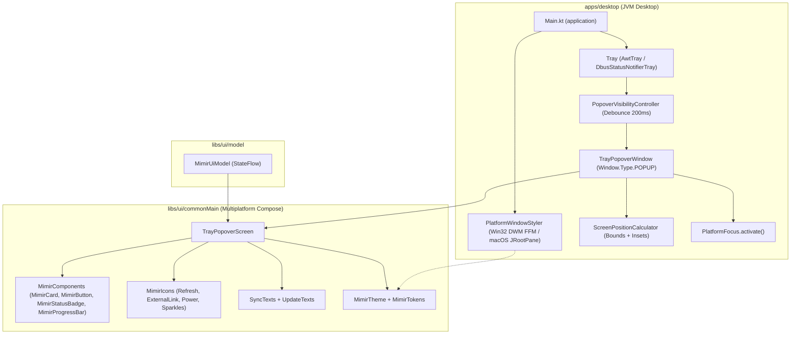

# Mimir: Архитектурная спецификация нативной стилизации окна и кроссплатформенного трей-поповера (`:apps:desktop`, `:libs:ui`)

**Дата:** 2026-11-06 (актуализировано по итогам архитектурного ревью)  
**Статус:** Согласовано (Builder-Checked)  
**Область:** `:apps:desktop`, `:libs:ui`, дизайн-система `MimirTokens`, кроссплатформенный десктопный UX  
**Родительская спека:** `docs/superpowers/specs/2026-10-23-mimir-design.md`, `docs/superpowers/specs/2026-10-24-mimir-desktop-design.md`, `docs/superpowers/specs/2026-10-24-mimir-desktop-polish-design.md`

---

## 1. Замысел и цели

### 1.1 Мотивация и контекст
Mimir — клиент синхронизации хранилищ Obsidian с шифрованием поверх Google Drive. Интерфейс приложения построен на базе дизайн-системы Obsidian (`design/tokens.json` → [`MimirTokens.kt`](file:///home/gidragir/projects/mimir/libs/ui/src/commonMain/kotlin/dev/mimir/ui/MimirTokens.kt), [`MimirTheme.kt`](file:///home/gidragir/projects/mimir/libs/ui/src/commonMain/kotlin/dev/mimir/ui/MimirTheme.kt), [`MimirComponents.kt`](file:///home/gidragir/projects/mimir/libs/ui/src/commonMain/kotlin/dev/mimir/ui/components/MimirComponents.kt)).

Текущее десктопное окружение ([`Main.kt`](file:///home/gidragir/projects/mimir/apps/desktop/src/main/kotlin/dev/mimir/desktop/Main.kt)) страдает от двух заметных артефактов системного оформления:
1. **Контрастный белый заголовок окна ОС на Windows и неинтегрированная шапка на macOS:**
   - В [`Main.kt`](file:///home/gidragir/projects/mimir/apps/desktop/src/main/kotlin/dev/mimir/desktop/Main.kt#L123-L130) окно создаётся стандартным вызовом `androidx.compose.ui.window.Window` без передачи цветовой темы в оконный менеджер ОС. В результате на Windows поверх глубокой тёмной темы Mimir (`MimirTokens.DarkSurface = #262626`) отображается слепяще-белая системная полоса Win32.
   - Попытка решить это в лоб через `undecorated = true` на стандартном OpenJDK 27 (без JetBrains Runtime или Electron) превращает окно в `WS_POPUP`, ломая нативные возможности ОС: меню раскладки **Windows 11 Snap Layouts (`Win+Z`)**, аппаратные скругления углов и тени DWM, плавный ресайз без дрожания (jitter) на мультимониторных конфигурациях с разным DPI, а в тайлинговых композиторах Linux (niri, Sway) добавляет лишнюю внутреннюю шапку с мёртвыми кнопками сворачивания/разворачивания.
2. **Архаичное системное меню трея:**
   - Реализация [`AwtTray.kt`](file:///home/gidragir/projects/mimir/apps/desktop/src/main/kotlin/dev/mimir/desktop/tray/AwtTray.kt) использует нативный `java.awt.PopupMenu` с `java.awt.MenuItem`, а [`createTray()`](file:///home/gidragir/projects/mimir/apps/desktop/src/main/kotlin/dev/mimir/desktop/tray/Tray.kt#L24-L32) отключает трей на macOS (`NoTray`).
   - На Windows `java.awt.PopupMenu` рисует серый прямоугольник классического Win32 без поддержки тёмной темы, прогресс-баров и карточек состояния.
   - Пользователь не может быстро оценить состояние хранилища (статус, путь к папке, время последней синхронизации, прогресс и конфликты) без открытия главного окна.

Цель спецификации — спроектировать:
- **Нативную стилизацию системного окна ОС (`PlatformWindowStyler`)** при сохранении `undecorated = false` и 100% нативной физики оконного менеджера (окрашивание шапки и рамки в точные цвета `MimirTokens` через JDK 27 FFM `DwmSetWindowAttribute` на Windows, прозрачный интегрированный `fullWindowContent` на macOS, нативное поведение тайлинга на Linux).
- **Кроссплатформенный трей-поповер (`TrayPopoverWindow` + `TrayPopoverScreen`)**, переиспользующий готовые компоненты [`MimirComponents.kt`](file:///home/gidragir/projects/mimir/libs/ui/src/commonMain/kotlin/dev/mimir/ui/components/MimirComponents.kt) и контракт [`MimirUiModel`](file:///home/gidragir/projects/mimir/libs/ui/src/commonMain/kotlin/dev/mimir/ui/model/MimirUiModel.kt) на Windows, Linux (Wayland/X11) и macOS.

---

### 1.2 Цели
1. **Нативная стилизация рамки главного окна (`PlatformWindowStyler`):**
   - Главное окно сохраняет `undecorated = false` и все системные возможности ОС (ресайз композитором, Snap Layouts `Win+Z`, тени, скругление углов, жесты macOS, чистый тайлинг без лишних шапок в niri/Sway).
   - **Windows 10/11:** через стандартный JDK 27 Foreign Function & Memory API (`java.lang.foreign` → `dwmapi.dll` `DwmSetWindowAttribute`) системный заголовок окрашивается точно в цвет `MimirTokens.DarkSurface` (`#262626`) / `LightSurface` (`#F8F8F8`), текст заголовка — в `DarkText` / `LightText`, внешняя рамка — в `DarkBorder` / `LightBorder`, системные кнопки переключаются в `DWMWA_USE_IMMERSIVE_DARK_MODE`.
   - **macOS:** через свойства `JRootPane` (`apple.awt.fullWindowContent = true`, `apple.awt.transparentTitleBar = true`, `apple.awt.windowTitleVisible = false`, `NSAppearanceNameDarkAqua` / `NSAppearanceNameAqua`) заголовок становится прозрачным и сливается с фоном `MimirTheme`, сохраняя нативные кнопки «светофора» слева.
   - **Linux:** композитор (niri, Sway, Hyprland, KDE Plasma, GNOME) управляет рамкой окна нативно без дублирующих внутренних заголовков и кнопок.
2. **Информативный трей-поповер на базе готовых компонентов `:libs:ui`:**
   - Клик по иконке трея открывает плавающее окно `TrayPopoverWindow` (`Window.Type.POPUP`) с экраном `TrayPopoverScreen(model: MimirUiModel?, ...)`.
   - Экран строится исключительно из существующих примитивов дизайн-системы (`MimirCard`, `MimirStatusBadge`, `MimirProgressBar`, `MimirButton`, `MimirIcons`) и форматирования [`SyncTexts`](file:///home/gidragir/projects/mimir/libs/ui/src/commonMain/kotlin/dev/mimir/ui/screens/SyncTexts.kt) / [`UpdateTexts`](file:///home/gidragir/projects/mimir/libs/ui/src/commonMain/kotlin/dev/mimir/ui/model/UpdateTexts.kt).
   - Поддерживаются все обязательные состояния UX: запуск/инициализация (`model == null`), не настроено/заблокировано (`NotConfigured` / `isLocked`), покой (`Idle`), сканирование и применение (`Syncing`), нет сети (`Offline`), ошибка/конфликты (`Error` / `conflicts`), доступное обновление (`UpdateUiState`).
3. **Кроссплатформенность трея без сюрпризов:**
   - **Windows:** позиционирование поповера у системного трея с учётом панели задач (`ScreenInsets`); одиночный клик по `TrayIcon` переключает поповер с защитой от повторного открытия при потере фокуса (`PopoverVisibilityController`, debounce 200 мс); вывод главного окна через [`PlatformFocus.activate`](file:///home/gidragir/projects/mimir/apps/desktop/src/main/kotlin/dev/mimir/desktop/PlatformFocus.kt).
   - **Linux:** поповер создаётся с `Window.Type.POPUP`, чтобы тайлинговые композиторы (niri, Sway) не встраивали его в сетку колонок. **Ruling (2026-11-07, проверка на niri):** под niri X11-клиенты идут через xwayland-satellite, который показывает override-redirect окно только как xdg_popup сфокусированного X11-окна приложения — поповер невидим или обрезан. Там `PopoverBehavior` выбирает окно `NORMAL` фиксированного размера (niri делает его плавающим) без закрытия по потере фокуса; Esc закрывает по отпусканию (Xwayland повторяет «залипшее» нажатие). В [`DbusStatusNotifierTray`](file:///home/gidragir/projects/mimir/apps/desktop/src/main/kotlin/dev/mimir/desktop/tray/DbusStatusNotifierTray.kt) сигнал `Activate(x, y)` переключает Compose-поповер с передачей координат клика, а `DbusMenu` сохраняется для правого клика (`ContextMenu`) и панелей без поддержки оконных поповеров.
   - **macOS:** включение `AwtTray` в [`createTray()`](file:///home/gidragir/projects/mimir/apps/desktop/src/main/kotlin/dev/mimir/desktop/tray/Tray.kt); позиционирование поповера под строкой меню macOS (вверху справа).

---

### 1.3 Не-цели
- Эмуляция клиентских декораций окна (`undecorated = true`, кастомные кнопки Min/Max/Close и программный `WindowResizer` через `window.setBounds`) на стандартном OpenJDK 27.
- Создание отдельной `TrayPopoverViewModel` или дублирование бизнес-логики вне [`MimirUiModel`](file:///home/gidragir/projects/mimir/libs/ui/src/commonMain/kotlin/dev/mimir/ui/model/MimirUiModel.kt) и [`SyncTexts`](file:///home/gidragir/projects/mimir/libs/ui/src/commonMain/kotlin/dev/mimir/ui/screens/SyncTexts.kt).
- Просмотр и редактирование заметок внутри трей-поповера.
- Использование сторонних JNI/JNA библиотек или привязка к закрытому API JetBrains Runtime (`JBR`).
- Отказ от `DbusMenu` на Linux: экспорт меню по D-Bus остаётся запасным путём для системных панелей.

---

### 1.4 Анти-цели
- Прямой импорт `java.awt.*` или `androidx.compose.ui.window.*` в `commonMain` модуля `:libs:ui` (сломает сборку `wasmJs` и `android`).
- Использование emoji (`📁`, `🕒`, `↻`, `✕`) вместо чётких векторных иконок [`MimirIcons`](file:///home/gidragir/projects/mimir/libs/ui/src/commonMain/kotlin/dev/mimir/ui/components/MimirIcons.kt).
- Хардкод тёмных токенов (`MimirTokens.DarkSurface`) напрямую в экранах вместо семантических цветов [`MaterialTheme.colorScheme`](file:///home/gidragir/projects/mimir/libs/ui/src/commonMain/kotlin/dev/mimir/ui/MimirTheme.kt), поддерживающих обе темы (Dark и Light).
- Ломание нативного Aero Snap / Snap Layouts (`Win+Z`) на Windows 11 или создание лишней внутренней шапки окна в тайлинговых композиторах Linux (niri, Sway).

---

## 2. Инварианты Mimir

### 2.1 Платформы

| Цель | Главное окно (`PlatformWindowStyler`) | Трей и поповер (`Tray` + `TrayPopoverWindow`) |
| :--- | :--- | :--- |
| **Linux desktop** (Wayland niri/Sway, KDE, GNOME, X11) | `undecorated = false`, `_JAVA_AWT_WM_NONREPARENTING=1`. В тайлинговых WM (niri, Sway) композитор рисует только рамку фокуса без лишней внутренней шапки и мёртвых кнопок Min/Max; в KDE/GNOME используется нативная декорация среды. | [`DbusStatusNotifierTray`](file:///home/gidragir/projects/mimir/apps/desktop/src/main/kotlin/dev/mimir/desktop/tray/DbusStatusNotifierTray.kt): левый клик (`Activate(x, y)`) переключает `TrayPopoverWindow` (`Window.Type.POPUP`), правый клик открывает нативный `DbusMenu` (запасной путь для панелей). При отсутствии `StatusNotifierWatcher` — `available = false`, закрытие окна завершает процесс. |
| **Windows desktop** (10/11, MSI) | `undecorated = false`. `PlatformWindowStyler` через JDK 27 FFM (`dwmapi.dll` `DwmSetWindowAttribute`) включает `DWMWA_USE_IMMERSIVE_DARK_MODE (20)` и окрашивает заголовок (`DWMWA_CAPTION_COLOR = 35`), текст (`36`) и рамку (`34`) в цвета `MimirTokens` (`#262626` / `#F8F8F8`), сохраняя Snap Layouts (`Win+Z`), тени, скругление углов и плавный ресайз. | [`AwtTray`](file:///home/gidragir/projects/mimir/apps/desktop/src/main/kotlin/dev/mimir/desktop/tray/AwtTray.kt) без устаревшего `java.awt.PopupMenu`: одиночный клик по `TrayIcon` (`MouseAdapter`) передаёт координаты клика и переключает `TrayPopoverWindow` над панелью задач. Двойной клик открывает главное окно через [`PlatformFocus.activate`](file:///home/gidragir/projects/mimir/apps/desktop/src/main/kotlin/dev/mimir/desktop/PlatformFocus.kt). |
| **macOS desktop** (`.app` / DMG) | `PlatformWindowStyler` выставляет на `JRootPane` свойства `apple.awt.fullWindowContent = true`, `apple.awt.transparentTitleBar = true`, `apple.awt.windowTitleVisible = false` и `NSAppearanceNameDarkAqua` / `Aqua`, сливая фон окна с областью системных кнопок «светофора». | [`AwtTray`](file:///home/gidragir/projects/mimir/apps/desktop/src/main/kotlin/dev/mimir/desktop/tray/AwtTray.kt) включён в [`createTray()`](file:///home/gidragir/projects/mimir/apps/desktop/src/main/kotlin/dev/mimir/desktop/tray/Tray.kt) для `Mac OS X`. Поповер позиционируется под строкой меню в правом верхнем углу экрана (`insets.top`). |
| **Android / Docker / JS-клиенты** | Неприменимо: в Android — системный Edge-to-Edge (`safeDrawingPadding()`), в Docker — headless без UI, в Web/Obsidian/Extension — окно браузера или вкладка Obsidian. | Неприменимо: системный трей десктопа отсутствует (на Android работает `StatusNotifier` через системные уведомления, в расширении — badge иконки браузера). |

### 2.2 Дизайн
* **Паттерны (`mimir-design-patterns`):**
  1. **UDF и единая модель (`StateFlow`):** `TrayPopoverScreen` не создаёт собственной ViewModel и читает реактивное состояние напрямую из [`MimirUiModel`](file:///home/gidragir/projects/mimir/libs/ui/src/commonMain/kotlin/dev/mimir/ui/model/MimirUiModel.kt) (эталон — [`StatusScreen.kt`](file:///home/gidragir/projects/mimir/libs/ui/src/commonMain/kotlin/dev/mimir/ui/screens/StatusScreen.kt)).
  2. **Чистый UI в `:libs:ui/commonMain` + платформенные адаптеры в `:apps:desktop`:**
     - В `libs/ui/src/commonMain` живут чистые `@Composable` без зависимости от AWT: `TrayPopoverScreen` и векторные иконки в [`MimirIcons`](file:///home/gidragir/projects/mimir/libs/ui/src/commonMain/kotlin/dev/mimir/ui/components/MimirIcons.kt).
     - В `apps/desktop/src/main` живут платформенные компоненты: `PlatformWindowStyler` (по образцу [`PlatformFocus.kt`](file:///home/gidragir/projects/mimir/apps/desktop/src/main/kotlin/dev/mimir/desktop/PlatformFocus.kt)), `TrayPopoverWindow`, `PopoverVisibilityController`, `ScreenPositionCalculator`, `Tray` (`AwtTray`, `DbusStatusNotifierTray`).
  3. **Тестируемые побочные эффекты и чистые вычисления:** расчёт координат поповера `ScreenPositionCalculator.calculate(...)`, преобразование цветов `toWin32ColorRef(color)` и контроллер анти-дребезга фокуса (`PopoverVisibilityController`) оформляются чистыми классами/функциями без зависимости от живого `GraphicsEnvironment` или Win32 API.
* **Переиспользование готовых компонентов:**
  - Карточки — [`MimirCard`](file:///home/gidragir/projects/mimir/libs/ui/src/commonMain/kotlin/dev/mimir/ui/components/MimirComponents.kt#L197-L208).
  - Статус — [`MimirStatusBadge`](file:///home/gidragir/projects/mimir/libs/ui/src/commonMain/kotlin/dev/mimir/ui/components/MimirComponents.kt#L211-L258).
  - Прогресс — [`MimirProgressBar`](file:///home/gidragir/projects/mimir/libs/ui/src/commonMain/kotlin/dev/mimir/ui/components/MimirComponents.kt#L261-L284).
  - Кнопки — [`MimirButton`](file:///home/gidragir/projects/mimir/libs/ui/src/commonMain/kotlin/dev/mimir/ui/components/MimirComponents.kt#L54-L137) (`Primary`, `Secondary`, `Ghost`).
  - Тексты — [`SyncTexts`](file:///home/gidragir/projects/mimir/libs/ui/src/commonMain/kotlin/dev/mimir/ui/screens/SyncTexts.kt) и [`UpdateTexts`](file:///home/gidragir/projects/mimir/libs/ui/src/commonMain/kotlin/dev/mimir/ui/model/UpdateTexts.kt).

### 2.3 IO
* **Вызовы Google Drive API и дисковый IO:** 0 вызовов, 0 байт.
* **Потоки и реактивность:** UI подписывается на `StateFlow` модели (`status`, `progress`, `vaultPath`, `lastSyncTime`, `updateState`, `conflicts`, `isLocked`, `connectionStatus`).
* **Экономия ресурсов в фоне:** пока `TrayPopoverWindow` скрыт (`visible = false`), композиция содержимого поповера и секундный тикер времени `produceState` (`now`) **не выполняются** (рендеринг тела оборачивается в `if (visible)`), поэтому в свёрнутом состоянии нагрузка на CPU и GPU равна 0%.

### 2.4 UX

#### Сценарий пользователя
1. **Работа с главным окном:** пользователь запускает Mimir → видит нативное окно ОС, шапка и рамка которого окрашены точно в тон темы Obsidian (`#262626` в тёмной теме, `#F8F8F8` в светлой). Все привычные жесты ОС (`Win+Z`, прилипание к краям, ресайз за любую границу, тайлинг в niri/Sway, «светофор» на macOS) работают нативно. Закрытие окна при активном трее скрывает его в трей.
2. **Быстрая проверка через трей:** пользователь кликает по иконке Mimir в трее → мгновенно над областью уведомлений открывается `TrayPopoverWindow` (`320.dp` шириной). Пользователь видит статус, путь к хранилищу, время последней синхронизации или живой прогресс-бар.
3. **Действия из поповера:** пользователь может запустить синхронизацию кнопкой «Синхронизировать сейчас», развернуть главное окно («Открыть Mimir»), перейти к обновлению или выйти из приложения. Клик вне поповера, нажатие `Esc` или повторный клик по иконке трея закрывают поповер.

#### Таблица обязательных состояний `TrayPopoverScreen` (`mimir-ui-ux`)

| Состояние | Условие | Что видит пользователь в поповере | Доступные действия |
| :--- | :--- | :--- | :--- |
| **Запуск (Инициализация)** | `model == null` и `startupError == null` | Шапка Mimir + `MimirCard` с неопределённым `MimirProgressBar(null)` и текстом «Запуск…» | «Открыть Mimir», «Выход» |
| **Ошибка запуска** | `model == null` и `startupError != null` | Шапка с точкой ошибки + карточка с человекочитаемым описанием сбоя старта | «Открыть Mimir», «Выход» |
| **Не настроено / Заблокировано** | `status == SyncStatus.NotConfigured` или `vaultPath == null` или `isLocked == true` | `MimirStatusBadge(status)`, пояснение («Хранилище не подключено» / «Хранилище заблокировано») | Primary-кнопка «Настроить Mimir» (открывает главное окно), «Выход» |
| **Покой (Успех)** | `status == SyncStatus.Idle` | `MimirStatusBadge(Idle)`, карточка хранилища (имя папки, путь с `TextOverflow.Ellipsis`, `SyncTexts.whenFinished`), при наличии проблем прошлого прогона — строка `SyncTexts.problemsTitle` | Primary «Синхронизировать сейчас», Secondary «Открыть Mimir», Ghost «Выход» |
| **Долгая операция (Синхронизация)** | `status == SyncStatus.Syncing` | `MimirStatusBadge(Syncing)`, карточка прогресса: при `Scanning`/`Comparing` — `MimirProgressBar(null)` и `SyncTexts.scanned(...)`; при `Applying` — `MimirProgressBar(done/total)`, `SyncTexts.counter(done, total)` и текущий файл `SyncTexts.actionNow(item)` | Кнопка «Синхронизация…» в состоянии `loading = true` (`enabled = false`), «Открыть Mimir» |
| **Нет сети (Offline)** | `status == SyncStatus.Offline` | `MimirStatusBadge(Offline)`, карточка хранилища + подсказка `SyncTexts.OFFLINE_HINT` | «Синхронизировать сейчас» (`enabled = false`), «Открыть Mimir», «Выход» |
| **Ошибка синхронизации** | `status is SyncStatus.Error` | `MimirStatusBadge(Error)`, заголовок `SyncTexts.errorTitle(status.kind)` (без сырого `e.message`!) | Primary «Открыть Mimir» (для повторного входа или просмотра деталей), «Выход» |
| **Конфликты / Обновление** | `conflicts.isNotEmpty()` или `trayUpdateLabel(updateState) != null` | Компактный баннер конфликтов (`SyncTexts.notificationConflict(conflicts.size)`) и/или плашка обновления (`UpdateTexts.available(version)`) | Клик по баннеру открывает главное окно и закрывает поповер |

---

## 3. Архитектура и компоненты

### 3.1 Диаграмма компонентов



---

## 4. Детальный дизайн компонентов

### 4.1 Расширение векторных иконок (`MimirIcons`)

В [`libs/ui/src/commonMain/kotlin/dev/mimir/ui/components/MimirIcons.kt`](file:///home/gidragir/projects/mimir/libs/ui/src/commonMain/kotlin/dev/mimir/ui/components/MimirIcons.kt) добавляются геометрически точные векторные иконки для `TrayPopoverScreen` (24×24 viewport, `StrokeCap.Round`/`StrokeJoin.Round`, без единого emoji):
- `Refresh`: круговые стрелки синхронизации.
- `ExternalLink`: иконка открытия главного окна.
- `Power`: иконка выхода из приложения.
- `Sparkles`: иконка доступного обновления.

---

### 4.2 Нативная стилизация системного окна (`PlatformWindowStyler`)

В `apps/desktop/src/main/kotlin/dev/mimir/desktop/window/PlatformWindowStyler.kt` создаётся платформенный стилизатор окна (по образцу [`PlatformFocus.kt`](file:///home/gidragir/projects/mimir/apps/desktop/src/main/kotlin/dev/mimir/desktop/PlatformFocus.kt)):

```kotlin
package dev.mimir.desktop.window

import androidx.compose.ui.graphics.Color
import dev.mimir.ui.MimirTokens
import java.awt.Window

object PlatformWindowStyler {
    fun apply(
        window: Window,
        isDark: Boolean,
        osName: String = System.getProperty("os.name").orEmpty(),
    )

    /** Преобразует Compose Color в Win32 COLORREF (0x00BBGGRR). */
    internal fun toWin32ColorRef(color: Color): Int
}
```

**Детали реализации по платформам:**
1. **Windows 10/11 (JDK 27 Foreign Function & Memory API — `user32.dll` + `dwmapi.dll`):**
   - Получение `HWND` окна без рефлексии в закрытые пакеты `sun.awt.*`: через `user32.dll` (`FindWindowExW` по классу `SunAwtFrame` с проверкой `GetWindowThreadProcessId(hwnd, &pid) == ProcessHandle.current().pid()`, либо `GetActiveWindow()`).
   - Вызов `DwmSetWindowAttribute(hwnd, dwAttribute, pvAttribute, cbAttribute = 4)`:
     - `DWMWA_USE_IMMERSIVE_DARK_MODE = 20`: `1` при `isDark == true`, иначе `0` (работает на Windows 10 20H1+ и Windows 11).
     - `DWMWA_CAPTION_COLOR = 35`: `toWin32ColorRef(if (isDark) MimirTokens.DarkSurface else MimirTokens.LightSurface)` (`0x00262626` / `0x00F8F8F8`).
     - `DWMWA_TEXT_COLOR = 36`: `toWin32ColorRef(if (isDark) MimirTokens.DarkText else MimirTokens.LightText)` (`0x00DEDCDC` / `0x002E2E2E`).
     - `DWMWA_BORDER_COLOR = 34`: `toWin32ColorRef(if (isDark) MimirTokens.DarkBorder else MimirTokens.LightBorder)` (`0x00363636` / `0x00D4D4D4`).
   - Вызов обёрнут в `runCatching` (graceful degradation на старых сборках Windows или при отсутствии `dwmapi.dll`).
2. **macOS (`javax.swing.RootPaneContainer`):**
   - На `rootPane` устанавливаются стандартные свойства:
     - `apple.awt.application.appearance` = `if (isDark) "NSAppearanceNameDarkAqua" else "NSAppearanceNameAqua"`
     - `apple.awt.fullWindowContent` = `true`
     - `apple.awt.transparentTitleBar` = `true`
     - `apple.awt.windowTitleVisible` = `false`
3. **Linux:**
   - Никакого вмешательства (`no-op`): оконный менеджер / Wayland-композитор управляет рамкой окна нативно.

---

### 4.3 Контракт трея и контроллер видимости поповера (`Tray` + `PopoverVisibilityController`)

#### Эволюция интерфейса `Tray` ([`apps/desktop/src/main/kotlin/dev/mimir/desktop/tray/Tray.kt`](file:///home/gidragir/projects/mimir/apps/desktop/src/main/kotlin/dev/mimir/desktop/tray/Tray.kt))

Чтобы поддержать как открытие поповера по клику с координатами иконки, так и прямое открытие главного окна из резервного системного меню (`DbusMenu`), контракт `Tray` дополняется:

```kotlin
package dev.mimir.desktop.tray

/** Экранные координаты клика по иконке трея (если платформа их сообщает). */
data class TrayClickAnchor(val screenX: Int, val screenY: Int)

interface Tray {
    val available: Boolean

    fun show(
        status: String,
        onOpen: () -> Unit,
        onSyncNow: () -> Unit,
        onQuit: () -> Unit,
        /** Клик по самой иконке трея; по умолчанию делегирует в [onOpen]. */
        onActivate: (TrayClickAnchor?) -> Unit = { onOpen() },
    )

    fun update(status: String)
    fun setUpdate(label: String?, onClick: () -> Unit) = Unit
    fun close()
}
```

1. **Актуализация [`createTray()`](file:///home/gidragir/projects/mimir/apps/desktop/src/main/kotlin/dev/mimir/desktop/tray/Tray.kt#L24-L32):**
   - Поддержка Windows и macOS через `AwtTray`, Linux — через `DbusStatusNotifierTray`:
   ```kotlin
   fun createTray(
       osName: String = System.getProperty("os.name").orEmpty(),
       awtTraySupported: () -> Boolean = { java.awt.SystemTray.isSupported() },
       dbusTray: () -> Tray = { DbusStatusNotifierTray() },
   ): Tray = when {
       (osName.startsWith("Windows") || osName.startsWith("Mac") || osName.contains("OS X")) && awtTraySupported() -> AwtTray()
       osName.startsWith("Linux") -> dbusTray()
       else -> NoTray()
   }
   ```
2. **Обновление [`AwtTray`](file:///home/gidragir/projects/mimir/apps/desktop/src/main/kotlin/dev/mimir/desktop/tray/AwtTray.kt):**
   - Конструктор `TrayIcon(image, status, /* popup = */ null)` создаётся **без нативного `java.awt.PopupMenu`**, что полностью устраняет устаревшее серое меню Win32.
   - Добавляется `MouseAdapter`:
     - При `mouseReleased` с `e.clickCount == 1` вызывается `onActivate(TrayClickAnchor(e.xOnScreen, e.yOnScreen))`.
     - При двойном левом клике (`e.clickCount >= 2 && SwingUtilities.isLeftMouseButton(e)`) вызывается `onOpen()` (разворачивает главное окно).
3. **Обновление [`DbusStatusNotifierTray`](file:///home/gidragir/projects/mimir/apps/desktop/src/main/kotlin/dev/mimir/desktop/tray/DbusStatusNotifierTray.kt):**
   - В `Item.Activate(x: Int, y: Int)` вызывается `onActivate(TrayClickAnchor(x, y).takeIf { x > 0 || y > 0 })`.
   - Экспорт `DbusMenu` полностью сохраняется: правый клик по иконке в панели Linux (Waybar, KDE Plasma, GNOME AppIndicator) открывает системное меню с пунктами «Открыть», «Синхронизировать сейчас», «Выход» и строкой обновления из [`bindUpdateItem`](file:///home/gidragir/projects/mimir/apps/desktop/src/main/kotlin/dev/mimir/desktop/tray/TrayUpdates.kt).

#### Защита от дребезга фокуса (`PopoverVisibilityController`)

На всех десктопных ОС клик по иконке в системном трее при уже открытом поповере сначала переводит системный фокус на панель задач (срабатывает `windowLostFocus` → поповер закрывается), а через 10–50 мс доставляет событие `onActivate` от иконки трея. Без фильтрации поповер тут же откроется заново.

```kotlin
class PopoverVisibilityController(
    private val debounceMs: Long = 200L,
    private val clockMillis: () -> Long = System::currentTimeMillis,
) {
    var visible: Boolean = false
        private set
    var lastAnchor: TrayClickAnchor? = null
        private set
    private var lastFocusLostAtMs: Long = -1_000L

    fun onFocusLost(): Boolean {
        if (visible) {
            visible = false
            lastFocusLostAtMs = clockMillis()
        }
        return visible
    }

    fun onTrayActivate(anchor: TrayClickAnchor?): Boolean {
        lastAnchor = anchor
        if (!visible && (clockMillis() - lastFocusLostAtMs) in 0..<debounceMs) {
            return false
        }
        visible = !visible
        return visible
    }

    fun dismiss() {
        visible = false
    }
}
```

---

### 4.4 Позиционирование поповера (`ScreenPositionCalculator`)

Чистый калькулятор в `apps/desktop/src/main/kotlin/dev/mimir/desktop/tray/ScreenPositionCalculator.kt` принимает геометрию экрана, отступы панели задач (`ScreenInsets`), размер поповера (`320×380 px` с учётом DPI) и опциональный `TrayClickAnchor`:

```kotlin
data class ScreenGeometry(
    val bounds: Rectangle,
    val insets: Insets,
)

object ScreenPositionCalculator {
    fun calculate(
        screen: ScreenGeometry,
        popoverSize: Dimension,
        anchor: TrayClickAnchor? = null,
        margin: Int = 8,
        osName: String = System.getProperty("os.name").orEmpty(),
    ): Point
}
```

**Правила расчёта:**
1. Рабочая область экрана (`workArea`) вычисляется вычитанием `insets` из `bounds`:
   - `left = bounds.x + insets.left`
   - `top = bounds.y + insets.top`
   - `right = bounds.x + bounds.width - insets.right`
   - `bottom = bounds.y + bounds.height - insets.bottom`
2. Если передан `anchor != null`:
   - По горизонтали: окно центрируется относительно `anchor.screenX` (`x = anchor.screenX - popoverSize.width / 2`).
   - По вертикали: если `anchor.screenY` находится в верхней половине экрана — окно ставится под верхней панелью (`top + margin`), иначе — над нижней панелью (`bottom - popoverSize.height - margin`).
3. Если `anchor == null` (или `(0, 0)` под Wayland без координат SNI):
   - Определяется положение панели задач по `insets`:
     - Если `insets.top > insets.bottom` или `osName` — macOS / Linux с верхней панелью (GNOME): правый верхний угол (`x = right - popoverSize.width - margin`, `y = top + margin`).
     - Если `insets.left > insets.right` и панель слева: левый нижний/верхний угол у внутренней границы панели (`x = left + margin`).
     - По умолчанию (Windows / KDE / панель снизу): правый нижний угол (`x = right - popoverSize.width - margin`, `y = bottom - popoverSize.height - margin`).
4. Результат жёстко зажимается (`coerceIn`) в границы `[left + margin, right - popoverSize.width - margin]` и `[top + margin, bottom - popoverSize.height - margin]`, гарантируя отсутствие выхода за пределы экрана.

---

### 4.5 Экран поповера (`TrayPopoverScreen`)

В `libs/ui/src/commonMain/kotlin/dev/mimir/ui/screens/TrayPopoverScreen.kt` создаётся компактный экран шириной `320.dp`:

```kotlin
@Composable
fun TrayPopoverScreen(
    model: MimirUiModel?,
    startupError: String? = null,
    onOpenMainWindow: () -> Unit,
    onQuit: () -> Unit,
    clock: Clock = Clock.System,
    modifier: Modifier = Modifier,
)
```

**Визуальная структура и переиспользование компонентов:**
1. **Контейнер поповера:**
   - `Surface` / `MimirCard` с `RoundedCornerShape(MimirTokens.Radius8)`, обводкой `ObsidianStyle.panelBorder()` (`1.dp`) и внутренним отступом `MimirTokens.Space16`.
2. **Шапка (`Row`):**
   - Название `BuildConfig.APP_NAME` (`MaterialTheme.typography.titleMedium`) слева.
   - Готовый компонент [`MimirStatusBadge(status)`](file:///home/gidragir/projects/mimir/libs/ui/src/commonMain/kotlin/dev/mimir/ui/components/MimirComponents.kt#L211-L258) справа (`testTag = "popover_status_badge"`).
3. **Карточка хранилища и состояния (`MimirCard`):**
   - Если хранилище настроено (`vaultPath != null` и `!isLocked`):
     - Иконка `MimirIcons.Folder` (`16.dp`, `MimirTokens.Accent`) + имя конечной папки хранилища (`MaterialTheme.typography.labelLarge`) + полный путь (`MaterialTheme.typography.bodySmall`, `color = onSurfaceVariant`, `maxLines = 1`, `overflow = TextOverflow.Ellipsis`).
     - Строка статуса фазы из `SyncTexts.phaseTitle(status, progress, needsSignIn)` или время последней синхронизации `SyncTexts.whenFinished(lastSync, now)`.
   - Если идёт синхронизация (`status == SyncStatus.Syncing`):
     - Готовый [`MimirProgressBar`](file:///home/gidragir/projects/mimir/libs/ui/src/commonMain/kotlin/dev/mimir/ui/components/MimirComponents.kt#L261-L284) (неопределённый при `Scanning`/`Comparing`, детерминированный `done.toFloat() / total` при `Applying`).
     - Счётчик `SyncTexts.counter(p.done, p.total)` и текущий файл `p.current?.let { SyncTexts.actionNow(it) }` (`maxLines = 1`, `TextOverflow.Ellipsis`).
   - Если хранилище не настроено или заблокировано:
     - Иконка `MimirIcons.Lock` / `MimirIcons.Cloud` + поясняющий текст и призыв открыть настройку.
4. **Компактные плашки внимания (опционально, если активны):**
   - Если `conflicts.isNotEmpty()`: компактная строка с предупреждением `SyncTexts.notificationConflict(conflicts.size)`, клик вызывает `onOpenMainWindow()`.
   - Если доступно или готово к установке обновление (`UpdateUiState.Available` / `ReadyToInstall`): акцентная плашка (`MimirTokens.Accent.copy(alpha = 0.14f)`) с иконкой `MimirIcons.Sparkles` и текстом `UpdateTexts.available(version)`, клик вызывает `onOpenMainWindow()`.
5. **Панель быстрых действий (`Column`, `spacedBy(MimirTokens.Space8)`):**
   - Если хранилище настроено и не заблокировано:
     - `MimirButton(text = if (syncing) SyncTexts.SYNCING else SyncTexts.SYNC_NOW, onClick = { scope.launch { model.triggerSync() } }, variant = MimirButtonVariant.Primary, loading = syncing, enabled = status == SyncStatus.Idle, icon = { Icon(MimirIcons.Refresh, null, Modifier.size(16.dp)) }, modifier = Modifier.fillMaxWidth().testTag("popover_sync_button"))`.
   - Кнопка открытия главного окна:
     - `MimirButton(text = if (needsSetup) "Настроить Mimir" else "Открыть Mimir", onClick = onOpenMainWindow, variant = if (needsSetup) MimirButtonVariant.Primary else MimirButtonVariant.Secondary, icon = { Icon(MimirIcons.ExternalLink, null, Modifier.size(16.dp)) }, modifier = Modifier.fillMaxWidth().testTag("popover_open_button"))`.
   - Нижний ряд:
     - Выровненная вправо `MimirButton(text = "Выход", onClick = onQuit, variant = MimirButtonVariant.Ghost, icon = { Icon(MimirIcons.Power, null, Modifier.size(14.dp)) }, modifier = Modifier.testTag("popover_quit_button"))`.

---

## 5. Подходы и компромиссы (Approaches & Tradeoffs)

### 5.1 Оформление главного окна: Нативная стилизация (`PlatformWindowStyler`) vs Кастомный `undecorated = true` CSD

| Критерий | Вариант 1: `PlatformWindowStyler` (`undecorated = false` + FFM DWM / Cocoa) — **Выбранный** | Вариант 2: `undecorated = true` + Compose `MimirTitleBar` + `WindowResizer` |
| :--- | :--- | :--- |
| **Windows 11 Snap Layouts (`Win+Z`), тени и скругление углов** | **100% нативно:** сохраняются системные тени, аппаратное скругление углов, меню Snap Layouts и корректная максимизация | **Сломано в стандартном OpenJDK:** окно превращается в `WS_POPUP` без системной тени, без `Win+Z` и с перекрытием таскбара при максимизации |
| **Точность цвета под палитру Obsidian** | **100% совпадение:** `DWMWA_CAPTION_COLOR` красит заголовок ровно в `MimirTokens.DarkSurface` (`#262626`) / `LightSurface` (`#F8F8F8`), а на macOS заголовок прозрачен | Совпадение внутри Compose, но без системной тени окно сливается с нижележащими тёмными окнами |
| **Плавность ресайза и мультимониторный DPI** | **Аппаратный ресайз ОС** без единой строчки кода и без дрожания (jitter) на мониторах с разным масштабом | Сильное дрожание («эффект желе») при ресайзе за левый/верхний край из-за неатомарности `window.setBounds` и перерисовки Skia |
| **Linux (Wayland niri / Sway)** | **Идеально для тайлинга:** нет лишней внутренней шапки `36.dp` и мёртвых кнопок Min/Max | Лишняя шапка внутри тайла и конфликт `WindowDraggableArea` с геометрией XWayland |
| **Чистота `:libs:ui/commonMain`** | Не загрязняет общий KMP-модуль десктопными контролами окна | Требует держать десктопный `MimirTitleBar` в общем модуле |

### 5.2 Архитектура экрана поповера: Прямое использование `MimirUiModel` vs Отдельная `TrayPopoverViewModel`

| Критерий | Вариант 1: Прямой `MimirUiModel` + `SyncTexts` — **Выбранный** | Вариант 2: Отдельная `TrayPopoverViewModel` |
| :--- | :--- | :--- |
| **Дублирование кода** | **0 дублирования:** переиспользуются `MimirUiModel`, `FakeMimirUiModel`, `SyncTexts`, `UpdateTexts` | Дублирует подписки на `StateFlow` и логику форматирования, уже написанную в `StatusScreen` и `SyncTexts` |
| **Соответствие `mimir-design-patterns`** | Полное соответствие каталогу паттернов (UDF: экран читает `MimirUiModel`) | Лишний промежуточный слой, не предусмотренный архитектурой `:libs:ui` |

---

## 6. План тестирования и верификация

1. **Unit-тесты UI-состояний поповера (`libs/ui/src/desktopTest`):**
   - `TrayPopoverScreenTest`: проверка всех состояний таблицы UX на базе [`FakeMimirUiModel`](file:///home/gidragir/projects/mimir/libs/ui/src/commonMain/kotlin/dev/mimir/ui/model/FakeMimirUiModel.kt) (`model = null`, `NotConfigured`, `Idle`, `Syncing` в фазах `Scanning` и `Applying`, `Offline`, `Error`, наличие `conflicts` и `UpdateUiState.Available`).
2. **Unit-тесты стилизации окна, геометрии и анти-дребезга (`apps/desktop/src/test`):**
   - `PlatformWindowStylerTest`: проверка конвертации `toWin32ColorRef` (`MimirTokens.DarkSurface` → `0x00262626`, `MimirTokens.DarkText` → `0x00DEDCDC`), установки клиентских свойств `JRootPane` для macOS и безопасного вызова `apply` на разных `osName`.
   - `ScreenPositionCalculatorTest`: проверка расчёта координат для панели задач снизу (Windows/KDE), сверху (macOS/GNOME), слева/справа, позиционирования по `TrayClickAnchor` и зажатия координат (`clamp`) внутри рабочей области монитора.
   - `PopoverVisibilityControllerTest`: проверка переключения видимости и подавления повторного открытия в окне `200 мс` после `onFocusLost()`.
   - `TrayTest`: проверка выбора `AwtTray` на Windows и macOS и `DbusStatusNotifierTray` на Linux.
3. **Автоматизированная скриншотная верификация (`mise run screenshots` / [`UiScreenshotTest.kt`](file:///home/gidragir/projects/mimir/libs/ui/src/desktopTest/kotlin/dev/mimir/ui/screenshots/UiScreenshotTest.kt)):**
   - Снимки `TrayPopoverScreen` (Idle, Syncing, Error/Update) в тёмной (`ObsidianDarkColors`) и светлой (`ObsidianLightColors`) темах.

---

## 7. Чек-лист соответствия правилам Mimir

- [x] Модули и пути соответствуют структуре монорепо (`:apps:desktop`, `:libs:ui`).
- [x] Главное окно сохраняет `undecorated = false` и нативные механики ОС, окрашиваясь через `PlatformWindowStyler` (Win32 DWM FFM / macOS `JRootPane`).
- [x] `TrayPopoverScreen` в `:libs:ui/commonMain` не зависит от `java.awt.*` и `WindowScope` (не ломает `wasmJs` и `android`).
- [x] Переиспользованы готовые компоненты (`MimirCard`, `MimirButton`, `MimirStatusBadge`, `MimirProgressBar`, `MimirIcons`, `SyncTexts`, `UpdateTexts`) и контракт `MimirUiModel`.
- [x] Никаких emoji в UI — только векторные иконки `MimirIcons`.
- [x] Полная поддержка обеих тем (`Dark` и `Light`) через `MaterialTheme.colorScheme`.
- [x] Присутствуют все 4 обязательных раздела «Инварианты Mimir» (Платформы, Дизайн, IO, UX) и таблица всех состояний экрана.
