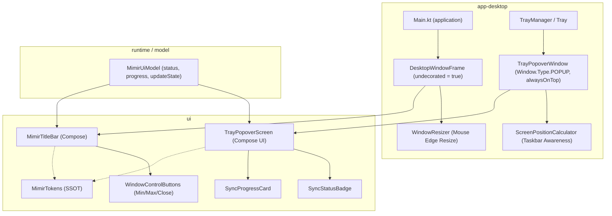

# Mimir: Архитектурная спецификация кастомного заголовка окна и кроссплатформенного трей-поповера (`:app-desktop`, `:ui`)

**Дата:** 2026-11-04  
**Статус:** Согласовано (Builder-Checked)  
**Область:** `app-desktop`, `ui`, дизайн-система `MimirTokens`, кроссплатформенный десктопный UX  
**Родительская спека:** `docs/superpowers/specs/2026-10-24-mimir-desktop-design.md`, `docs/superpowers/specs/2026-10-24-mimir-desktop-polish-design.md`

---

## 1. Замысел и цели

### 1.1 Мотивация и контекст
Mimir — клиент синхронизации хранилищ Obsidian с шифрованием на базе Google Drive. Интерфейс приложения построен на базе дизайн-системы в тёмных тонах Obsidian (`MimirTokens.DarkBase`, `DarkSurface`, `Accent = #705DCF`).

Однако текущее десктопное окружение страдает от двух заметных артефактов устаревшего системного оформления:
1. **Стандартный светлый заголовок окна ОС (Titlebar):**
   - На Windows окно создаётся стандартным вызовом `androidx.compose.ui.window.Window` с нативными декорациями ОС (`undecorated = false`). В результате поверх глубокой тёмной темы Mimir отображается контрастная белая системная полоса Windows с дефолтными системными кнопками и иконкой.
   - Это разрушает целостность интерфейса и противоречит стилистике современных инструментов заметок (Obsidian, VS Code, JetBrains IDE), использующих интегрированные бесшовные заголовки (Client-Side Decorations / CSD).
2. **Архаичное системное меню трея:**
   - Реализация [`AwtTray.kt`](file:///app-desktop/src/main/kotlin/dev/mimir/desktop/tray/AwtTray.kt) на Windows использует нативный `java.awt.PopupMenu` с `java.awt.MenuItem`.
   - Это создаёт серый угловатый прямоугольник классического Win32 (в стиле Windows 95) со статичным шрифтом без поддержки тёмной темы, ховеров, иконок и статусов.
   - Пользователь лишён возможности быстро оценить состояние хранилища (статус подключения, дату последней синхронизации, текущий прогресс синка) без разворачивания основного окна.

Цель данной спецификации — разработать:
- **Бесшовный кастомный заголовок окна на Compose (`MimirTitleBar`)** в стиле Obsidian для основного окна Mimir.
- **Полноценный кроссплатформенный трей-поповер (`TrayPopoverWindow`) на Compose**, работающий единообразно на Windows, Linux (под любыми композиторами: niri, Sway, GNOME, KDE, X11) и macOS.

---

### 1.2 Цели
1. **Интегрированный Titlebar (Obsidian CSD):**
   - Окно приложения выполняется без системных рамок (`undecorated = true`), а верхняя панель рисуется средствами Compose Multiplatform в токенах `MimirTokens`.
   - Заголовок окна бесшовно сливается с фоном приложения (`DarkSurface` / `DarkBase`), отображает миниатюрную иконку, название хранилища/приложения и кастомные кнопки управления («Свернуть», «Развернуть/Восстановить», «Закрыть»).
   - Поддержка перетаскивания окна за заголовок (`WindowDraggableArea`), двойного клика для максимизации и безопасного ресайза окна мышью за границы (`WindowResizer`).
2. **Информативный трей-виджет (поповер):**
   - Клик по иконке в трее открывает не голое меню, а плавающее окно Compose (`TrayPopover`), выполненное в едином визуальном стиле Mimir.
   - Содержимое поповера:
     - Шапка: логотип, индикатор текущего состояния (`Idle`, `Syncing`, `Offline`, `Error`) с цветовой индикацией.
     - Информационная карточка: имя локального хранилища, время последней успешной синхронизации («Только что», «N мин назад»).
     - Прогресс активной синхронизации: анимированный прогресс-бар, число обработанных файлов, имя текущего файла.
     - Быстрые действия: кнопка «Синхронизировать сейчас» (с индикатором), кнопка «Открыть окно Mimir», кнопка «Выход».
     - Баннер обновления: отображение плашки обновления приложения при наличии новой версии.
3. **Кроссплатформенность и поведение без сюрпризов:**
   - **Windows:** точное позиционирование поповера над панелью задач в правом нижнем углу; закрытие при потере фокуса (`windowLostFocus`) или клике мимо; бесшовный ресайз окна.
   - **Linux:** поддержка любых окружений (Wayland niri, Sway, Hyprland, GNOME Shell, KDE Plasma, X11). В тайлинговых композиторах заголовок не блокирует тайлинг; трей-поповер открывается с типом `Window.Type.POPUP` (не тайлится как отдельная колонка). Сохраняется параллельный экспорт `DbusMenu` для панелей, запрашивающих контекстное меню через D-Bus.
   - **macOS:** корректная интеграция с позицией менюбара (вверху справа); на окне учитывается специфика расположения контролов (traffic lights).
4. **Следование дизайн-системе:** 100% цветов, отступов и скруглений берутся из `MimirTokens` (`design/tokens.json`).

---

### 1.3 Не-цели
- Создание встроенного проводника файлов или просмотрщика заметок внутри трей-поповера (заметки открываются в Obsidian или основном окне Mimir).
- Использование тяжелых C-библиотек или платформенно-зависимых бинарников.
- Отказ от D-Bus интерфейса StatusNotifierItem на Linux: D-Bus меню остаётся доступным для панелей, не поддерживающих оконные поповеры.

---

### 1.4 Анти-цели
- Нестабильное позиционирование поповера (выход за пределы видимой области экрана или перекрытие панели задач).
- «Залипание» поповера на экране: поповер обязан надёжно закрываться при клике в любое другое место экрана или нажатии клавиши `Esc`.
- Ломание тайлинга на Linux (в тайлинговых WM типа niri окно не должно ломать сетку тайлинга).
- Потеря возможности ресайза окна при переходе на `undecorated = true`.

---

## 2. Инварианты Mimir

### 2.1 Платформы
* **Windows (10/11):**
  - Главное окно: `undecorated = true`. Ресайз окна реализуется прозрачной рамкой-перехватчиком мыши (`WindowResizer`) с изменением системного курсора (`Cursor.NW_RESIZE_CURSOR` и др.).
  - Трей-поповер: `ComposeWindow` без рамок, вычисляющий координаты над системным треем (`GraphicsEnvironment.localGraphicsEnvironment.maximumWindowBounds`). Перехват кликов по `TrayIcon` (AWT) с переключением видимости.
* **Linux (Wayland niri, Sway, GNOME, KDE, X11):**
  - Под Wayland / niri переменная `_JAVA_AWT_WM_NONREPARENTING=1` уже выставлена в лаунчерах.
  - В тайлинговых WM (niri, Sway) главное окно слушается правил тайлинга композитора. `WindowResizer` активен только в плавающем режиме (в тайлинге размеры диктуются WM, попытки изменения `window.bounds` не конфликтуют с композитором).
  - Трей-поповер конфигурируется с типом `java.awt.Window.Type.POPUP` — композиторы Wayland/XWayland трактуют его как всплывающий оверлей/поповер, а не как новое тайлинговое окно (не дробит рабочую область на колонки).
  - Для полной совместимости с DE (KDE, Waybar, GNOME AppIndicator) сохраняется экспорт `DbusMenu` по правому клику (`ContextMenu`), а левый клик (`Activate`) переключает Compose-поповер.
* **macOS:**
  - Трей-поповер позиционируется в правом верхнем углу (под панелью меню macOS).
  - Заголовок окна адаптирует отступы слева (`traffic lights` macOS), либо отображает гармоничные плоские кнопки Mimir.
* **Android / Headless / Web UI:**
  - Неприменимо для оконного менеджера десктопа (в Android используется нативная Activity с системным статус-баром, в Web UI — браузерное окружение, в Docker — headless без UI).

### 2.2 Дизайн
* **Паттерн:** Single Source of Truth (`MimirTokens`) + Компонентная архитектура Compose Multiplatform (UDF — Unidirectional Data Flow).
* **Модульная структура:**
  - `:ui`: чистые визуальные компоненты `MimirTitleBar`, `WindowControlButtons`, `TrayPopoverScreen`, не зависящие от ОС.
  - `:app-desktop`: интеграция с окнами AWT/Compose (`WindowResizer`, `TrayPopoverWindow`, `DesktopWindowFrame`, позиционирование по экрану).
* **Эталонные классы:**
  - `MimirTokens.kt` — источник цветов и радиусов.
  - `StatusScreen.kt` — эталон карточки хранилища и отображения статуса синхронизации.
  - `AwtTray.kt` / `DbusStatusNotifierTray.kt` — точки подключения событий клика трея.

### 2.3 IO
* **Вызовы Google Drive API:** 0 вызовов.
* **Сетевой трафик:** 0 байт.
* **Потоки:** Все UI-анимации и рендеринг выполняются строго на основном потоке Compose/AWT (`Dispatchers.Main`). Чтение статуса и прогресса — реактивно из существующих `StateFlow<SyncStatus>` и `StateFlow<SyncProgress?>` без поллинга.
* **Производительность:** Поповер не создаёт фоновых утечек памяти: при скрытии поповер скрывается (`isVisible = false`) и отписывается от тяжелых анимаций.

### 2.4 UX
* **Тайтлбар главного окна:**
  - Высота: `36 dp`.
  - Фон: `MimirTokens.DarkSurface` (тёмная тема) / `MimirTokens.LightSurface` (светлая тема) с тонкой нижней границей `MimirTokens.DarkBorder`.
  - Левая часть: логотип Mimir (16 dp) + название "Mimir" + опциональный бейдж vault (`MimirTokens.DarkTextMuted`).
  - Центральная часть: зона перетаскивания окна (`WindowDraggableArea`). Двойной клик переключает `WindowPlacement.Maximized` / `WindowPlacement.Floating`.
  - Правая часть: три кнопки 36x36 dp:
    - Свернуть (`—`): сворачивает окно в панель задач/трей. Hover: полупрозрачный белый/серый.
    - Развернуть/Восстановить (`□` / `❐`): переключает максимизацию. Hover: полупрозрачный белый/серый.
    - Закрыть (`✕`): если трей доступен, скрывает в трей (`visible = false`); иначе закрывает приложение. Hover: цвет ошибки `MimirTokens.StatusError` (`#E5736A`) с белой иконкой (классический десктопный UX).
* **Трей-поповер (размер 320x360 dp, скругление 8 dp, тень/граница 1 dp `DarkBorder`):**
  - Шапка: логотип + статусная точка (зелёная `StatusSuccess` / фиолетовая `Accent` / красная `StatusError` / серая `StatusOffline`) + текстовый статус («Все файлы актуальны», «Синхронизация…», «Офлайн»).
  - Карточка Vault: путь к локальной папке с красивой обрезкой, время последней синхронизации («Только что», «12 минут назад»).
  - Прогресс-бар: появляется плавно только при активном статусе `Syncing` (число обработанных файлов, имя текущего файла).
  - Баннер обновления: карточка с акцентным цветом `MimirTokens.Accent`, если доступна новая версия.
  - Панель действий:
    - «Синхронизировать сейчас» (Primary Button): запускает синк; если синк уже идёт — спиннер.
    - «Открыть Mimir» (Secondary Button): разворачивает главное окно и переводит на него фокус.
    - Кнопка «Выход»: аккуратная кнопка закрытия приложения в подвале.
  - Закрытие: при клике мимо окна или нажатии `Esc` поповер моментально закрывается.

---

## 3. Архитектура и компоненты

### 3.1 Диаграмма компонентов



---

## 4. Детальный дизайн компонентов

### 4.1 Кастомный тайтлбар окна (`MimirTitleBar`)

Модуль `:ui` объявляет кроссплатформенный компонент заголовка:

```kotlin
@Composable
fun WindowScope.MimirTitleBar(
    title: String = "Mimir",
    subtitle: String? = null,
    isMaximized: Boolean,
    onMinimize: () -> Unit,
    onMaximizeToggle: () -> Unit,
    onClose: () -> Unit,
    modifier: Modifier = Modifier,
)
```

1. **`WindowDraggableArea`:**
   Вся свободная поверхность тайтлбара оборачивается в `WindowDraggableArea`, что позволяет стандартным движением перетаскивать окно по экрану.
2. **Обработка двойного клика:**
   `Modifier.combinedClickable(onDoubleClick = onMaximizeToggle)` переключает состояние максимизации окна при двойном клике в свободной области.
3. **Кнопки управления (`WindowControlButtons`):**
   - Каждая кнопка имеет фиксированный размер `36.dp x 36.dp` для комфортного клика мышью.
   - Отрисовка векторная (простые геометрические линии и крестик через Compose Canvas/Path для максимальной четкости без размытия шрифтовых глифов).
   - Кнопка закрытия имеет подсветку красным фоном `MimirTokens.StatusError` при наведении курсора.

### 4.2 Ресайз окна без рамок (`WindowResizer`)

При `undecorated = true` нативная платформа отключает системные рамки изменения размера окна. Чтобы окно можно было свободно ресайзить за любой край и угол, в `:app-desktop` реализуется компонент/модификатор `WindowResizer`:
- Вокруг контента окна резервируется невидимая чувствительная зона шириной `5.dp`.
- Перемещение мыши над чувствительной зоной меняет курсор мыши на соответствующий (`Cursor.N_RESIZE_CURSOR`, `Cursor.E_RESIZE_CURSOR`, `Cursor.SE_RESIZE_CURSOR` и т.д.).
- Перетаскивание мыши за край изменяет `window.bounds` (координаты и размер окна с учётом `window.minimumSize = Dimension(720, 520)`).
- При `isMaximized == true` или в тайлинговых менеджерах окон Linux ресайз автоматически отключается/игнорируется, чтобы не конфликтовать с композитором.

### 4.3 Поповер системного трея (`TrayPopoverWindow`)

В `:app-desktop` создаётся вторичное легковесное окно:

```kotlin
@Composable
fun TrayPopoverWindow(
    visible: Boolean,
    onDismissRequest: () -> Unit,
    model: MimirUiModel,
    onOpenMainWindow: () -> Unit,
    onSyncNow: () -> Unit,
    onQuit: () -> Unit,
)
```

Параметры окна:
- `undecorated = true`
- `alwaysOnTop = true`
- `resizable = false`
- `type = java.awt.Window.Type.POPUP`
- `state = rememberWindowState(size = DpSize(320.dp, 360.dp))`

#### Алгоритм позиционирования (`ScreenPositionCalculator`):
1. Определяется активный монитор, где находится панель задач / системный трей (через `GraphicsEnvironment.getLocalGraphicsEnvironment().defaultScreenDevice`).
2. Запрашиваются экранные границы с учётом таскбара: `Toolkit.getDefaultToolkit().getScreenInsets(gc)` и `gc.defaultConfiguration.bounds`.
3. Положение окна по умолчанию:
   - **Windows / Linux (панель снизу):** правый нижний угол, с отступом `8.dp` от панели задач и края экрана.
   - **macOS / Linux (панель сверху):** правый верхний угол под панелью меню.
   - **Панель сбоку (слева/справа):** окно прижимается к внутренней границе панели задач.
4. Если клик по иконке трея предоставляет координаты события мыши (`MouseEvent`), окно центрируется по X относительно клика, сохраняя зазор до панели задач.

#### Жизненный цикл и закрытие поповера:
- Добавляется слушатель `window.addWindowFocusListener`: при `windowLostFocus` вызывается `onDismissRequest()`, моментально скрывающий поповер.
- Перехват клавиши `Key.Escape` на верхнем контейнере закрывает поповер.
- При повторном клике по иконке трея: если поповер был открыт — он скрывается; если закрыт — открывается.
- Двойной клик по иконке трея: скрывает поповер и сразу отображает главное окно приложения.

---

### 4.4 Экран поповера (`TrayPopoverScreen`)

UI-макет строится из карточек на базе `MimirTokens`:

```
+-------------------------------------------------------+
|  [Icon] Mimir                      (● Синхронизировано)|
+-------------------------------------------------------+
|  📁 Obsidian Vault                                    |
|  D:\Documents\Vault                                   |
|  🕒 Последняя синхронизация: Только что               |
+-------------------------------------------------------+
|  [|||||||||||||||||||||||||........] 75%              |
|  Синхронизация: daily/2026-11-04.md (15 из 20)        |
+-------------------------------------------------------+
|  [★ Доступно обновление v0.2.0           [Обновить] ] |
+-------------------------------------------------------+
|  [  ↻ Синхронизировать сейчас  ]                      |
|  [  ⤢ Открыть главное окно     ]                      |
|                                                       |
|                                            [⏻ Выход]  |
+-------------------------------------------------------+
```

---

## 5. Подходы и компромиссы (Approaches & Tradeoffs)

### 5.1 Оформление главного окна: Кастомный CSD vs DWM Dark Mode

| Критерий | Вариант 1: Кастомный Compose CSD (Выбранный) | Вариант 2: DWM Immersive Dark Mode |
| :--- | :--- | :--- |
| **Визуальная монолитность** | **Идеальная:** заголовок и контент — единое бесшовное тёмное полотно | Удовлетворительная: тёмная полоса, но с нативными системными кнопками Windows |
| **Кроссплатформенность** | Одинаковый премиум-стиль на Windows, Linux, macOS | Требует специфичных системных вызовов под каждую ОС (Win32 DWM, Cocoa, X11) |
| **Кастомизация элементов** | Полная: возможность поместить статус синка прямо в заголовок | Невозможно: только системный заголовок и стандартные кнопки ОС |
| **Сложность реализации** | Требует аккуратной реализации `WindowResizer` | Простая установка атрибута окна |

**Решение:** Принят **Вариант 1 (Кастомный Compose CSD)**, так как он обеспечивает аутентичный визуальный стиль Obsidian и идентичен на всех платформах.

### 5.2 Трей: Compose Popover Window vs Расширенный JPopupMenu

| Критерий | Вариант 1: Compose Popover Window (Выбранный) | Вариант 2: Стилизованный Swing `JPopupMenu` |
| :--- | :--- | :--- |
| **Богатство интерфейса** | Полная мощь Compose: прогресс-бары, анимации спиннеров, интерактивные карточки | Ограничено Swing-компонентами (текст, иконки, примитивные прогресс-бары) |
| **Соответствие токенам** | 100% прямое использование `MimirTokens` и `@Composable` компонентов | Необходимость писать кастомный LookAndFeel или рендереры Swing |
| **Поддержка тем** | Автоматическая реактивная поддержка тем через `MimirTheme` | Ручная перерисовка компонентов при смене темы |

**Решение:** Принят **Вариант 1 (Compose Popover Window)**.

---

## 6. План тестирования и верификация

1. **Unit-тесты логики состояний (`:ui` desktopTest):**
   - Тестирование `TrayPopoverViewModel` / состояния поповера при смене `SyncStatus` (Idle, Syncing, Offline, Error).
   - Тестирование форматирования даты последней синхронизации и прогресса синка.
2. **Тесты позиционирования (`:app-desktop` test):**
   - Проверка расчета координат окна поповера для различных расположений панели задач (снизу, сверху, слева, справа).
   - Проверка защиты от выхода координат за пределы экрана (`clampToBounds`).
3. **Ручная кроссплатформенная проверка:**
   - **Windows:** проверка ховеров кнопок тайтлбара, закрытия по клику мимо поповера, плавного ресайза окна мышью за все 4 угла и края.
   - **Linux (Arch / niri / Wayland):** проверка корректности отображения окна в тайлинге, отсутствие двойных рамок, открытие поповера без крашей D-Bus.
   - **macOS:** проверка позиционирования поповера в правом верхнем углу под менюбаром.

---

## 7. Чек-лист соответствия правилам Mimir

- [x] Все цвета и отступы берутся строго из `MimirTokens` (`design/tokens.json`).
- [x] Никаких безусловных зависимостей от Android SDK или C-библиотек (JNI/JNA).
- [x] Отсутствие поллинга: данные поступают реактивно через `StateFlow`.
- [x] Присутствуют все 4 обязательных раздела «Инварианты Mimir» (Платформы, Дизайн, IO, UX).
