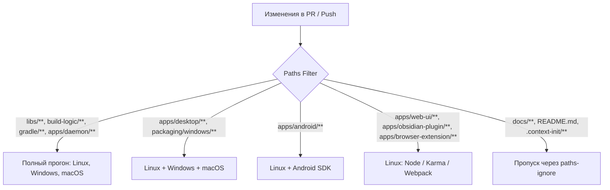

# Mimir: Архитектурная спецификация реорганизации монорепозитория, гигиены зависимостей и пайплайна релизов/CI

**Дата:** 2026-11-04  
**Статус:** Approved (согласовано с пользователем)  
**Область:** Корневая конфигурация (`settings.gradle.kts`, `build.gradle.kts`, `gradle.properties`), модули `apps/` и `libs/`, `build-logic`, `.github/workflows/` (`ci.yml`, `release.yml`, замена `changesets.yml` на `release-please.yml`), `mise.toml`.

---

## 1. Замысел и цели (Quick View)

### 1.1 Мотивация и контекст
Mimir — кроссплатформенный клиент синхронизации заметок Obsidian с Google Drive с шифрованием, совместимым с `rclone crypt`. Проект охватывает 6 принципиально разных вариантов запуска:
* Desktop (Windows MSI, Arch Linux pacman, macOS);
* Mobile (Android APK);
* Headless (демон с REST API на порту 47821, Docker);
* Web UI (WasmJs Compose);
* Плагин Obsidian (Kotlin/JS);
* Расширение Chromium MV3 (Kotlin/JS).

Исторически репозиторий формировался с плоской структурой: 11 модулей располагались непосредственно в корневой директории вперемешку с конфигурационными файлами, скриптами упаковки, дизайн-токенами и каталогами агентов/IDE.

Кроме того, по привычке из экосистемы TypeScript для управления версиями был внедрён инструмент `@changesets/cli`. Это привело к созданию 11 фиктивных файлов `package.json` и `CHANGELOG.md` в чисто Kotlin-модулях, появлению `pnpm-workspace.yaml` и скрытому конфликту пакетных менеджеров (репозиторий использует `pnpm`, а Kotlin/JS внутренне использует Gradle `yarn`, из-за чего в `package.json` было запрещено указывать `packageManager`). При этом модули были объединены в `fixed`-группу changesets, то есть проект фактически уже имел единую версию.

В условиях отказа от удалённого кэширования (Remote Build Cache) текущий CI тратит до 45 минут на полный прогон тестов и сборки на трёх операционных системах (`ubuntu-latest`, `windows-latest`, `macos-latest`) при любых изменениях, даже если правка затронула только CSS браузерного расширения.

Настоящая спецификация формулирует архитектурную реорганизацию репозитория:
1. Переход к строгой двухуровневой структуре: `apps/` (точки входа и приложения) и `libs/` (переиспользуемые KMP-библиотеки).
2. Замена связки Changesets + 11 фиктивных `package.json` на нативный для монорепозиториев инструмент контроля релизов **Release Please** (на базе Conventional Commits) с сохранением удобного changelog по компонентам.
3. Внедрение интеллектуального селективного CI на базе **Paths Filter**, исключающего холостые запуски тяжелых Windows/macOS раннеров.
4. Включение линтера зависимостей **AutonomousApps Dependency Analysis** для контроля чистоты classpath и ускорения локальной компиляции.

---

### 1.2 Инварианты Mimir

#### 1. Платформы
Реорганизация затрагивает структуру каталогов и CI всех поддерживаемых платформ:
* **Desktop (Windows, Linux, macOS):** перемещение `app-desktop` в `apps/desktop`. Выходные артефакты (MSI, Arch uber-jar) и контракты лаунчеров (`_JAVA_AWT_WM_NONREPARENTING=1`, `win.norestart=true`) сохраняются без изменений.
* **Android:** перемещение `app-android` в `apps/android`. Сохраняется условие опциональности Android SDK (`AndroidSdk.isAvailable`).
* **Daemon & Docker:** перемещение `daemon` в `apps/daemon`. Dockerfile перенастраивается на новый контекст сборки.
* **Web UI:** перемещение `web-ui` в `apps/web-ui`.
* **Obsidian Plugin & Browser Extension:** перемещение в `apps/obsidian-plugin` и `apps/browser-extension`.
Код самих платформ не меняет своего поведения: меняются только Gradle-пути проектов (`:apps:*`, `:libs:*`) и файловое расположение.

#### 2. Дизайн
* **Паттерн:** Separation of Concerns (Разделение ответственности) + Convention Plugins (Composite Build).
* **Слоистая архитектура:**
  `apps/*` $\to$ `libs/ui` $\to$ `libs/runtime` $\to$ `libs/drive` $\to$ `libs/core`.
  `libs/core` остаётся чистой KMP-библиотекой без платформенных зависимостей.
* **Эталонные модули:**
  * Библиотека: `libs/core/build.gradle.kts` (плагин `mimir.kmp-library`).
  * Приложение: `apps/desktop/build.gradle.kts`.

#### 3. IO и производительность сборки
* **CI:** Исключение холостых запусков Windows/macOS виртуальных машин при локальных изменениях (например, в JS-клиентах или документации) экономит до 80% машинного времени GitHub Actions.
* **Локальная компиляция:** Оптимизация `api` vs `implementation` через `dependency-analysis` минимизирует ABI-зависимости и каскадную перекомпиляцию модулей Gradle.
* **Внешнее IO:** Удалённое кэширование **не используется**. Локальный кэш задач Gradle (`org.gradle.caching=true`) и Configuration Cache сохраняются.

#### 4. UX и Developer Experience (DX)
* **Для пользователя:** Сохраняется единая концепция продукта — единый номер версии (`Mimir v0.3.0`) на всех устройствах, исключающий несовместимость демона, расширения и мобильного клиента. В GitHub Releases формируется детальный, структурированный по компонентам список изменений.
* **Для разработчика (DX):**
  * Чистый корень проекта без визуального шума из 11 одинаковых папок.
  * Полное удаление 11 фиктивных `package.json` и `CHANGELOG.md`.
  * Автоматический бамп версий и подготовка Release PR без необходимости вручную запускать CLI-утилиты changesets.
  * Сохранение удобных задач `mise run <target>` с обновленными Gradle-путями.

---

### 1.3 Цели
1. Реорганизовать 11 модулей в два логических каталога: `apps/` (6 приложений) и `libs/` (5 библиотек).
2. Обновить Gradle-проекты (`:apps:*`, `:libs:*`) в `settings.gradle.kts`, `build.gradle.kts`, `mise.toml` и скриптах сборки.
3. Полностью исключить `@changesets/cli`, фиктивные `package.json` в модулях и `pnpm-workspace.yaml`.
4. Внедрить **Release Please** для автоматического ведения CHANGELOG.md, семантического версионирования по Conventional Commits и обновления `mimir.version` в `gradle.properties`.
5. Внедрить двухконтурную селективную фильтрацию в `.github/workflows/ci.yml` через `dorny/paths-filter`, отсекающую запуск ненужных ОС и задач.
6. Интегрировать плагин `com.autonomousapps.dependency-analysis` для автоматизированного аудита чистоты зависимостей.

---

### 1.4 Не-цели и Анти-цели
* **Не-цели:**
  * Внедрение удаленного HTTP/S3 кэша Gradle (прямой запрет пользователя).
  * Разделение версий библиотек (например, независимый выпуск `libs:core 1.2.0` отдельно от `apps:desktop 0.3.0`).
  * Переход на Bazel, Pants, Turborepo или Nx (KMP и Compose Multiplatform требуют нативного Gradle).
* **Анти-цели:**
  * Ломка существующих лаунчеров, ключей подписи Windows/Android и Docker-сборок при смене путей.
  * Оставление неиспользуемых файлов версионирования в подпапках.

---

## 2. Архитектура новой файловой структуры

### 2.1 Дерево каталогов репозитория

```text
mimir/
├── apps/                               # Конечные точки входа, запускалки и дистрибутивы
│   ├── desktop/                        # Compose Multiplatform Desktop (Windows MSI, Arch Linux, macOS)
│   ├── android/                        # Android Application (APK, GIS auth, WorkManager)
│   ├── daemon/                         # Headless Ktor HTTP API демон (127.0.0.1:47821)
│   ├── web-ui/                         # Compose WasmJs SPA интерфейс (раздаётся демоном)
│   ├── obsidian-plugin/                # Плагин для Obsidian на Kotlin/JS
│   └── browser-extension/              # Chromium MV3 расширение на Kotlin/JS
│
├── libs/                               # Переиспользуемые библиотеки (чистый KMP / Compose UI)
│   ├── core/                           # Чистый KMP: доменная модель, rclone crypt, абстракции ФС и порты
│   ├── drive/                          # KMP: адаптер Google Drive API, OAuth, resumable upload
│   ├── client/                         # KMP: HTTP-клиент к демону, общие DTO и интерфейс
│   ├── runtime/                        # KMP (JVM/Android): фасад MimirRuntime, вход, SQLite/JSON state
│   └── ui/                             # Compose Multiplatform: общая дизайн-система, экраны, компоненты
│
├── build-logic/                        # Composite build: Gradle convention plugins
│   ├── src/main/kotlin/
│   │   ├── mimir.settings.settings.gradle.kts
│   │   ├── mimir.android-support.gradle.kts
│   │   └── mimir.kmp-library.gradle.kts
│   └── ...
│
├── design/                             # SSOT дизайн-системы (tokens.json)
├── packaging/                          # Скрипты дистрибуции (Arch PKGBUILD, Dockerfile)
├── scripts/                            # Вспомогательные скрипты (generate-tokens.mjs)
├── docs/                               # Архитектурная документация, спеки и планы
│
├── .github/
│   └── workflows/
│       ├── ci.yml                      # Интеллектуальный CI с paths-filter
│       ├── release.yml                 # Сборка и публикация артефактов по тегу v*
│       └── release-please.yml          # Автоматический релизный PR и тегирование
│
├── gradle/
│   ├── libs.versions.toml              # Version Catalog
│   └── wrapper/
│
├── package.json                        # Корневой package.json ТОЛЬКО для генерации токенов
├── gradle.properties                   # SSOT для mimir.version и параметров сборки
├── settings.gradle.kts                 # Подключение :apps:* и :libs:*
├── build.gradle.kts                    # Корневой build.gradle.kts
└── mise.toml                           # Таски разработки (обновленные пути к Gradle проектам)
```

### 2.2 Маппинг модулей и путей в Gradle

| Старый путь | Новый путь | Gradle Project Path | Назначение |
|---|---|---|---|
| `/core` | `/libs/core` | `:libs:core` | Домен, шифрование, порты |
| `/drive` | `/libs/drive` | `:libs:drive` | Адаптер Google Drive API |
| `/client` | `/libs/client` | `:libs:client` | HTTP клиент к демону |
| `/runtime` | `/libs/runtime` | `:libs:runtime` | Оркестрация движка и логин |
| `/ui` | `/libs/ui` | `:libs:ui` | Compose UI и дизайн-система |
| `/app-desktop` | `/apps/desktop` | `:apps:desktop` | Десктопное приложение |
| `/app-android` | `/apps/android` | `:apps:android` | Мобильное Android-приложение |
| `/daemon` | `/apps/daemon` | `:apps:daemon` | Headless демон |
| `/web-ui` | `/apps/web-ui` | `:apps:web-ui` | WasmJs веб-клиент |
| `/obsidian-plugin` | `/apps/obsidian-plugin` | `:apps:obsidian-plugin` | Плагин Obsidian |
| `/browser-extension` | `/apps/browser-extension` | `:apps:browser-extension` | Расширение Chromium |

### 2.3 Конфигурация `settings.gradle.kts`

```kotlin
pluginManagement {
    includeBuild("build-logic")
    repositories {
        google()
        mavenCentral()
        gradlePluginPortal()
    }
}

plugins {
    id("mimir.settings")
    id("org.gradle.toolchains.foojay-resolver-convention") version "1.0.0"
}

dependencyResolutionManagement {
    repositories {
        google()
        mavenCentral()
    }
}

rootProject.name = "mimir"

// Библиотеки (libs)
include(
    ":libs:core",
    ":libs:drive",
    ":libs:client",
    ":libs:runtime",
    ":libs:ui",
)

// Приложения и клиенты (apps)
include(
    ":apps:desktop",
    ":apps:daemon",
    ":apps:web-ui",
    ":apps:obsidian-plugin",
    ":apps:browser-extension",
)
// Модуль :apps:android подключается условно через convention-плагин mimir.settings
// (build-logic/src/main/kotlin/mimir.settings.settings.gradle.kts) при наличии Android SDK.
```

В `build-logic/src/main/kotlin/mimir.settings.settings.gradle.kts`:
```kotlin
import dev.mimir.build.AndroidSdk
import org.gradle.api.logging.Logging

if (AndroidSdk.isAvailable(rootDir)) {
    if (File(rootDir, "apps/android").isDirectory) include(":apps:android")
} else {
    Logging.getLogger("mimir").warn("Android SDK not found: skipping Android targets")
}
```

---

## 3. Контроль релизов: Замена Changesets на Release Please

### 3.1 Принцип работы
Вместо ручного создания `.changeset/*.md` файлов разработчики и субагенты коммитят изменения по стандарту **Conventional Commits**:
* `feat(desktop): add custom titlebar with obsidian csd`
* `fix(extension): resolve oauth loopback redirect`
* `perf(core): optimize rclone cipher memory allocations`
* `chore(deps): bump ktor to 3.6.0`

GitHub Action `google-github-actions/release-please-action` выполняет следующую автоматизацию:
1. При слиянии коммитов в ветку `main` Action анализирует историю git.
2. Создаёт или обновляет открытый Pull Request: `chore: release v0.3.0`.
3. В теле PR ведётся автогенерируемый `CHANGELOG.md` с красивой группировкой по компонентам (`desktop`, `extension`, `core` и т.д.).
4. При слиянии этого PR:
   * Бампается `mimir.version` в `gradle.properties`.
   * Ставится Git-тег `v0.3.0` (`"include-component-in-tag": false`).
   * Создаётся GitHub Release со структурированным списком изменений.
5. Поскольку теги, созданные стандартным `GITHUB_TOKEN`, не триггерят другие workflows по событию `on: push: tags`, workflow `release-please.yml` при `release_created == 'true'` явно вызывает `.github/workflows/release.yml` через `workflow_call` (передавая `tag_name`), который компилирует, подписывает и прикрепляет к созданному релизу Windows MSI, Android APK, пакет Arch, архивы плагина/расширения и публикует Docker-образ.

### 3.2 Конфигурация `.github/release-please-config.json`

```json
{
  "packages": {
    ".": {
      "release-type": "simple",
      "package-name": "mimir",
      "include-component-in-tag": false,
      "bump-minor-pre-major": true,
      "bump-patch-for-minor-pre-major": true,
      "extra-files": [
        {
          "type": "properties",
          "path": "gradle.properties",
          "property": "mimir.version"
        }
      ],
      "changelog-sections": [
        {"type": "feat", "section": "Features"},
        {"type": "fix", "section": "Bug Fixes"},
        {"type": "perf", "section": "Performance Improvements"},
        {"type": "revert", "section": "Reverts"},
        {"type": "docs", "section": "Documentation", "hidden": true},
        {"type": "style", "section": "Styles", "hidden": true},
        {"type": "chore", "section": "Miscellaneous Chores", "hidden": true},
        {"type": "refactor", "section": "Code Refactoring"},
        {"type": "test", "section": "Tests", "hidden": true},
        {"type": "build", "section": "Build System", "hidden": true},
        {"type": "ci", "section": "Continuous Integration", "hidden": true}
      ]
    }
  }
}
```

Файл манифеста версий `.github/.release-please-manifest.json`:
```json
{
  ".": "0.2.0"
}
```

### 3.3 Workflow `.github/workflows/release-please.yml` и интеграция с `release.yml`

```yaml
name: Release Please

on:
  push:
    branches:
      - main

concurrency:
  group: release-please
  cancel-in-progress: false

permissions:
  contents: write
  pull-requests: write

jobs:
  release-please:
    runs-on: ubuntu-latest
    outputs:
      release_created: ${{ steps.release.outputs.release_created }}
      tag_name: ${{ steps.release.outputs.tag_name }}
    steps:
      - uses: google-github-actions/release-please-action@v4
        id: release
        with:
          config-file: .github/release-please-config.json
          manifest-file: .github/.release-please-manifest.json

  release:
    needs: release-please
    if: needs.release-please.outputs.release_created == 'true'
    permissions:
      contents: write
      packages: write
    uses: ./.github/workflows/release.yml
    with:
      tag: ${{ needs.release-please.outputs.tag_name }}
    secrets: inherit
```

В `.github/workflows/release.yml`:
* Обновляются пути задач и артефактов (`:apps:desktop:packageMsi`, `apps/desktop/build/...`, `:apps:android:assembleRelease`, `apps/android/build/...`, `:apps:obsidian-plugin:zipPlugin`, `apps/obsidian-plugin/build/...`, `:apps:browser-extension:zipExtension`, `apps/browser-extension/build/...`).
* В шаге `softprops/action-gh-release@v2` выставляется `generate_release_notes: false`, чтобы при ручном теге или вызове из `release-please.yml` артефакты прикреплялись к релизу без затирания и дублирования структурированного описания от Release Please.

---

## 4. Интеллектуальный CI (Селективный запуск через Paths Filter)

В отсутствие удаленного кэша время выполнения CI оптимизируется отсечением незатронутых операционных систем и сборок.

### 4.1 Матрица изменений и целевые раннеры



### 4.2 Обновление `.github/workflows/ci.yml`

1. Добавляется предваряющая джоба `detect-changes` на базе `dorny/paths-filter@v3`, формирующая динамический JSON-массив `os_matrix` (так как в GitHub Actions нельзя задать `if` для отдельных элементов статического массива `strategy.matrix.os`):
```yaml
  detect-changes:
    name: Detect Changed Modules
    runs-on: ubuntu-latest
    outputs:
      core_or_libs: ${{ steps.filter.outputs.core_or_libs }}
      desktop: ${{ steps.filter.outputs.desktop }}
      android: ${{ steps.filter.outputs.android }}
      js_or_web: ${{ steps.filter.outputs.js_or_web }}
      os_matrix: ${{ steps.matrix.outputs.os_matrix }}
    steps:
      - uses: actions/checkout@v4
        with:
          persist-credentials: false
      - uses: dorny/paths-filter@v3
        id: filter
        with:
          filters: |
            core_or_libs:
              - 'libs/**'
              - 'build-logic/**'
              - 'gradle/**'
              - 'build.gradle.kts'
              - 'settings.gradle.kts'
              - 'gradle.properties'
              - 'mise.toml'
              - '.github/workflows/ci.yml'
            desktop:
              - 'apps/desktop/**'
              - 'apps/daemon/**'
              - 'packaging/windows/**'
              - 'packaging/arch/**'
              - 'packaging/docker/**'
            android:
              - 'apps/android/**'
            js_or_web:
              - 'apps/web-ui/**'
              - 'apps/obsidian-plugin/**'
              - 'apps/browser-extension/**'
              - 'design/**'
              - 'scripts/**'
      - id: matrix
        run: |
          if [ "${{ steps.filter.outputs.core_or_libs }}" = "true" ] || [ "${{ steps.filter.outputs.desktop }}" = "true" ]; then
            echo 'os_matrix=["ubuntu-latest","windows-latest","macos-latest"]' >> "$GITHUB_OUTPUT"
          else
            echo 'os_matrix=["ubuntu-latest"]' >> "$GITHUB_OUTPUT"
          fi
```

2. Джоба `build` потребляет `os: ${{ fromJSON(needs.detect-changes.outputs.os_matrix) }}`:
   * **Linux (`ubuntu-latest`):** запускается всегда (базовая проверка, unit-тесты, JS-тесты, Android, сборка демона).
   * **Windows (`windows-latest`) и macOS (`macos-latest`):** включаются в матрицу **только** если `core_or_libs == 'true' || desktop == 'true'` (включая `apps/daemon/**`, от которого зависит `apps/desktop`).
3. Бывшая джоба `changesets` в `ci.yml` заменяется на легковесную джобу `tokens` (`node scripts/generate-tokens.mjs --check`), не требующую `pnpm install`.

Это исключает очереди и экономит до 35 минут на каждом PR, затрагивающем только веб/мобильные/скриптовые компоненты.

---

## 5. Гигиена зависимостей (`com.autonomousapps.dependency-analysis`)

### 5.1 Подключение плагина
В `gradle/libs.versions.toml` используется версия `3.20.1`, совместимая с Gradle 9.8+, Kotlin 2.4.21 (`kotlin-bom:2.4.21`) и байткодом JVM 26 (`asm-relocated:9.10.1.0`):
```toml
[versions]
dependencyAnalysis = "3.20.1"

[plugins]
dependency-analysis = { id = "com.autonomousapps.dependency-analysis", version.ref = "dependencyAnalysis" }
```

В корневой `build.gradle.kts`:
```kotlin
plugins {
    alias(libs.plugins.dependency.analysis)
    alias(libs.plugins.compose.multiplatform) apply false
    alias(libs.plugins.compose.compiler) apply false
    alias(libs.plugins.buildconfig) apply false
}

dependencyAnalysis {
    structure {
        ignoreKtx(true)
    }
    issues {
        all {
            onAny {
                severity("warn")
            }
        }
    }
}
```

### 5.2 Использование
* Команда `./gradlew buildHealth` локально анализирует монорепозиторий и генерирует отчет в `build/reports/dependency-analysis/build-health-report.txt`.
* Плагин находит:
  * Неиспользуемые зависимости (`UnusedDependencies`).
  * Зависимости, объявленные как `api`, но используемые строго внутренне (замена на `implementation` исключает транзитивную перекомпиляцию потребителей).
  * Транзитивные зависимости, к классам которых есть прямое обращение, но они не объявлены явно (`UsedTransitiveDependencies`).
* Режим `severity("warn")` гарантирует, что специфичные для Compose Multiplatform и KMP синтетические зависимости не блокируют сборку ложными срабатываниями.

---

## 6. План поэтапной миграции (Migration Plan)

| Шаг | Действие | Затрагиваемые файлы |
|---|---|---|
| **1. Зависимости** | Подключение `com.autonomousapps.dependency-analysis` (`3.20.1`) в `libs.versions.toml` и `build.gradle.kts`. | `gradle/libs.versions.toml`, `build.gradle.kts` |
| **2. Перемещение папок** | Перенос директорий `core`, `drive`, `client`, `runtime`, `ui` $\to$ `libs/`<br>Перенос `app-desktop` $\to$ `apps/desktop`, `app-android` $\to$ `apps/android`, `daemon`, `web-ui`, `obsidian-plugin`, `browser-extension` $\to$ `apps/`. | Файловая система (`git mv`), `.gitignore` (`/libs/*/build/`, `/apps/*/build/`) |
| **3. Конфигурация сборки и путей** | Обновление `settings.gradle.kts`, `mimir.settings.settings.gradle.kts`, ссылок `project(":libs:...")` / `project(":apps:...")` во всех `build.gradle.kts`, путей в скриптах токенов, скриншотов, векторов rclone, упаковки Arch/Docker и `mise.toml`. | `settings.gradle.kts`, `build-logic/src/main/kotlin/mimir.settings.settings.gradle.kts`, `libs/**/build.gradle.kts`, `apps/**/build.gradle.kts`, `scripts/generate-tokens.mjs`, `scripts/gen-rclone-vectors.sh`, `apps/browser-extension/scripts/capture-screenshots.mjs`, `libs/ui/src/desktopTest/**/UiScreenshotTest.kt`, `libs/ui/src/desktopTest/**/UpdateCardScreenshotTest.kt`, `.github/scripts/build-arch.sh`, `packaging/docker/Dockerfile`, `mise.toml` |
| **4. Удаление Changesets** | Удаление 11 `package.json` и `CHANGELOG.md` из подмодулей, `pnpm-workspace.yaml`, каталога `.changeset/`, скриптов `sync-version.mjs` и `tag-release.mjs`, очистка корневого `package.json`. | Удаление файлов, `package.json` |
| **5. Release Please и Release CI** | Создание `.github/release-please-config.json`, `.github/.release-please-manifest.json`, workflow `release-please.yml` (с вызовом `release.yml`), обновление путей в `release.yml`, удаление `changesets.yml`. | `.github/release-please-config.json`, `.github/.release-please-manifest.json`, `.github/workflows/release-please.yml`, `.github/workflows/release.yml` |
| **6. Оптимизация CI и документация** | Внедрение `dorny/paths-filter` и проверки токенов в `ci.yml`, синхронизация карты модулей в `AGENTS.md`, `README.md` и скиллах `.agents/skills/mimir-*`. | `.github/workflows/ci.yml`, `AGENTS.md`, `README.md`, `.agents/skills/mimir-*/SKILL.md` |

---

## 7. Верификация

1. **Gradle Build Health:** `./gradlew buildHealth` проходит без критических ошибок архитектуры.
2. **KMP Сборка:** `./gradlew assemble` и `./gradlew allTests` компилируют библиотеки и приложения по новым путям `:apps:*` и `:libs:*`.
3. **Mise Интеграция:** Все задачи `mise run desktop`, `mise run daemon`, `mise run web`, `mise run plugin`, `mise run extension` корректно вызывают обновлённые пути тасок.
4. **CI Workflow:** `dorny/paths-filter` корректно активирует/пропускает Windows и macOS раннеры при точечных PR.
5. **Release Please:** При создании коммита с префиксом `feat:` генерируется корректный релизный PR с бампом `mimir.version` в `gradle.properties`.
